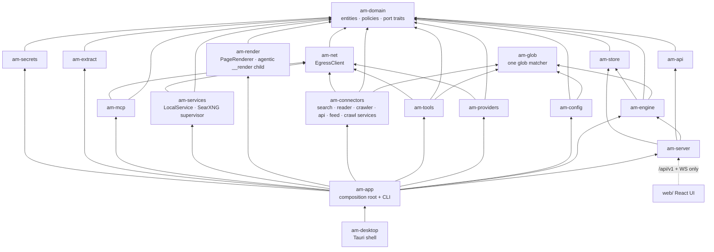
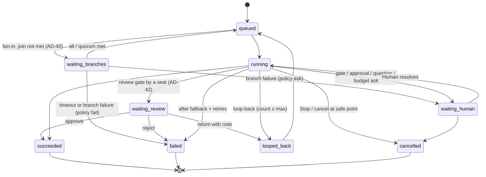
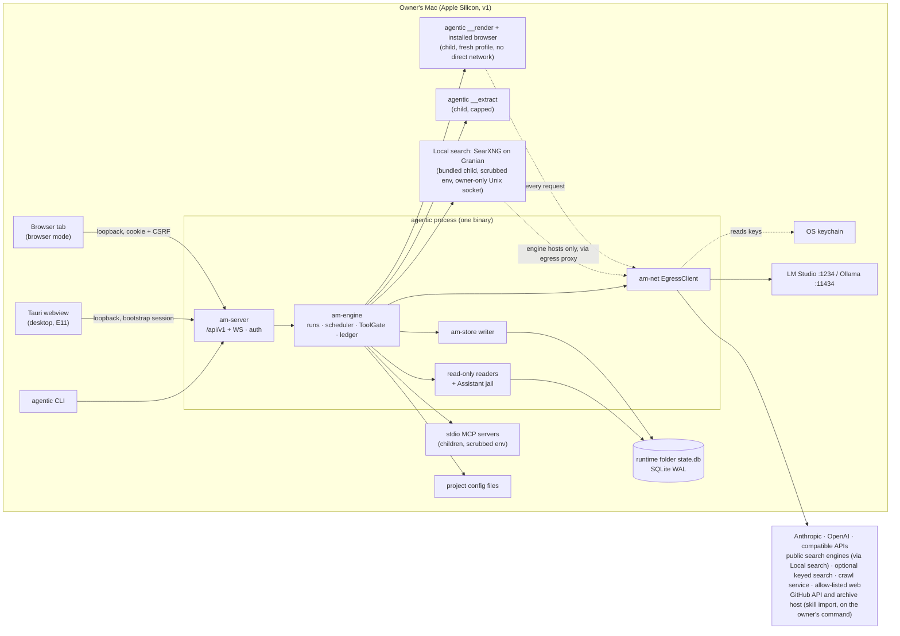
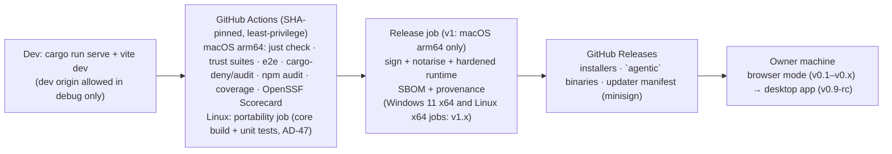
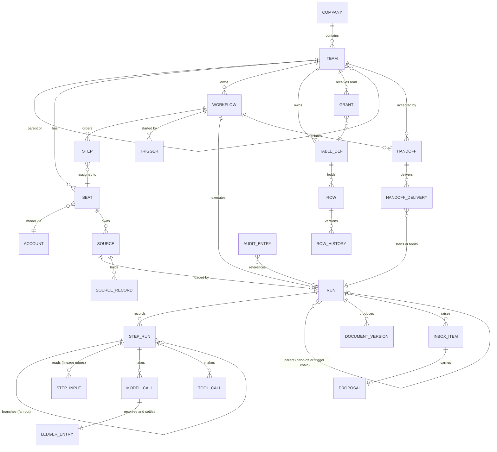

# Architecture Spine — Agentic Manager

## Design Paradigm

**Hexagonal modular monolith.** One Cargo workspace of small crates, built into one binary (`agentic`). A pure domain sits at the centre. The application core (engine) drives it through **ports**: traits the project owns. **Adapters** implement the ports: SQLite, HTTP providers, MCP, keychain, parsers, egress. **Composition roots** (`am-app`, `am-desktop`) wire adapters to ports. Two supporting patterns ride on top:

- **Single writer, many readers** (CQRS-lite). Every mutation is a typed command executed by one writer task, in one transaction with its audit entry. Reads use read-only connections.
- **Durable run journal.** A run is a persisted state machine. Each transition commits before its side effect.

| Layer | Crates | May depend on |
|---|---|---|
| Domain (pure: entities, value types, policies, port traits) | `am-domain` | std, serde, thiserror, jiff, uuid only |
| Application core | `am-engine` (runs and the run graph, hand-offs, lineage, agent loop, ToolGate, ledger policy, scheduler and trigger chains, Source loads and the ingest pipeline, estimator, Inbox, proposals, Assistant) | `am-domain`, `am-store` |
| Shared pure utility (amended 2026-11-20, architect REPLAN) | `am-glob` (the one glob matcher: globset and NFC normalisation behind its own types; no IO) | `globset`, `unicode-normalization` only; `am-config`, `am-engine`, `am-tools` and `am-connectors` may depend on it |
| System of record | `am-store` (SQLite writer and readers, migrations, journal, ledger, audit, rows, backups) · `am-config` (project files) | `am-domain` |
| Adapters | `am-net` · `am-providers` · `am-tools` · `am-connectors` · `am-render` · `am-services` · `am-mcp` · `am-extract` · `am-secrets` | `am-domain`; `am-net` is the only adapter others may use |
| Delivery | `am-api` (DTOs and events, ts-rs) · `am-server` (axum, auth, WebSocket, embedded UI) | `am-domain`, `am-engine`, `am-api`, the `am-store` read handle |
| Composition roots | `am-app` (lib + `agentic` binary: serve, validate, run, status, stop, gate) · `am-desktop` (Tauri) | everything |



## Invariants & Rules

### Stack, licence and the spike

#### AD-1 — Rust-first single binary, gated by a two-week spike [ADOPTED]

- **Binds:** all; C2, D4; the first story of E1.
- **Prevents:** building on the superseded Python stack sketch, or committing epics before the risky crates are proven.
- **Rule:** The core is Rust in one binary: engine, loopback HTTP/WebSocket server, scheduler and SQLite. The React + TypeScript UI is embedded in that binary. Browser mode ships first and Tauri 2 wraps the same UI later. This **supersedes the earlier Python stack sketch in full**: FastAPI, Pydantic, SQLModel/SQLAlchemy, APScheduler, watchdog, the MCP Python SDK, pytest and PyInstaller/Nuitka sidecars are not used. Its repo layout is replaced by the Structural Seed below. The spike is E1 story 1. It is built inside the real workspace layout behind the real ports and kept if it passes. Each criterion ends as a runnable test or recorded demo, with a pass/fail verdict in the E1 spike report:

| # | Criterion | Passes when |
|---|---|---|
| 1 | Provider port | Anthropic and OpenAI-compatible (incl. LM Studio) stream text and tool calls through `LlmProvider`, usage is captured, and cancelling mid-stream stops the stream within 1 s; the frontier half runs live on the owner's Anthropic key, or on an OpenAI or other OpenAI-compatible cloud key with the Anthropic adapter on recorded fixtures (amended 2026-11-19, owner answers) |
| 2 | Crash resume | `kill -9` during a step on SQLite WAL, restart, and the run resumes losing at most the in-flight model call; ledger totals reconcile |
| 3 | Scheduler | croner + jiff fire a cron with timezone, and a macOS sleep across a fire time triggers exactly one catch-up on wake |
| 4 | Files to models | (rewritten 2026-11-19, owner folder-access direction) The folder-access tool (AD-30) links `AM_SPIKE_DOCS_DIR`, a local folder outside the repo holding files of mixed types (PDF with and without a text layer, images, spreadsheets, Word and PowerPoint files, csv and text), read-only; it lists the folder and reads every file under the confinement rules (a canonicalised grant root, symlink escapes refused, no write) and attaches each file through `LlmProvider` file parts to (a) a frontier model (Anthropic Messages on the owner's Anthropic key, or the OpenAI Responses API on an OpenAI key) and (b) a local vision-capable model served by LM Studio or Ollama. The report records, per file type and model, accepted natively or refused (with the worded refusal, made before any request), tokens and cost. Passes when every accepted type yields an answer naming a known word in the file, every type the model's flags exclude is refused before any byte is sent, and the confinement cases pass (a symlink leaving the folder, a `../` path and a write attempt are refused). The files stay outside the repo (owner, 2026-11-18): the test is skipped with "AM_SPIKE_DOCS_DIR not set" when the path is absent and the owner's recorded run is the evidence; CI runs it on small synthetic fixtures under `fixtures/` against recorded provider responses |
| 5 | MCP | rmcp client lists and calls tools on 2 real servers, one over stdio and one over streamable HTTP: the official reference servers `@modelcontextprotocol/server-filesystem` 2.4.0 (stdio, `--read-only` on a throwaway folder; `read_text_file`) and `@modelcontextprotocol/server-everything` 2.3.1 (`streamableHttp`, http://127.0.0.1:3001/mcp; `echo`), launched by the spike with npx (amended 2026-11-19; stack-spike.md lists the commands) |
| 6 | Local server | The Host, Origin and session checks reject the rebinding, cross-origin fetch and cross-origin WebSocket tests |
| 7 | Keychain | Store, read and delete a key through `SecretStore` in the macOS Keychain (amended 2026-11-19: Windows and Linux stores are v1.x, AD-47) |
| 8 | Desktop | A signed and notarised Tauri build that links the core in-process launches on a clean Mac and serves the UI. **Deferred** (owner, 2026-11-19) until the owner's Apple Developer account exists: the spike keeps an ad-hoc-signed build that launches and serves the UI as stand-in evidence, and the signed and notarised demo gates the start of E11 story 3, before v0.9-rc |
| 9 | Agent productivity | Claude Code agents complete one representative story (a ToolGate rule with its tests) through `just check` without human code edits |

#### AD-2 — Spike fallback is a hybrid behind unchanged contracts

- **Binds:** all; D4 replan path.
- **Prevents:** a failed spike forcing a rewrite of the UI, config format or data.
- **Rule:** If two or more of criteria 1–7 and 9 fail, the plan goes to REPLAN through Sofia with the hybrid below (amended 2026-11-19: criterion 8 is deferred until the owner's Apple Developer account exists, is not counted here, and gates E11 story 3 instead). A single failure gets a local workaround recorded in the spike report and no replan. **Hybrid:** Rust stays wherever its criteria passed. Each failed capability moves behind its existing port as an out-of-process worker, speaking JSON-RPC over stdio and launched by the core (for example a Python PDF extractor or provider worker). If criterion 9 fails, the core itself becomes Python, behind the identical `/api/v1` contract, config format and SQLite schema, and ships as a Tauri sidecar. Under every fallback the UI, the API contract (AD-14), the config format (AD-16) and the DB schema (AD-7) stay unchanged and language-neutral.

#### AD-3 — Licence is MIT [ADOPTED]

- **Binds:** every crate, package and template; C1.
- **Prevents:** shipping under the superseded Apache-2.0 line, or linking a copyleft dependency.
- **Rule:** The repository and every crate and package are MIT. **This supersedes the earlier Apache-2.0 line.** `cargo-deny` and the npm licence check allow only MIT, MIT-0, Apache-2.0, BSD-2/3-Clause, ISC, Zlib, Unicode-3.0 and MPL-2.0 (MIT-0 amended 2026-11-20, architect REPLAN, owner: MIT without the attribution clause, so it adds no obligation; it lets `jsonschema` link through `borrow-or-share`). One per-crate exception (amended 2026-11-21, owner, "Exception for notify"): CC0-1.0 is allowed for the `notify` crate alone, through a cargo-deny `[[licenses.exceptions]]` entry in `deny.toml` naming that crate at its pinned Stack version, so a version bump is reviewed again; it is not added to the allow-list, notify's own dependencies stay under the allow-list, and any other CC0-1.0 crate fails CI. A further exception is an owner decision. GPL, LGPL and AGPL fail CI. A native library linked into the binary needs a permissive licence recorded in `THIRD_PARTY.md` (v1 links none: pdfium was dropped on 2026-11-19 with bundled OCR, AD-46).

### Boundaries and ports

#### AD-4 — Dependency direction is enforced, not advised

- **Binds:** all crates.
- **Prevents:** adapters calling each other, IO leaking into the domain, and cyclic coupling that defeats the AD-2 hedge.
- **Rule:** Crates may depend only along the Design Paradigm diagram. `am-domain` has no IO or async-runtime dependency. Adapters depend on `am-domain` and optionally `am-net`, never on each other or on `am-engine`. `cargo xtask check-deps` checks `cargo metadata` against this matrix and fails CI on a new edge.

#### AD-5 — Own thin ports around every pre-1.0 or volatile crate

- **Binds:** `am-domain` ports; `am-providers`, `am-mcp`, `am-extract`, `am-secrets`, `am-tools`, `am-net`; R6–R10, R19, R46, R47.
- **Prevents:** pre-1.0 API churn (LLM clients, PDF crates, rmcp) rippling through the engine, and agents writing against hallucinated crate APIs.
- **Rule:** The ports are `LlmProvider`, `DocExtractor`, `McpClient`, `SecretStore`, `SearchProvider`, `EgressClient`, `PageRenderer` (AD-39, added 2026-11-18), `LocalService` (AD-45, added 2026-11-18) and `Clock` (`OcrService`, added 2026-11-19, was retired the same day with the owner's folder-access direction, AD-46; `DocExtractor` is narrowed to the text fallback, table imports and HTML, AD-30). **File parts** (amended 2026-11-19): `LlmProvider` requests carry typed content parts, text and `FilePart { name, media_type, bytes }`; each adapter maps a file part to its provider's native input (AD-31) or returns `Unsupported { media_type, model }` before any byte is sent, and no adapter converts a file. No foreign type (rmcp, reqwest, keyring, pdf crates, croner, calamine, chromiumoxide) appears in a port signature or in `am-domain`. Provider adapters are our own: Anthropic Messages and OpenAI-chat-compatible, over reqwest SSE through `am-net`. genai, rig-core and async-openai are not dependencies. Each pinned pre-1.0 crate has a `docs/crate-notes/<crate>.md` for its pinned version.

### Data, state and persistence

#### AD-6 — One writer; read-only readers; a jailed Assistant connection

- **Binds:** `am-store`, `am-engine`, `am-server`; R38, R43, R45; D6.
- **Prevents:** two components writing the same rows with different provenance or audit, and the Assistant or a dashboard query writing.
- **Rule:** The store uses rusqlite (not sqlx). One writer task owns the only read-write connection. Every mutation is a typed command carrying an Actor (AD-24) and commits with its audit entry in one transaction. The **user store** (AD-17; amended 2026-11-22 after the reviewer gate) is shared by every process of the owner on this Mac, so it has no long-lived writer task: a process writes it through one read-write connection used only while it holds `<app data dir>/user.lock` (an advisory `flock`, waited for with a bounded time and refused in words after it), in transactions that begin `IMMEDIATE`, and it re-reads the audit chain tip, the latest History and the pending intents under the lock before writing; opening and migrating the user store, and settling its pending intents, happen under the same lock. Reader connections open `SQLITE_OPEN_READ_ONLY` with `query_only=ON`. The Assistant and dashboards use a dedicated read-only connection. Its authorizer is an allow-list (amended 2026-11-19, final review 2 security M6): only `SQLITE_SELECT`, `SQLITE_READ` of `v_*` views and the tables those views read through, and a fixed list of deterministic functions are allowed; `sqlite_master`/`sqlite_schema`, `knowledge_fts` and its shadow tables, every other table, ATTACH, every PRAGMA and `load_extension` are denied; the connection runs `query_only=ON` with extension loading off, `SQLITE_LIMIT_LENGTH`, `SQLITE_LIMIT_SQL_LENGTH`, `SQLITE_LIMIT_EXPR_DEPTH` and `SQLITE_LIMIT_COMPOUND_SELECT` lowered, a capped page cache (memory limit), a progress handler that enforces the time limit, and the reader enforces the row cap.

#### AD-7 — SQLite durability and forward-only migrations [ADOPTED C5]

- **Binds:** `am-store`, `am-config`; R5, R14, R49.
- **Prevents:** data loss on upgrade or crash, a silent migration, and an old binary corrupting a newer database.
- **Rule:** The database runs WAL, `synchronous=FULL`, `foreign_keys=ON`. Migrations are forward-only numbered SQL files embedded in the binary, applied by am-store's own migrator under `user_version` (amended 2026-11-20, architect REPLAN: `rusqlite_migration =2.7.0` requires `rusqlite ^0.41` against the pinned 0.43, so no migration crate is linked); each step runs in its own transaction with its `migration_reports` row and its `store.migrated` audit entry (AD-25). A `VACUUM INTO` backup is taken before any migration of an existing database; pre-migration backups go to `backups/pre-migration/` and only the three newest are kept, older ones deleted once a migration commits (daily backups live apart in `backups/daily/`, AD-32; once the backup key exists, pre-migration copies are encrypted the same way) (amended 2026-11-20, architect REPLAN). Moving a legacy in-project runtime folder (AD-32) is reported the same way. The user store (AD-17) migrates under the same rules with its own migration set and `application_id`, distinct from a project store's, under `user.lock` (AD-6), its pre-migration backups kept in `<app data dir>/backups/pre-migration/` (the `accounts migrate` backups live apart in `backups/accounts-migrate/` and are never pruned, AD-15); every process checks `user_version` before each user-store write, and one that finds a newer version refuses its keyed calls in words naming the newer binary (amended 2026-11-22, owner: global Accounts; tightened after the reviewer gate). A config file whose `schema_version` is newer than the binary knows is refused in plain words, like a newer database. The binary refuses to open a database whose version is newer than it knows. Every applied migration is reported (UI banner and CLI line). Every config file carries `schema_version`; a config migration is shown as a diff and written only on owner accept. A daily `VACUUM INTO` backup keeps N copies (default 14).

#### AD-8 — Durable run journal; resume re-issues only the in-flight call

- **Binds:** `am-engine`, `am-store`; R12–R15, R32, R33, R73, R74, R75.
- **Prevents:** duplicated side effects and double spend after a crash, and divergent ideas of "where the run is".
- **Rule:** Runs, step runs, model calls and tool calls are journal rows. Each state transition commits before the side effect it authorises. On start, an unfinished run resumes at its last committed transition. A model call without `settled` is marked lost and re-issued, and its reservation settles at the reserved amount. Local-write tool calls are idempotent by (run, step, call_seq). External-effect calls are never auto-replayed; they return to the Inbox. The step state machine is below; a fan-out step's branches are step runs of their own with a `branch_key`, and a fan-in step waits in `waiting_branches` until its join condition holds (amended 2026-11-18, AD-40). A step run waiting on a review gate seat in another department is `waiting_review` (AD-42). Resume re-enters every unfinished branch independently.



#### AD-9 — Spend ledger: reserve, then settle; enforcement before estimation [ADOPTED D2]

- **Binds:** `am-engine` (ledger policy), `am-store` (ledger), UI meter; R11, R20, R28, R29, RULE-7, RULE-11.
- **Prevents:** settled spend exceeding a cap, meters and caps computed from different numbers, and an estimate influencing a cap.
- **Rule:** Before every model call the engine asks the writer to **reserve** (counted prompt tokens + `max_output_tokens`) × price. The reserve checks atomically against every enclosing scope: call, step, run, seat, workflow (per run, week and month) and company week. Scheduled runs use their own lower caps. If any scope would exceed, nothing is called: the step pauses, a Budget ask is raised, and the affected schedules pause. After the call the entry **settles** from provider usage. Missing usage settles at the reservation. Money is stored as i64 micro-units in USD and in the company currency (default from the system locale, amended 2026-11-19), with the price-file rate snapshot id. The meter reads settled + reserved. The estimator is a read-only consumer of ledger history: it shows a range with its basis and never writes a cap. **Service spend** (amended 2026-11-18, AD-39): paid connector use (third-party crawl credits, keyed search queries) is a ledger entry of kind `service`, priced from the `services` section of `models/prices.yaml`, reserved before the call against the Source or step, seat, workflow and company scopes and settled from the service's reported usage, exactly as model calls are; Assistant spend stays its own scope. **Branches** (amended 2026-11-18, AD-40): each fan-out branch reserves per call against its own step scope and the shared run, seat, workflow and company scopes, so N branches can never jointly exceed a run cap; a run started by a hand-off or trigger reserves against its own workflow's caps and records its parent run, so a chain's spend rolls up per run and per chain. **Chain scope** (amended 2026-11-19, final review 2 security M4, owner delegated): every run started by a cross-department hand-off or an event trigger also reserves, in the same atomic writer check, against a **chain scope** keyed by the root run's `chain_id`, whose cap is the company setting `max_chain_spend` (default: the scheduled-run cap × `max_chain_depth`); a breach stops the chain's next start or call with one Budget ask naming the chain, so N departments started by one event cannot jointly pass it.

#### AD-10 — Untrusted content is a type; reader/actor separation is enforced by the engine [ADOPTED D11]

- **Binds:** `am-domain` (types), `am-engine` (prompt assembly, ToolGate), `am-tools`, `am-mcp`, `am-store` (row taint); R27, R32, R43, R50, RULE-8.
- **Prevents:** untrusted text reaching instructions, and a step that read a poisoned page or document acting outward.
- **Rule:** Prompt content is either `Instruction` (config- or owner-authored, including a seat's goal, backstory and attached skills, AD-38) or `UntrustedData` (web, search, documents, a seat's reference files, pages read from saved or dropped links, MCP results, free-text in table rows (generalised 2026-11-18), source records, rendered pages and knowledge search results (AD-39), files listed or read from a linked folder and every file part attached to a model call (AD-30, amended 2026-11-19), the archive and files of a skill import not yet applied (AD-38, amended 2026-11-22, owner), and rows written by a tainted step or by a Source load, flagged by the row's `taint` column; amended 2026-11-18). There is no conversion from `UntrustedData` to `Instruction`. `UntrustedData` renders only inside a labelled fence in the user role. A step is **tainted** once any `UntrustedData` enters its context. A tainted step's external-effect calls become Approval items showing the exact payload, and it may write only its declared table (a `table_write` to any other table is refused and audited). A tainted step may not carry table- or document-derived data out through read-class network tools: AD-11's tainted-read rule binds every such call, and AD-12 re-checks it (amended 2026-11-18, restoring D11 requirement 2's query-string clause). **Across departments** (amended 2026-11-18, AD-41): a hand-off payload carries the producing step's taint; a step that receives a tainted payload is tainted, a fan-in step is tainted if any branch it receives was tainted, and an AI review gate that reads a tainted payload is a tainted reader; taint never clears on crossing a department, a review approval or a trigger. **Taint through text a tainted step writes** (amended 2026-11-19, final review 2 security H1 and H2, owner delegated): anything a tainted step authors is `UntrustedData` wherever it lands, so taint cannot be laundered through a model's own words. (a) A loop-back reason, a reviewer's return or reject note (AD-36, AD-42) and an `ask_seat` question (AD-46) written by a tainted step enter the recipient's prompt inside the untrusted fence and taint the recipient; within one run, a step that takes any input from a tainted step is tainted (next, loop-back, gate, fan-in and hand-off alike). (b) In a tainted step every local-write tool writes only that step's declared outputs: `table_write` only its declared table, `workspace_write` only the declared workspace paths, `write_document` only its declared document, and nothing else; `remember` and `propose_change` from a tainted step create a Proposal marked **tainted-origin**, which is **never approvable**: its card shows the full text and offers only Dismiss or "Start my own edit from this", which opens the ordinary editor pre-filled so any change is the owner's own `ConfigEdit` (RULE-3). (c) Local writes are **marked untrusted at rest**: rows carry `taint`, document versions and workspace files carry the taint of the step that wrote them (a `taint` column on document versions; a sidecar record per workspace file in the store, keyed by path and content hash), and a later `workspace_read`, `read_file` or document input of a tainted-at-rest item returns `UntrustedData` and taints the reader, however long after. The UI shows `UntrustedData` as plain text in an untrusted well. The injection pack (zero outbound calls, zero approvable proposals (a tainted-origin Proposal is never approvable), zero requests carrying a canary value from a table or document, zero untrusted items written as trusted at rest) is a release gate.

#### AD-11 — ToolGate is the single choke point for every tool call

- **Binds:** `am-engine`, `am-tools`, `am-connectors`, `am-mcp`; R27, R46, R47, R61, R70, RULE-8, RULE-9, RULE-10, RULE-11.
- **Prevents:** a tool path that skips grants, class, taint, egress or limits checks, and two components classifying the same tool differently.
- **Rule:** The agent loop calls tools only through `ToolGate`. ToolGate checks the seat's grant, the action class, the step's taint, egress (AD-12), the budget, and the iteration, tool-call, loop-back and wall-clock caps. Each tool's manifest declares its class as read, local-write or external-effect, its network needs and its `max_uses_per_step` (amended 2026-11-18, AD-39: a per-step call count like CrewAI's `max_usage_count`, overridable per seat; the call past it is refused and logged). **Tool classes in v1:** read: `web_search`, `read_url`, `read_website`, `read_file`, `arxiv`, `read_skill_file`, `search_knowledge`, `table_read`; local-write: `table_write`, `write_document`, `draft_message` (a draft only, never sent), `propose_change`; external-effect: MCP tools by default. The capability tools of AD-46 add read `list_files` (Folder access, amended 2026-11-19), `workspace_read`, `calculate`, `stats`, `query_table` and local-write `write_file` (only for a folder linked with write access, amended 2026-11-19), `workspace_write`, `remember`, `ask_seat` (amended 2026-11-19); in a tainted step every local-write tool is bound to the step's declared outputs (AD-10 (b)). Source loads (crawler, API, feed, local repository) are not tools: no model invokes them (AD-39). MCP tools default to external-effect, and lowering a class is privilege-widening. v1 registers no send tools. The "what this seat can touch" panel is computed from the same manifests and grants ToolGate uses. **Tainted-read rule** (amended 2026-11-18): in a tainted step (AD-10) a read-class network call is allowed only when (a) its host is on the seat's allow-list and (b) its URL is byte-identical to a URL recorded for this step, meaning one present in the step's trusted inputs, in its seat's saved links, in a link list claimed from its drop folder (AD-30), on a source record this step read (AD-39), or returned to this step by its search provider, used as-is with no model-composed path, query string or body; and a search query from a tainted step may use only words that occur in the step's `Instruction` parts (role instructions, the seat's goal, backstory and attached skills, CEO goals, guidance notes, step instruction; amended 2026-11-18), never words from rows, documents or `UntrustedData`. Any other call is not made: it becomes an Approval item showing the exact URL or query (Approve once, never always). This allow-list-of-recorded-URLs design was chosen over taint tracking of argument provenance because substring or canary matching is defeated by encoding (base64, splitting, case), while an exact-membership check is enforceable and testable; canary matching stays as a test oracle and an audit alarm. Residual risk, stated on the About page: a model can still choose which recorded URL to fetch, a low-bandwidth signal bounded by the tool-call cap. A per-seat "may send data out" flag is v1.x (Deferred).

#### AD-12 — One egress client; allow-lists enforced below the tools

- **Binds:** `am-net`, all adapters that use the network, `am-domain` (the `SkillSource` port), `am-engine` and `am-app` (the skill import); R7, R27, R46, R48, R60, RULE-5, RULE-9.
- **Prevents:** SSRF, a tool or provider opening its own HTTP client, any call outside configured endpoints and the one fixed set the owner commands, and an app-made request turning into a general fetch path or a telemetry channel.
- **Rule:** `am-net::EgressClient` is the only HTTP client. Providers, tools, search, fetch and MCP-over-HTTP all use it, and a clippy `disallowed-methods` rule bans constructing a reqwest client elsewhere. Each request carries its seat and Account (or is the one skill-import request kind below; amended 2026-11-22, owner). A tool, reader or `Fetcher` request must match the seat's `allowed_hosts` (AD-48); a request carrying an Account goes only to that Account's pinned endpoint, and one carrying an MCP server only to its approved URL (amended 2026-11-20, architect REPLAN). The resolver blocks private, link-local, loopback and metadata addresses. The exception is a local Account (`local-lmstudio`, `local-ollama`) on 127.0.0.1 at its well-known port. DNS is pinned per request. Redirects (at most 3) are re-checked, bodies are size-capped, and auth headers are stripped on a host change. Each request from a tainted step also carries the step's recorded URL set, and the client refuses a URL not in it (defence in depth below ToolGate's tainted-read rule, AD-11). An owner-added OpenAI-compatible Account may pin a loopback `127.0.0.1:<port>` the owner typed (for example a llama.cpp or vLLM server), never the app's own port and never a private or LAN range; adding it is privilege-widening. Every website fetch by a connector or a reader tool goes through `Fetcher` (AD-39), which wraps `EgressClient` with the robots.txt check, the product user agent and per-host spacing; a Source load's requests carry the owner seat and must stay inside the Source's scope hosts, which must themselves be on that seat's allow-list (amended 2026-11-18). A blocked call is written to the audit log and shown in Doctor. stdio MCP network use is **declared, not enforced**, and the About page says so. **Rendered Reader and crawl services** (amended 2026-11-18, AD-39): the headless browser of the Rendered Reader never reaches the network itself; every request it makes is paused over the Chrome DevTools Protocol and performed by the parent through `Fetcher`, and CDP runs over an anonymous pipe between the `agentic __render` child and the browser it launched (`--remote-debugging-pipe`, amended 2026-11-19, final review 2: no debugging port, no TCP, nothing another process can connect to) (`chromiumoxide::Browser::connect` and `Browser::launch`, which open a WebSocket or HTTP client, are banned by the same clippy rule). A crawl-service Account (AD-39) may pin a loopback `127.0.0.1:<port>` the owner typed for a service the owner self-hosts, under the same rules as an owner-added OpenAI-compatible Account; adding it is privilege-widening. The service's own fetching happens outside the app's client: the app sends it only the Source's scope, and its network use is declared at add time and on the About page, as for stdio MCP. **Skill-import requests** (amended 2026-11-22, owner: skill import from GitHub). One kind of request carries no seat, no Account and no MCP server: the app's own download for a skill import (AD-38). *Shape:* it is not an `HttpRequest` with a free URL. `am-domain` owns one port, `SkillSource`, with two calls: look up the commit of a branch or tag (owner, repository, ref name), and fetch the archive of a commit (owner, repository, 40-hex SHA). Each call takes the command's `Actor`, which must be `Human`. `am-net` is its only implementation and builds every URL itself. `am-app` hands the port only to the skill-import command handler: no tool manifest, ToolGate path, connector, provider, engine run, schedule, trigger or Assistant path holds it, and a trust test proves it (`crates/am-e2e/tests/trust/skill_import_*.rs`). *Who:* the handler runs only inside a Human command: Import skill… in a UI session, or `agentic skills import <url>` under AD-15's CLI-class rule. A seat, a tool or a model never causes it. *Where:* `am-net` holds the host set as a compiled constant, exactly two hosts, checked on the live service 2026-11-22: `api.github.com` and `codeload.github.com`. It sends two request shapes and no other. The lookup is `GET https://api.github.com/repos/<owner>/<repo>/commits/<ref>` with `Accept: application/vnd.github.sha`, where `<ref>` is `HEAD`, `refs/heads/<branch>` or `refs/tags/<tag>`, sent as one path segment with each `/` as `%2F`. The archive is `GET https://api.github.com/repos/<owner>/<repo>/zipball/<sha>`, which answers 302 to `https://codeload.github.com/<owner>/<repo>/legacy.zip/<sha>`. `github.com` itself is never contacted: the URL the owner types is parsed, not fetched. The set is not in config, so no setting, patch, import or Reload can add to it. It is consulted only for these two calls. It is never written to, merged into or matched against a seat's `allowed_hosts`, an Account's endpoint or the client's general allow-list, so a seat, Account, MCP or Local search proxy request to either host is blocked unless that caller's own list allows it; a seat reaches these hosts only if the owner put them on that seat's list through the normal confirmation. The two hosts are app infrastructure, like a provider's endpoint, not department vocabulary (AD-23). *How:* https to port 443, `GET`, no body, no query string, the product user agent (AD-39) and `Accept`, and no header taken from a caller. No credential: no `Authorization` header, no cookie and no keychain read, so v1 reads public repositories only. An owner matches `[A-Za-z0-9-]{1,39}` and a repository `[A-Za-z0-9._-]{1,100}`, never `.` or `..`; a branch or tag must be a valid git ref name (so no `~`, `^`, `:`, `..`, `@{`, backslash, control character or empty segment) and is percent-encoded; anything else is refused before a request is built. The same resolver, DNS pinning and blocked-address checks apply as to every request. At most 3 redirects are followed per call, each re-checked: a lookup may be redirected only within `api.github.com` (a renamed repository answers 301 to `/repositories/<id>/…`), only the archive call may be redirected to `codeload.github.com`, and any other target is refused. Bodies are capped: 64 KB for a lookup, 64 MB for the archive. One import command makes at most 16 requests, redirects included, at least 1 s apart per host; one import runs at a time per project; the app never retries on its own. A rate-limit answer (403 or 429 carrying `x-ratelimit-remaining: 0` or `retry-after`; unauthenticated lookups are limited to 60 an hour per address) is reported in words with the reset time. These are API calls with no seat, as an Account call is, so they do not pass through `Fetcher`. *Shown and recorded:* `am-net` writes one audit entry per request, redirect hops included, allowed or blocked, as it does for a blocked call. The entry is by the command's Human actor, never `System`, goes through the open project's writer, and holds the call kind, host, path as sent (cut to 512 characters), outcome and, for the archive, its sha256; no second entry is written for the same request. The import's confirm step names both hosts (AD-38). The About page carries one line naming them (amended 2026-11-22, owner answers), built with epic 9 story 16: "Skill import contacts api.github.com and codeload.github.com, and only when you import a skill from a GitHub URL." Sally (`bmad-ux`) may reword it; both host names and the "only when" stay. The page reads the two names from the core over `/api/v1`, never from a literal in `web/src`; their one source is `am-net`'s constant, which `am-app` passes to the server as two plain values at start, and the About handler holds no `SkillSource`. A private repository, read through an optional GitHub Account, is v1.x (Deferred). **No telemetry.** No telemetry host exists, and a CI test asserts it over the fixed hosts in the binary's egress configuration. A skill-import request is not telemetry: it is sent only on the owner's command and carries only the repository path the owner typed and the product user agent. That test names the set explicitly (amended 2026-11-22, owner): from the commit of epic 9 story 16 that adds the constant, and not before, its expected list holds `api.github.com` and `codeload.github.com` for skill import, and it fails on a third host there, on either host fixed for any other use, and on any fixed host it does not name.

#### AD-13 — Loopback server authentication

- **Binds:** `am-server`, `am-app` (serve, open, service, sandbox self-test), `am-desktop`, `am-mcp`, `am-extract`, `am-render` and `am-services` (child launch), `xtask` (helper signing), web bootstrap; R16, R17, R79, R80, RULE-6, RULE-13, RULE-15.
- **Prevents:** DNS rebinding, CSRF and cross-site WebSocket hijack of the local API, a session secret leaking through URLs, logs or files, another localhost service replaying a port-blind cookie, and a same-user child process (stdio MCP server, `agentic __extract`) acting as the owner.
- **Rule:** The server binds 127.0.0.1 only. There is no LAN option in v1. A 256-bit session secret is generated per launch and **held in the server's memory only; it is never written to disk** (amended 2026-11-18). In browser mode, `agentic serve` (or `agentic open`, which asks the running server to launch the browser itself and never returns the code to its caller; one per 10 s, audited) opens the UI with a **single-use launch code valid for 60 s** in the URL fragment. The page exchanges it for an HttpOnly, SameSite=Strict session cookie named for the port (`am_s_<port>`) and receives a per-session CSRF value in the response body, held in page memory and never stored in a cookie or browser storage, then strips the fragment. Desktop mode receives the session through Tauri bootstrap IPC. **Every** API request, GET included, needs the `X-AM-CSRF` header with that value, and the WebSocket upgrade carries it as a subprotocol, so a cookie alone (as another `localhost:<port>` service would receive it) authenticates nothing. The terminal pairing code is 8 base32 characters (40 bits), limited to 5 attempts a minute, and pairing locks after 10 failures until restart. A failed launch-code exchange invalidates the code; this is an accepted denial of service, recovered by `agentic open` or the pairing code. The CLI authenticates with a separate per-launch **CLI token** in a 0600 file in the app data dir, which grants only the CLI class of AD-15. Children (stdio MCP servers, `agentic __extract`, `agentic __render` and the browser it launches, Local search) start with a scrubbed environment, every file descriptor but stdio (and, for the browser, its two CDP pipe descriptors) closed and their own working folder as cwd (MCP: `.agentic/workspace/mcp/<server-id>/`, AD-26), and are given no path to the app data dir. **OS isolation of hostile-input children** (amended 2026-11-19, final review 2 security H5, owner delegated; facts checked 2026-11-19, see the Children isolation decision below): on macOS the parser child (`__extract`, which since 2026-11-19 runs only the text fallback, table imports, archive expansion and HTML extraction; its Tesseract grandchild was retired with bundled OCR, AD-46) and Local search's Python run under the **App Sandbox**, the Apple-supported mechanism for helper executables in a Developer ID, notarised app: each is a separately signed executable in `Contents/MacOS/` (the extract helper is a copy of the `agentic` binary signed with its own entitlements and started as `agentic-extract __extract`) carrying `com.apple.security.app-sandbox` and nothing else (no `inherit`, because the parent app is not sandboxed and a child with `inherit` and no sandboxed parent crashes), plus `com.apple.security.network.client` for Local search only, so the kernel denies them the app data dir (CLI token, user Accounts file and user store included, AD-17), every project folder, the keychain and other apps' data; the extract helper has no network entitlement at all, and input and output pass over stdio. At start, and in Doctor, a **sandbox self-test** launches each helper on a canary file in the app data dir and requires the open to fail; if it does not (an unsigned dev build, or a future macOS change), the feature **fails closed** (the text fallback, imports or Local search unavailable, Doctor red, worded; attaching a file natively to a model parses nothing in a child, so it stays available) unless the owner sets "Run parsers without OS isolation", which is privilege-widening and shown on the About page. The **rendering browser cannot be sandboxed by the app** (Chrome, Chromium and Edge are third-party binaries the app cannot re-sign, and a browser inside an App Sandbox loses its own sandbox), so `agentic __render` and the browser run as the owner, isolated by Chromium's own renderer sandbox (never `no_sandbox`), an empty temporary profile, CDP over a pipe, no direct network (AD-39) and the CLI-class narrowing below; this residual risk is stated on the About page. stdio MCP servers are not OS-isolated in v1 (AD-26, Deferred). Because those two kinds of child run as the owner and could read any file the owner can, no file grants more than the CLI class, and while either is enabled (a stdio MCP server, or a Source with `render: true`) the CLI class makes no decisions (AD-15). The Host allow-list is `127.0.0.1:<port>` and `localhost:<port>`. The Origin allow-list (served origin; Tauri origins in desktop builds; the Vite dev origin only in debug builds) is checked on every request, including the WebSocket upgrade. There are no CORS headers. The launch code is bound to this server instance and is invalidated on first use or on any failed exchange. The app data dir and the project's runtime folder (`.agentic/`, AD-32) must be 0700 and their files 0600, or the server refuses to start (the Windows owner-only ACL equivalent is v1.x, AD-47). **A forged Account confirmation by a same-user process is outside the threat model** (amended 2026-11-22, owner: "same-user forged confirmation — accept and document as out of threat model"): a process running as the owner's macOS user, whether an owner-uid child (a stdio MCP server, `agentic __render` or the browser it launches) or any other program the owner runs, can write the app data dir's user Accounts file, the user store and its audit rows together and so forge an Account confirmation record that AD-15's *Key use* check accepts (AD-17); this is accepted, stated on the About page and in the `docs/` threat model, and not defended against. The same holds for AD-15's *Terminal* check (amended 2026-11-22, owner: "(c) accepted under the same-user rule"): a process running as the owner that opens a pseudo-terminal and drives `agentic accounts` through it passes that check; this is accepted, stated beside the forgery, and not defended against. **That acceptance rests on one condition** (amended 2026-11-22, owner: "this rests on the app's own agents being unable to start processes or terminals (true in v1: no shell tool, no skill scripts). Any future feature that lets agents run processes (e.g. v1.x skill scripts) must revisit this first."): nothing the app itself provides (a built-in tool or capability, a skill, a connector, a trigger, a step or the Assistant) lets an agent start a process or open a terminal. In v1 that holds: there is no built-in shell or process tool, no file in a skill folder is ever run (AD-38), Calculate & analyse runs no arbitrary code (AD-46), and the app starts its children from config, never with a command, path or argument taken from a tool call. An MCP server the owner adds is the owner's own program (AD-26): if its tools run commands, a seat granted them can start processes, which is inside this same-user residual (such a server can already write the owner's files) and is not defended against; `add`, `change`, `remove` and `migrate` stay refused while any reachable project enables a stdio MCP server (AD-15 *Open*). Any feature that would let an agent start a process or a terminal (v1.x skill scripts, sandboxed code execution, a shell tool) needs an amendment of this AD that revisits this residual and AD-15's *Terminal* check before it ships. **The app data dir comes from `$HOME`** (amended 2026-11-22, owner: "App data folder from $HOME: leave it. A program already running as me is outside the threat model (same-user rule). Record it as a residual risk."): am-app derives the app data dir and the runtime base (AD-32) from `HOME` (`XDG_DATA_HOME` off macOS), so a process running as the owner that starts `agentic` with another `HOME` points it at an app data dir that process wrote, with its own Accounts file and user store (the keychain search list follows `HOME` too, and that process can still point it at the owner's login keychain); this residual risk is recorded beside the forgery, stated on the About page and in the `docs/` threat model, and not defended against (no lookup of the home folder from the user database; `HOME`, and `XDG_DATA_HOME` off macOS, stay the only inputs, and no app-specific env var, flag or setting names another app data dir). Only those three are accepted: every other rule of this AD, and AD-15's CLI-class narrowing while such a child is enabled, still applies.

#### AD-14 — One versioned API is the only UI↔core path

- **Binds:** `am-api`, `am-server`, `web/`, `am-desktop`; R32, R56.
- **Prevents:** the UI and core drifting on shapes, a second Tauri-only command surface, and UI coupling to the core language (the AD-2 hedge).
- **Rule:** The UI talks to the core only over `/api/v1` HTTP and one WebSocket event stream, in browser and desktop mode alike. Tauri IPC is limited to session bootstrap, window control and the updater. DTO and event types are defined in `am-api` and generated to `web/src/api/generated/` by ts-rs, and CI fails on drift. Events carry a monotonic `seq`, and a client reconnects with `since=<seq>`. Every error uses one envelope: `code`, `message` in plain words, optional `fix`, optional `details`.

#### AD-15 — Propose, then approve: only a human command handler applies [ADOPTED D6]

- **Binds:** `am-engine`, `am-server`, `am-config`, `am-app` (CLI), `am-domain`, `am-secrets` and `am-store` (the interim CLI Account edit, the user store and its audit port, AD-17); R4, R6, R34, R44, R50, R51, R53, RULE-3.
- **Prevents:** any agent, the Assistant or an import applying a change, approving a gate, resuming a schedule or raising a cap; an agent, script or child process adding an Account to widen its own access; an Account's key reaching a provider or endpoint the owner never confirmed; a project using an Account the owner never approved for it; and multiple proposal formats.
- **Rule:** No engine code path applies a Proposal, resolves a gate or approval, resumes a schedule or raises a cap. Only API or CLI command handlers carrying `Actor::Human` do. Agents and the Assistant have no tool that reaches the local API. There is **one Proposal shape**: a list of typed config patches, an effect summary, a `privilege_widening` flag, source references (rows, runs, or an import's source, AD-38) and a dry-run estimate when it starts a run. The Assistant, the Coordinator template's learning loop, the Developer hat, "Run now" and template or department imports all use it. Each Proposal records the config snapshot hash it was built on. Apply refuses if any file it touches has changed since, and offers to re-propose. A Proposal whose source rows are tainted (AD-10) says so on its card; a Proposal created by a tainted step (`remember`, `propose_change`, the learning loop reading tainted reasons) is tainted-origin and never approvable (AD-10 (b)). A privilege-widening apply needs a second call carrying a confirm token that expires in 2 minutes. CLI approvals require an interactive TTY. No auto-approve or "always allow" exists. **Who may decide** (amended 2026-11-18): Human commands come in two classes. The **CLI class** (CLI token from AD-13) is read, status, validate and stop at all times, plus, on an interactive TTY and only while no stdio MCP server is enabled in the project, resolving a Review or Question, Dismiss, a Budget ask's Leave stopped, a manual run start, resuming a schedule and starting a skill import from a GitHub URL (amended 2026-11-22, owner: it makes the app send AD-12's skill-import requests, creates Proposals and applies none; the server refuses the CLI-token request in the states named next and also while "Run parsers without OS isolation" is on, and the CLI then names Import skill… in the UI); once a stdio MCP server or a Source with `render: true` is enabled (children that run as the owner, AD-13) these decisions move to the UI and the CLI prints `agentic open --item <id>`. From the first build that serves the Inbox UI (epic 6), resolving a Review whose payload is tainted or crossed a department also needs the UI class (amended 2026-11-19, final review 2 security H5); in v0.1, before the UI exists, the CLI may resolve it because no owner-uid hostile-input child exists yet (the extract child is App-Sandboxed, MCP and rendering arrive later). The **UI class** (session cookie plus the in-memory CSRF value) may do everything the CLI class may, and alone may apply any Proposal and make config edits, except the interim CLI Account edit below. **Project-open decisions** (AD-32; amended 2026-11-21, Sofia REPLAN, owner: no terminal in the product): Open here anyway and Confirm move are runtime decisions, not config edits, so both classes may make them: the CLI only as the startup flags `agentic serve --take-over` or `--confirm-move` on an interactive TTY (no CLI-token API route makes a project-open decision), which asks on the TTY with No the default, and which is refused naming the UI while the project's config (read through am-config without opening the store) enables a stdio MCP server or a Source with `render: true`, as for every CLI decision; creating a project, Keep this project's state and Treat as new project write `company.yaml`, so they are UI class only. The System mint of a missing `project_id` (AD-32) is not a decision, so no class rule applies to it. **Privilege-widening** is decided by one exhaustive function, `am-config::is_widening(patch) -> Vec<Widening>` (amended 2026-11-19, final review 2 security H3, owner delegated), over the typed config patch with a compile-time exhaustive `match` on every schema field, so a new field does not compile until it is classified; the writer enforces it on every path (UI edit, Proposal, import, Assistant, Developer hat, Reload and startup per AD-16, API), never the UI. Widening kinds: raising any cap (seat, workflow, run, week, month, chain, Source limit, `max_uses_per_step`, `max_parallel`, `max_chain_depth`, a linked folder's download wait); adding a tool grant, or adding to a seat's `allowed_hosts` a pattern its existing patterns do not cover (AD-48, `HostPattern::covers`; amended 2026-11-20, architect REPLAN); adding or re-approving an MCP server; lowering a tool class; adding an Account (loopback, crawl-service, search or model) to the user-level list (AD-17), or changing an existing Account's provider or `base_url`, path included (amended 2026-11-22, owner: "treat changing an Account's provider or address as a widening change requiring re-confirmation, required before runs/Doctor send keys"; *Key use* below refuses an unconfirmed change from the user-level story on, before any run path from epic 2 story 6 or Doctor sends a key); in a project, naming an Account its approved grant set does not list (a seat's model or fallback, a capability's provider, a Source), or using a named Account whose confirmed destination (provider, scheme, host, port) differs from the one the project's approved grant set recorded for it, which the grant set stores beside each Account id (built with the approved grant set by epic 4 story 18; owner, 2026-11-22: deferred there from epic 2); such a difference found at a startup load, a Reload or a run start holds the project like any widening, with AD-30's folder sentence when a seat on that Account links a folder and the destination moves off this Mac (amended 2026-11-22, owner: Accounts are user-level, so this replaces adding an Account to a project; tightened after the reviewer gate; a `ConfigMigration` that moves a project's Account definitions to the user list keeps the same ids and is not widening); switching a capability on; linking a folder to a seat, widening a linked folder's include patterns, or switching its write access on; linking a folder to a seat whose model or fallback is a cloud Account, or changing such a seat's model or fallback from a local to a cloud Account while it has linked folders (the effect sentence says the folder's files leave this Mac for that Account's host; amended 2026-11-19, folder access); choosing or changing a capability's provider Account; adding or widening a hand-off or an `accepts` entry; adding or retargeting an event trigger into another department; adding a grant; changing a review gate's reviewer from a human seat to an AI seat, or removing a human gate (a human review gate is never silently replaced by AI); importing a skill; adding a seat, department or template by import that switches any capability on or carries any of the above; editing the Local search engine list (adds proxy hosts, AD-45); setting "Fall back to built-in" off-to-on is not widening, while "Run parsers without OS isolation" is. Each widening and each **external-effect** Approve once additionally need the confirm token, which the server issues only over the live WebSocket of the UI session that asked, bound to that session and that request, single-use and valid 2 minutes; a token presented by another session, after that WebSocket closed, or with the CLI token is refused. The UI's trusted-pointer-event check on Apply is client-side defence in depth only; this credential split is the control. A **config migration** (AD-7) is one typed `ConfigMigration` command, classified by comparing the old and new snapshots' grants, not field by field (amended 2026-11-20, architect REPLAN). A `ConfigCreate` (AD-16) is classified against an empty grant set (no tools, hosts, Accounts, capabilities, folders, hand-offs, accepts, triggers or grants; caps compared with the loader's defaults), so a created file that carries any grant is widening, except under the shipped-template rule below; `project_id` is classified as not widening, and a change to it is an `IdentityChange` (AD-16) (amended 2026-11-21, Sofia REPLAN). **Every committed widening is audited** (amended 2026-11-20, architect REPLAN): the apply writes one audit entry per widening, with its kind, the seat or file it touches and the value (a host pattern, a tool id, a folder id; never content) in the entry's redacted args, in the apply's own transaction (AD-25). **Interim CLI Account edit** (amended 2026-11-22, owner: "interim CLI exception"; tightened the same day after the reviewer gate; amended 2026-11-22, owner: global Accounts, so every Account below is a user-level Account of AD-17, written to the user Accounts file and recorded in the user store). Until epic 5 story 5 (the UI class's Account card with the confirm token) ships, epic 4 story 17 (the classifier) having shipped before it, `agentic accounts add`, `change`, `remove` and `migrate` may write the user Accounts file (`<app data dir>/accounts.yaml`, AD-17) through am-config's writer as the owner's own config edit (`Actor::Human`, the Owner hat; the first add on a Mac without that file is a `ConfigCreate`, AD-16), and `migrate` also removes one project's `models/accounts.yaml`. No other CLI config edit is allowed. Stories 2.1 and 2.3 built this edit per project, on `models/accounts.yaml` and the project store; the user-level story replaces that stage before epic 2 story 6. *Terminal:* only when stdin and stdout are both a real interactive terminal, checked by the one am-app predicate that every interactive-TTY rule in AD-15 and AD-32 uses; any other stdin (a pipe, a redirected file, one of the app's children) is refused in words before anything is read or written, so no agent, script or child process without a terminal can add or change an Account and widen its own access; the typed name and the key are read from that terminal. A same-user process that drives a pseudo-terminal passes this check, which is accepted under AD-13's same-user rule (owner, 2026-11-22); since neither the typed id nor `yes` is secret, such a process can make an address change that sends a stored key to another endpoint of the same provider, and that is part of the accepted residual. The acceptance holds only under AD-13's condition that the app's own agents cannot start a process or open a terminal (owner, 2026-11-22); a feature that lets them must revisit it first. A fake terminal exists only under `cfg(test)` or in am-testkit (a dev-dependency); no env var, flag or feature enables one in the release binary, and a guard test fails if one reaches a non-dev dependency of the `agentic` binary (owner, 2026-11-22). *Open:* no CLI-token API route adds, changes or removes an Account. The command runs in its own process. `add`, `change` and `remove` open no project: they read the user Accounts file and the user store, show their sentence and run their prompts holding no lock, then hold the user store's lock (`<app data dir>/user.lock`, AD-17) for a fresh re-read and the write; anything that changed since the sentence was shown (the file's bytes, the id, the references) refuses the command, to be run again. They are refused while the user Accounts file has an outside change (its bytes differ from the after-hash of its latest History entry in the user store), naming the file, until the owner reverts it (from epic 4 story 18, Reload). As for every CLI decision, they are refused while any reachable project of the root index enables a stdio MCP server or a Source with `render: true` (children that run as the owner, AD-13), naming the project (tightened 2026-11-22 after the reviewer gate; widened from the projects naming the Account to every reachable project (tightened 2026-11-22 after the reviewer gate, reviews/review-2026-11-22-accounts-answers-*.md)). `migrate --project <path>` also writes a project file, so for that project it resolves the project by AD-32's checks read-only (it mints no `project_id`, moves no legacy folder, migrates no store and writes no marker, and refuses in words on anything that would need one), holds that project's store lock for the whole command (refused naming the holder while `agentic serve`, `agentic service` or the desktop app holds the project), and is refused while that project's config enables a stdio MCP server or a Source with `render: true`, or has an outside change not yet reloaded (AD-16); like `add`, it is also refused while the user Accounts file has an outside change. *References:* `add`, `change` and `remove` look the Account id up, read-only through am-config, in every project of the runtime base's root index (AD-32) whose root is reachable, list each seat, fallback, capability or Source that names it, project by project, and name each project that could not be reached as not checked (*Remove* refuses on them; *Change* does not). *Add:* refuses a reserved id (`local-lmstudio`, `local-ollama`) or an id already in the user list. It prints one sentence naming the Account, its provider, the endpoint its calls go to, and the references found (the add brings them into force). It then requires the Account's name (its id) typed within 2 minutes; a mismatch or a timeout stores and writes nothing. Only then does it read the key without echo (`nix` termios, Stack), never from arguments or the environment, and store it only in the keychain through `SecretStore` (AD-17). An existing keychain entry for that id is reused, never overwritten, and the sentence says so before the id is typed, naming the provider and host the entry was last confirmed for (the latest record for the id, where an `account_removed` that carries `key_for` names the destination the entry was replaced for, *Change*); when the user store holds no confirmation for that id, or one for another provider or host, the owner must type the stored key and it must equal the entry (tightened 2026-11-22 after the reviewer gate). That stored-key check is the add's; `migrate` makes no keychain call at all (*Migrate* below), and every other path follows *Every path* below. It then writes the file, and if the write fails it deletes the keychain entry only when it created that entry. *Change* (added 2026-11-22, owner: "treat changing an Account's provider or address as a widening change requiring re-confirmation"; amended 2026-11-22, owner: "confirm by typing the Account name and seeing old vs new provider/address with an explicit yes — don't require typing the full stored key; if a key check is kept, use a hidden prompt and never echo, log or store it"; amended 2026-11-22, owner: "(b) in story 14, a provider change must require a new key (treated as remove + add) and must never send the old key to the new provider; an address change within the same provider is allowed after confirmation with the warning"; built by epic 2 story 14): `agentic accounts change <id>` with `--provider`, `--base-url` or both changes only those fields of one Account in the user list, and only on a real interactive terminal (*Terminal* above; any other stdin is refused in words with nothing written). An Account with no live confirmation record always takes the first-confirmation path below, whatever flags are given. Its sentence shows the old values (from the Account's latest confirmation record, *Record* below; for a first confirmation, the file's values) and the new provider and endpoint (scheme, host and port) side by side, and the references found: each reachable project that names the Account, with the seats, fallbacks, capabilities and Sources that name it, and each project of the root index that could not be checked, named as not checked (amended 2026-11-22, owner: "accounts change while a project can't be reached: don't refuse. Unlike remove, change keeps the id, so no reference breaks. Instead, the confirmation sentence must list the known projects that use the Account (and say if some couldn't be checked), so I see what the change affects before typing the name."); an unreachable project never refuses a change, so `change` has no `--force`; it then requires the Account's id typed within 2 minutes and then an explicit `yes`; a mismatch, a timeout or any other answer writes nothing, and the latest confirmation record still governs. **Address change** (the provider unchanged): for a keyed Account the sentence says the key stored under its id will now be sent to the new endpoint; the command never asks for the stored key and never reads, replaces or deletes the keychain entry; it keeps the key state (a remote endpoint still needs a stored key, so a keyless Account's change to a remote endpoint is refused, *Keyless loopback Account* below); it writes the user file through am-config's writer with its History entry and an `account_changed` confirmation record (*Record* below), which the *Key use* check then reads. **Provider change** (`--provider` names another provider), and the **first confirmation** of an Account with no live confirmation record (`change <id>`, flags optional, confirming the file's values or the flags' new ones; the way an Account `migrate` left unconfirmed, or one whose record a `remove` or an unfinished provider change ended, is confirmed in the CLI): treated as a remove and an add of the same id. The sentence says the key stored under the id will not be sent to the new provider and will be replaced by a new key typed now, the old key deleted from the keychain and not kept; after the typed id and `yes`, the new key is read at the add's hidden prompt (no echo; an empty answer writes nothing). Holding `user.lock`, it then (1) commits `account_removed` for the id (`reason: provider_change`, `key_for`: the new provider, scheme, host and port; written also when no live record exists), so no key is used under the old record from then on and any later add knows what the entry holds, (2) replaces the keychain entry (service `agentic-manager`, account `<id>`, AD-17's naming unchanged) with the new key through `SecretStore` by `delete` and then `set` on the missing entry, never `get` and never an in-place update (the pinned keychain crate decrypts the old item on an in-place set; a denied or locked keychain fails the command here, leaving the Account refused as below) (the one write that replaces an existing entry), and (3) writes the user file with its History entry and an `account_added` confirmation record naming the new values. A failure or crash after (1) leaves the Account with no live confirmation record, so every key use is refused and `list` says so, until `change` is run again with the key typed again; the old key is never read for, nor sent to, the new provider, and the new key never goes to the old one. Undo of a provider change or a first confirmation is refused, naming `change` (the old key is gone; going back is another provider change). A keyless Account (from epic 2 story 10) whose new endpoint is loopback may instead be confirmed keyless, chosen explicitly as at its add, and touches no keychain entry. When the app-written file already holds the values being confirmed (a reconciled write whose record was never committed), it writes only the record, after storing the new key when one is needed. For every kind of change, before epic 4 story 18 exists it also refuses a change from a loopback to a remote endpoint, or to another host, while a reachable project names the Account, because the per-project record of each Account's destination that would hold that project is built there (tightened 2026-11-22 after the reviewer gate; kept when that record was deferred to story 18, owner 2026-11-22); for a first confirmation the file's values stand as the old destination. *Every path:* a provider change and a first confirmation read a new key and replace the entry as above on every path that confirms an Account (this CLI, epic 4 story 18's confirmed Reload of an outside change, epic 5 story 5's Account card and any Undo); none confirms an existing keychain entry for a provider other than the one its latest record names (tightened 2026-11-22 after the reviewer gate, reviews/review-2026-11-22-accounts-answers-*.md). It is the CLI's only way to confirm or re-confirm an Account; a hand edit of the file is an outside change. Any key check added later reads the key only at the hidden prompt (no echo), and the key, or any prefix or hash of it, is never echoed, logged, stored or recorded. *Migrate* (added 2026-11-22, owner: global Accounts; amended 2026-11-22, owner: "make accounts migrate non-destructive", built by epic 2 story 13): `agentic accounts migrate --project <path>` moves that project's `models/accounts.yaml` to the user list. For each entry it shows the add's sentence: an id the user list already holds with the same provider, scheme, host and port needs nothing; an id it holds with another provider or endpoint refuses the whole command, naming both, unless the owner passes `--as <old>=<new>`, which adds the entry under the new id, unconfirmed (no keychain entry exists under it, the one under the old id belongs to the existing Account, and none is asked for), and renames every reference to it in that project inside the same `ConfigMigration`; the new id carries the file entry's own provider and endpoint, so the rename keeps each reference's destination and is not widening, and a re-run after a crash treats a new id already on the user list with that destination as already present; any other entry is added with the add's sentence and typed id, but `migrate` never reads, asks for or compares a key, and its confirmation is decided per entry (amended 2026-11-22, owner: "(a) migrate should not ask for stored keys — carry over an existing confirmation for the same address if the project had one; otherwise migrate the Account as unconfirmed so it can't send until confirmed normally"): `migrate` makes no keychain call. When that project's store (read-only, its audit chain verifying, AD-25) holds a latest `account_added` for the id, with no `account_removed` after it, that names the file entry's provider, scheme, host and port, and the user store holds no record at all for that id and is not marked `recovered` (am-app marks a user store it creates while the user Accounts file or `backups/accounts-migrate/` already exists; a recovered store carries nothing over) (tightened 2026-11-22 after the reviewer gate, reviews/review-2026-11-22-accounts-answers-*.md), `migrate` carries it over as the Account's confirmation record in the user store (`confirmation: migrated`, *Record*), and the sentence says the key stored under the id, if one exists, will be used for that destination; a source entry that names no provider does not match. Otherwise the Account enters the user list with no confirmation record: the sentence says no key will be used until it is confirmed with `agentic accounts change <id>` (a new key typed, *Change*) or, from epic 5 story 5, the UI Account card, and the *Key use* check refuses every key use of it before any keychain read. Then it writes a backup of the project's file to `<app data dir>/backups/accounts-migrate/<project-id>/<UTC timestamp>.yaml` (`AppDataLayout`; never pruned, one per run, with a manifest of the renames `--as` made): it writes the exact bytes it parsed, fsyncs the copy, and checks that the copy's and the current file's sha256 both equal the parsed bytes' (any difference removes nothing), and only then removes the file with one `ConfigMigration` (AD-7, AD-16) committed in that project's store; the user store's records commit first, so a crash between the two leaves the project file to migrate again, which then needs nothing for the entries already added. The lock order is the project's store lock, then `user.lock`. Nothing else of the project store is copied to the user store: only a matching `account_added`, carried over as above as a new user-store entry; the project's own records stay. `--dry-run` lists each entry (id, provider, host; new with its confirmation carried over, new and unconfirmed, already present or a clash) and writes nothing; it only reads, takes no lock and runs from any stdin. A second run finds nothing to move and writes nothing. `--rollback` (latest backup of that project) has every rule of `migrate` above (terminal, typed confirmation, project lock, CLI-class refusals); it re-creates the project's file byte for byte from its backup (a `ConfigCreate`, AD-16, not widening: the legacy file grants nothing and is never read to send a key) and reverts the references its manifest lists, in one transaction with History, and leaves the user list, the user store's records and the keychain alone. It is refused, writing nothing, when the backup is missing or fails its hash, when the project's file exists again, or when an id the restored file names is on the user list with another provider or endpoint than the backup's entry. *Record:* each user-level write commits its History entry (AD-16) and, in the same user-store transaction, one audit entry per widening (AD-25): an add writes kind `account_added` with the file, the Account id, its provider, the pinned scheme, host and port, the references found, its key state and `confirmation: typed_id`, and never the key (amended 2026-11-22, owner: the provider); a `migrate` that carries a confirmation over writes `account_added` with the same fields, `confirmation: migrated`, the project's id and the source entry's sequence number and hash, and never the key, while one that adds an Account unconfirmed writes its History entry and an audit entry of kind `account_listed` (the id, provider, scheme, host and port, references, `confirmation: none`), which is not a confirmation record (amended 2026-11-22, owner); an address change writes kind `account_changed` with the file, the Account id, the old and the new provider, scheme, host and port, the references found, its key state (unchanged) and `confirmation: typed_id_yes`, and never the key (amended 2026-11-22, owner); a provider change or a first confirmation writes `account_removed` (`reason: provider_change`, `key_for` the new destination) in its own transaction before the key is replaced, and then `account_added` with the new values, the references found, key state `stored` (or `none` for a keyless loopback Account), `replaces` (the old provider, scheme, host and port, or none) and `confirmation: typed_id_yes_new_key`, and never the key (amended 2026-11-22, owner); a remove writes `account_removed` with the id (`reason: removed`). An Account's **confirmation record** is its latest `account_added` or `account_changed` entry; the *Key use* check compares its (new) values. From story 17 the writer classifies the patch with `is_widening`, and its Account widenings write these same entry shapes, `account_listed` included, so an unconfirmed add never becomes a confirmation. The typed name (and, for a change, the `yes`) stands in for the confirm token only for a patch that adds or changes that one Account. *Remove:* refuses a reserved id, and refuses an id that a reference found above still names, naming them. It also refuses while any project of the root index could not be reached, naming each as a project that might name the Account (amended 2026-11-22, owner: "accounts remove refuses (or needs --force) if any unreachable project might reference the Account"); `--force` lifts only that refusal, never a found reference, and its sentence names each project it skips. Otherwise it is a plain edit with Undo. It leaves the keychain entry in place and says so. Undoing a remove re-adds an Account, which is widening and UI class. No Proposal, import or Assistant patch touches the user Accounts file, and Undo of a user-file change goes through the same confirming handler as the change. `agentic accounts list` and `test` make no config edit; when the user file has an outside change, `list` shows each Account's confirmed values beside the file's, so the owner can revert by hand. *Key use* (amended 2026-11-22, owner: "No key ever goes to a provider I didn't confirm"; tightened the same day after the reviewer gate; amended 2026-11-22, owner: global Accounts, so the file and the record are user-level). A key is sent only to a provider and endpoint that an owner confirmation recorded, and only while the user Accounts file is unchanged since the app wrote it; the endpoint here is the scheme, host and port (comparing the `base_url` path is Deferred, owner 2026-11-22). Before a key is read to be sent (`agentic accounts test`, a run, Doctor, any later call), the caller checks two things, read-only through a user-store reader, over the same bytes the call takes its endpoint from: those bytes of the user Accounts file hash to the after-hash of its latest History entry in the user store, and the latest confirmation record for that Account id (`account_added` or `account_changed`, *Record* above), with no `account_removed` after it, names the same provider, scheme, host, port and key state. A hash that fails while another process holds `user.lock`, or that matches a pending intent, is in flight: the checker waits for the lock (bounded) and checks again before refusing. After the key is read and before it is sent, the caller reads the id's latest user-store sequence number again; if it changed since the check, the key is dropped unsent and the check runs again (tightened 2026-11-22 after the reviewer gate, reviews/review-2026-11-22-accounts-answers-*.md). A run pins the user file's hash beside its project snapshot (AD-16), checks it when it starts and journals each Account's destination (provider, scheme, host, port); every call, a call re-issued on resume included (AD-8), goes only to that journaled destination and only while the latest confirmation record, with no `account_removed` after it, still names it; otherwise the call is not made and the run says why. If either check fails, no key is read, nothing is sent, and the refusal says in words what to do; an Account with no confirmation record (written by hand, never confirmed) is refused, and so is a provider or endpoint changed without a confirmation, until the owner confirms it (`change` from epic 2 story 14, with a new key for an Account with no confirmation record, or the UI from story 5.5). A project's `models/accounts.yaml` is never read to send a key. This is the rule for every key sent from the user-level story on, before epic 4 stories 17 and 18 exist, and it stays after them and after the *Retirement* below; stories 2.1 and 2.3 built it over the project's file and store. `agentic accounts test` runs the check through read-only readers, takes no lock and needs no terminal, from any stdin; it is not a CLI-class decision, so the stdio MCP and `render: true` refusal does not apply to it (Doctor uses the same check). The check defends against hand edits, sync tools, templates, imports and agents; a process running as the owner that writes the file, the user store and its audit rows together can forge the record, which is outside the threat model (AD-13, accepted by the owner 2026-11-22). *Later confirmations:* every confirmation that adds an Account, changes its provider or endpoint, or sets its key records what the check reads, in its own user-store transaction: a confirmation record of the shapes above (`account_changed` for a change of endpoint within one provider, `account_removed` then `account_added` for a provider change or a first confirmation, `account_added` otherwise; each with its own `confirmation` kind) and a History entry for the confirmed file. That covers `change`, `migrate`'s carried-over confirmations, epic 4 story 18's hold and confirmed Reload of an outside change of the user file (the baseline it classifies against is the latest confirmation record of each Account), epic 5 story 5's confirmed Account card, and the UI Undo of a remove. Every other change of the user file the app accepts (an edit of a name, Undo, a `ConfigMigration`, a reconciled intent, a non-widening Reload) commits a History entry whose after-hash is the accepted file, in the transaction that accepts it, so the hash check keeps passing and the confirmation-record comparison alone refuses a provider or endpoint the owner did not confirm. *Key state:* the latest confirmation record decides it. No `key` field or `key: stored` means the key stored under the Account's id is read; `key: none` means no key is read and no credential is sent. *Keyless loopback Account* (amended 2026-11-22, owner; built by epic 2 story 10, not story 3). An `openai-compatible` Account whose endpoint is `http://127.0.0.1:<port>[/path]` may be added with no key, chosen explicitly before the add's sentence, never by an empty answer at the key prompt. Its add sentence also says that its calls carry no credential and stay on this Mac. The add reads no key, the file entry has no `secret_ref`, and its `account_added` entry in the user store records `key: none`. A later `test` and every call send no credential and read no keychain entry, and pass the same check as any Account; only AD-31's reserved local Accounts skip it. A loopback Account may still be added with a key. A remote endpoint always needs a key: a keyless add, or a `change` to a remote endpoint of a keyless Account, is refused. From that story on, `test` and every call refuse an Account whose file `secret_ref` disagrees with its key state (a `secret_ref` against `key: none`, or none against a keyed record). *Retirement:* when story 5.5 ships, Accounts are added, changed, removed and moved out of a project only through the UI class with the confirm token, which the CLI cannot present, so `add`, `change`, `remove` and `migrate` are removed while `list` and `test` stay. **Batch and template seats** (amended 2026-11-19, final review 2 UX M9): one confirm token may cover several pending widenings listed together in one review dialog ("Review 3 changes…"), each named; a seat created from a role template **shipped inside the signed app**, with its template capabilities unchanged, is not widening for those capabilities (the add-seat popover names them before Create), while any template or seat that arrives by import is.

#### AD-16 — Config is files; the app writes them and never reloads silently [ADOPTED C6]

- **Binds:** `am-config`, `am-engine`, UI editors; R1–R4, R57, RULE-4.
- **Prevents:** silent two-way sync, a run seeing config change mid-flight, secrets in files, and two writers of one file.
- **Rule:** Only `am-config` reads or writes project files and the user Accounts file (AD-17; amended 2026-11-22, owner: global Accounts). Loading produces an immutable `ConfigSnapshot` keyed by content hash. Validation errors name the file, line and fix. A UI edit is a `ConfigEdit` command: an atomic write (temp file, fsync, rename), a History entry (diff, Actor, hat) and a self-write fingerprint. A new file is a `ConfigCreate` (amended 2026-11-21, Sofia REPLAN): the same atomic write, placed without replacing: the temp file is hard-linked to the final name (`std::fs::hard_link`, which fails when the name exists) and then removed, and the folder fsynced, so a file that appeared meanwhile refuses the create, and a volume that refuses hard links refuses it in words (built and tested on a local folder and on one under `~/Library/CloudStorage/`); missing parent folders inside the project are created; it carries the same intent row, History and audit as a `ConfigEdit`. Every new config file is a `ConfigCreate`, a Proposal apply's new files and a template's `.gitignore` included; the first-run wizard creates `company.yaml` this way (AD-32). The one project file not written through am-config is the `.agentic-open` marker, which `am-app` writes (AD-32). Undo applies the inverse diff as a new History entry. A file changed outside the app raises `ConfigChangedOnDisk`, and nothing applies until the owner chooses Reload. **Outside edits cannot widen silently** (amended 2026-11-19, final review 2 security H4, owner delegated): the store persists the **approved grant set** (a versioned record of every field `is_widening` classifies, AD-15, with its hash) each time an apply commits; an apply never creates the first approved grant set (nor does AD-15's interim CLI Account edit, which since 2026-11-22 writes the user Accounts file and never touches a project's grant set, its `migrate` aside, whose `ConfigMigration` keeps the same Account ids and destinations): only the first-run wizard's `ConfigCreate` of `company.yaml`, a confirmed first-load hold or a confirmed Reload does, and a `project_id` write (`ConfigIdentityAssign`: the System mint, Keep this project's state, Treat as new project) commits History and audit only, never the grant set; a `ConfigCreate` intent reconciled at startup writes its baseline as the create would have (amended 2026-11-21, Sofia REPLAN); a runtime folder with no approved grant set (a project opened from files for the first time on this Mac, AD-32) holds its first load for the two-step confirmation of every widening grant in it, except a project the app itself created from shipped templates, whose baseline is written at create (amended 2026-11-20, architect REPLAN; amended 2026-11-21, Sofia REPLAN: the first-run wizard's `ConfigCreate` of `company.yaml` commits the baseline in that create's History transaction, and a template applied afterwards updates it as any confirmed apply does; a copy given its own id by Treat as new project has none, so its first load holds like any project new to this Mac); a Reload, and every startup load, compares the new snapshot's grant set with it, and if `is_widening` finds any widening the snapshot is held: Reload becomes the two-step widening confirmation listing each widening, no run, schedule, trigger or Source load starts until it is confirmed, and Doctor and the banner say why; a non-widening outside edit still applies with the single Reload. A change to `company.yaml` `project_id` is an `IdentityChange` that Reload never applies (AD-32). **Apply order** (amended 2026-11-20, architect REPLAN): a `ConfigEdit` first commits an intent row (file, old and new hash), then writes and renames the file, then commits History, the audit entries and the approved grant set (when the apply may write it, above) in one transaction; at startup an intent whose file already has the new hash is completed and audited as reconciled, and one whose file does not is dropped. A run pins the snapshot hash it started with, and beside it the user Accounts file's hash (AD-17). A change of the user Accounts file whose bytes hash to the after-hash of its latest History entry in the user store was written by the app, by this or another process, and is adopted for new runs; any other change is an outside change: no key is sent under it (AD-15 *Key use*), and from epic 4 story 18 Reload applies it, as the two-step widening confirmation when it adds an Account or changes one's provider or `base_url` (amended 2026-11-22, owner). Files are YAML (serde-saphyr) or Markdown with YAML frontmatter (`seats/*.md`). The writer emits canonical key order and preserves Markdown bodies byte for byte; the one exception is a `project_id` write (AD-32), which changes only that line (amended 2026-11-21, owner decision). YAML comments in a UI-edited file are not preserved, and `agentic validate` warns about them. The validator rejects secret-looking values. The layout is in the Structural Seed.

#### AD-17 — Secrets live only in the OS keychain

- **Binds:** `am-secrets`, `am-net`, `am-store`, logging, and `am-config`, `am-app`, `am-domain` (`AppDataLayout`) for the user-level Account list (amended 2026-11-22); R6, R48, RULE-12.
- **Prevents:** keys reaching prompts, logs, traces, exports, config or tools; one provider key copied into per-project Account definitions that drift apart, and two owners of one Account (amended 2026-11-22).
- **Rule:** `SecretStore` wraps `keyring-core` with `apple-native-keyring-store` (its `keychain` feature) for the macOS Keychain, the only store in v1 (amended 2026-11-19, AD-47; amended 2026-11-20, architect REPLAN: the `keyring` 4 facade is not linked); Credential Manager on Windows and Secret Service on Linux are added behind the same port in v1.x, and no code outside `am-secrets` names a store. A key is stored under service `agentic-manager` and account `<account-id>`; one entry per user-level Account serves every project on this Mac; the entry is replaced only by AD-15 *Change*'s provider change or first confirmation, which never reads the old key (amended 2026-11-22, owner), and otherwise never overwritten (the naming is unchanged, so no keychain entry is migrated; amended 2026-11-22, owner; whether the desktop app reads without a prompt an entry the `agentic` CLI stored, given the keychain item's access list, is verified on the signed build in epic 11, together with how an entry re-created by AD-15 *Change* (delete, then set) trusts only the binary that created it and whether deleting an entry another binary created prompts or fails). `SecretString` implements no Debug, Display or Serialize. It is materialised only inside `am-net` request building and never handed to a tool. A tracing and audit redaction layer replaces registered secret values and known key patterns. Exports are secret-scanned. CI runs a canary-key leak scan over logs, journal, audit, exports and config. The keychain also holds each project's backup key (account `backup-key:<project-id>`, AD-32). **User-level Accounts** (amended 2026-11-22, owner: "global Accounts — one per provider key, reusable across projects — so design Accounts as user-level with globally unique ids that projects reference, rather than per-project copies"). *List:* a macOS user's Accounts live in one file, `<app data dir>/accounts.yaml` (`~/Library/Application Support/agentic-manager/` on macOS; `schema_version`; each entry `id`, `provider`, `name`, `base_url`, `secret_ref`; never a key), which only am-config reads and writes, by AD-16's rules. Its intent rows, History and hash-chained audit log (AD-25), which holds AD-15's Account confirmation records, live in the **user store**, `<app data dir>/user.db`, which am-store opens from the path am-app gives (AD-6, AD-7: WAL, `synchronous=FULL`, forward-only migrations, one writer at a time); a command writing it holds `<app data dir>/user.lock` for that write only, so several processes (two projects served at once, the CLI) take turns. One type beside `RuntimeLayout` in `am_domain`, `AppDataLayout`, names every path in the app data dir; before opening the user store, am-app checks the app data dir is 0700 and its files 0600 and refuses otherwise (AD-13). *Keys by id only:* a key is read only from the keychain entry named by the Account's own id; `secret_ref`, when present, must equal the id (a validate error otherwise), and every key reader uses one am-config predicate (tightened 2026-11-22 after the reviewer gate). *Ids:* chosen by the owner, kebab-case (Consistency Conventions) and unique in that list, the one Account namespace for every project on this Mac; the add and the validator refuse a duplicate, and `local-lmstudio` and `local-ollama` stay reserved (AD-31). Ids are never minted, so templates can name them and a project moved to another Mac resolves by the same id. *References:* a project holds no Account definition and no `models/accounts.yaml`. A seat's `model` and `fallback`, a capability's provider (AD-46) and a Source (AD-39) keep `account: <id>`, resolved against the user list (the reserved ids always resolve); an id the list lacks is an `agentic validate` warning naming each line that names it, with the fix (add that Account on this Mac), and a run or call that needs it is refused in words. Naming an Account a project's approved grant set does not list is a project-level widening (AD-15). *Old project files:* a project that still holds `models/accounts.yaml` (stories 2.1 and 2.3) gets an `agentic validate` error with the fix, and the file is never read to send a key; its definitions move to the user list by one `ConfigMigration` (AD-7) that removes the file, and each definition the user list lacks enters it only through the owner's typed-id confirmation, carrying over the project store's matching confirmation record or else unconfirmed until confirmed with a new key (AD-15 *Migrate*, amended 2026-11-22, owner: the CLI until epic 5 story 5, then the UI); an id the user list holds with another provider or endpoint is refused, naming both, until the owner renames one. *Templates and fixtures:* `templates/` and fixture project trees carry no `models/accounts.yaml` (`agentic validate --template` refuses one), except `fixtures/projects/legacy-accounts/`, the one old-format project the validate-error and `migrate` tests use; tests and `agentic validate --template` never read the real app data dir; the Company A sample's seats name `anthropic`, `openai`, `local-lmstudio` and `local-ollama`, and on apply an id missing on this Mac shows as a missing Account with Add Account, while an id present is listed, with its provider and host, as the project-level widening in the apply's confirmation; fixtures that need Accounts carry user-level files under `fixtures/accounts/<variant>.yaml`, which tests hand to the loader by path with `FakeSecretStore`. *Export, import and backup:* a company or department export carries references only, never an Account definition, a confirmation record or a key; an import lists the ids it names, missing ones as missing Accounts and present ones, with their provider and host, as the project-level widening in its confirmation; a project backup (AD-32) holds no user store, and a lost user store leaves the keys in the keychain and every Account to be re-confirmed (daily backup of the user store is Deferred). *Recovery* (amended 2026-11-22, owner: "recovery after a lost user database (likely Doctor, epic 9)"; built by epic 9 story 19): when the user store is missing (am-app then creates one marked `recovered`), unreadable, newer than this binary, or not a user store (another `application_id`) while the user Accounts file lists Accounts, Doctor names the state, without needing the store to open, and each Account left without a live confirmation record. It deletes and overwrites nothing (no file, store or keychain entry): a store that is unreadable or not a user store is only set aside, a UI-class decision (AD-15) carried out by am-app holding `user.lock` and refused while another process of this Mac serves or runs (naming it), which moves `user.db` together with its `-wal`, `-shm` and `-journal` files, each checked by sha256, into `<app data dir>/set-aside/<UTC timestamp>/` (an `AppDataLayout` path), after which am-app creates a new store marked `recovered`; a newer store is never set aside, and Doctor names the newer binary. am-app writes the `recovered` mark from epic 2 story 13, the story that first reads it. In a `recovered` store the user Accounts file has no History yet and is not read as an outside change; each Account's confirmation writes its first entry. Doctor reads no key and offers each Account's normal confirmation: the Account card's first confirmation (epic 5 story 5, AD-15 *Change*: a new key read at the hidden prompt, replacing the entry by *Change*'s rule); the CLI's `change` is retired by then (*Retirement*) and is not named. Until then the *Key use* check refuses every key use of that Account before any keychain read.

#### AD-18 — Own scheduler loop with persisted state and sleep/wake catch-up

- **Binds:** `am-engine` (scheduler), `am-store`; R17, R18, R20, R21.
- **Prevents:** missed or doubled runs after sleep, schedules silently resuming, and divergent timezone maths.
- **Rule:** The scheduler is a small loop of our own over croner 4 (jiff backend) and jiff time zones, using the `Clock` port. croner's jiff backend is built on jiff 0.2, so the scheduler alone links it as `jiff-croner` and converts at its one next-fire function (the instant as Unix milliseconds, the zone as its IANA name); nothing else uses jiff 0.2 (amended 2026-11-20, architect REPLAN). It persists each trigger's `next_fire`, `last_fired` and state: `active`, or `paused` with a reason (stop, budget, owner, invalid-config). It ticks at most every 30 s and detects wall-clock jumps for sleep/wake. The catch-up policy is `once` (default), `skip` or `all`, evaluated from persisted state. DST follows croner's documented semantics. A schedule resumes only by a Human command. Each scheduled run records `origin=scheduled`, which selects the scheduled caps. A Source's trigger (AD-39) is the same trigger shape on the same loop and starts a load run; stop, budget and owner pauses apply to it alike (amended 2026-11-18). **Event triggers** (amended 2026-11-18, AD-44) are evaluated by the same loop from journal events, not polled files; a triggered run records `origin=triggered` with its chain, uses the scheduled caps and is paused by Stop like any schedule.

#### AD-19 — Shared execution limits per Account

- **Binds:** `am-engine`, `am-providers`; R8, R12, R15, R74.
- **Prevents:** queued workflows each believing they own a provider's rate limit, retries that spend twice, and undocumented fallbacks.
- **Rule:** One `RateLimiter` registry, keyed by Account (concurrency plus token bucket), is shared by all runs. Steps run in graph order; fan-out branches run in parallel (at most `max_parallel`, default 4, per fan-out), each call still waiting on its Account's limiter, so three branches on one local server queue there (amended 2026-11-18, AD-40). Every step has a timeout. Only transient error classes retry, with jittered exponential backoff and a maximum attempt count. Each Account has a circuit breaker. On error, timeout, refusal or tool failure the seat switches to its fallback model, and the switch is written to the run log and the audit log. If the fallback also fails, the step fails and raises a Failure Inbox item naming the next action. A workflow has at most one active run: a manual, hand-off or triggered start while one is active queues behind it, and a duplicate scheduled fire is skipped and logged. Accounts are user-level (AD-17), but the registry lives in one process: two projects served at once each limit their own calls to a shared Account (amended 2026-11-22; limits across processes are Deferred).

#### AD-20 — Stop everything is one cancellation tree and a persisted flag [ADOPTED D11]

- **Binds:** `am-engine`, `am-server`, `am-app` (`agentic stop`), toolbar; R21, RULE-11.
- **Prevents:** a run, schedule or MCP child surviving Stop, and a restart silently undoing it.
- **Rule:** Cancellation flows through one tokio-util `CancellationToken` tree: global, then run, then step, then branch (one child token per fan-out branch, amended 2026-11-18, AD-40), then call. Cancelling a run cancels every branch; a fan-in's quorum or timeout cancels the branches it no longer waits for, and they settle per AD-9. Cancelling a run does not cancel runs it started through hand-offs or triggers; Stop everything does. A safe point is before the next call or tool, or the abort of an in-flight stream; the aborted call settles per AD-9. Pause (R5 in epic 6) reuses these safe points: a persisted per-run pause flag checked at step boundaries holds the run with no new run state; Resume clears it (confirmed 2026-11-18). Stop pauses every schedule with reason `stop` and persists a global stop flag, so a restart stays stopped. `agentic stop` calls the running server. If none is running, it sets the persisted flag through the store. MCP children are killed with their process group. Nothing is deleted.

#### AD-21 — Tables: generic row storage, per-table views, full row history

- **Binds:** `am-store`, `am-engine`, `am-tools` (`table_write`), UI grid; R37–R41, R45.
- **Prevents:** per-table DDL migrations, writes without provenance, and status changes without reasons.
- **Rule:** Rows live in one generic store (`table_rows`: table id, row id, JSON data, version, taint). Read-only SQL views per config table (`v_<table-id>`) are regenerated on config apply, and the Assistant and dashboards query only those views. Every row mutation appends a `row_history` after-image with its Actor, reason and run, step and seat (or human or import) in the same transaction. Template-defined status fields allow only the declared transitions, each with a non-empty reason, enforced by the store command. Each table has exactly one owning team. Writes come only from that team's seats, through `table_write` bound to the step's declared table, or from Human and Import actors. CSV and xlsx imports go through the same command after a diff.

#### AD-22 — Grants are read-only and runs read them as of run start [ADOPTED D1]

- **Binds:** `am-engine`, `am-store`, `am-config`; R42.
- **Prevents:** non-reproducible runs, and a grant becoming a write path.
- **Rule:** A grant gives one team read-only access to another team's table or document and lives in config. A run records `start_seq`, the `row_history` high-water mark at start, and reads granted tables as of `start_seq`. No copy tables are kept. A grant never enables `table_write`. Adding a grant is privilege-widening. A grant is read access only; passing work to another department is a declared hand-off (AD-41), never a grant (amended 2026-11-18).

#### AD-23 — The engine is generic; templates carry the nouns [ADOPTED D7]

- **Binds:** all crates and `web/src`; `templates/`, `fixtures/`; R26, RULE-1, RULE-2.
- **Prevents:** department-specific special cases in engine or UI code.
- **Rule:** Department vocabulary appears only under `templates/` and `fixtures/`. A CI denylist scan (department nouns, seat names and template ids) over `crates/` and `web/src` fails the build. Connector types are generic building blocks (AD-39); named sites, databases and export formats of a department exist only as Source files under `templates/` and `fixtures/` (amended 2026-11-18). v1 ships no domain department templates: `templates/` holds the Blank department, the generic role templates and the optional sample company `templates/samples/company-a/` (abstract names, synthetic, labelled "Sample company: Company A (two departments)" in the wizard), which loads through the same loader as a user department. **What a department does is fed to its agents; it is not the job of the agent manager engine** (owner, 2026-11-18): data cleaning, normalisation and enrichment are seat instructions, skills and tools, never engine features. In CI, the Company A fixture proves a grant (D1 reads D2's `table-t1`), cross-department hand-offs, a fan-out and fan-in, a review gate from another department and a trigger chain, all through generic config (amended 2026-11-18).

#### AD-24 — Every mutation carries an Actor [ADOPTED D5]

- **Binds:** `am-domain`, `am-store`, all command handlers; R3, R25, R38, R51, RULE-6.
- **Prevents:** anonymous changes, and a migration when LAN mode adds people.
- **Rule:** `Actor` is one of `Human(hat)`, `Seat(seat, run, step)`, `Assistant(proposal)`, `Import(source)` or `System(component)`. Every writer command takes one, with no default. History, provenance and audit render it in the same words, for example "You (Reviewer)". `Human` holds a person id (the owner in v1) so v1.x LAN mode needs no migration.

#### AD-25 — Append-only, tamper-evident audit log without row content

- **Binds:** `am-store`, `am-engine`, export; R3, R38, RULE-16.
- **Prevents:** rewriting history, and an audit log that blocks real deletion or leaks data.
- **Rule:** `audit_log` is hash-chained: each entry carries the hash of the one before. UPDATE and DELETE are blocked by triggers. Entries are written by the writer in the same transaction as the change. They cover model calls, redacted tool calls, approvals, provenance pointers, config edits, blocked egress, skill-import requests (AD-12, amended 2026-11-22, owner) and migrations. Entries hold ids, hashes and redacted arguments, never table row content or secrets, so deleting a row or run really deletes its content. Full prompts and responses live in the run journal and are deleted with the run. The audit log exports as JSON Lines. There are two chains: each project store's, and the user store's (AD-17; added 2026-11-22), which holds the Account confirmation records.

#### AD-26 — MCP is opt-in, pinned and re-approved on change [ADOPTED D11]

- **Binds:** `am-mcp`, `am-config`, `am-engine`; R47, RULE-13.
- **Prevents:** tool poisoning, rug-pull updates, key leakage into child processes, and MCP tools reaching unassigned seats.
- **Rule:** MCP uses rmcp (stdio child process and streamable HTTP) behind `McpClient`. Streamable HTTP runs over `am-net`'s `EgressClient` through rmcp's `StreamableHttpClient` trait (feature `transport-streamable-http-client` without its reqwest feature; SSE decoded by `sse-stream`), and a stdio server starts in its own process group through `process-wrap` (amended 2026-11-20, architect REPLAN). A server record in `tools.yaml` holds the command, args, env var names, cwd (`.agentic/workspace/mcp/<server-id>/`, created owner-only and never the project root, so a child cannot write seat or config files by relative path; defined 2026-11-19, final review 2 security H4), pinned version and declared network use. Approval stores a hash of the spec and its tool descriptions. On every connect the descriptions are re-hashed; a mismatch disables the server and raises a re-approval Inbox item. Children get a scrubbed environment containing only the listed variables, every inherited file descriptor but stdio closed, and no path to the app data dir (AD-13). Every listed variable's value is registered with the AD-17 redaction layer before launch, so a server that echoes it is redacted in journal, audit, trace export and drill-down. A tool reaches a seat only when assigned. Results are `UntrustedData`.

#### AD-27 — Fixed, labelled prompt assembly; never truncate

- **Binds:** `am-engine`, run drill-down UI; R10, R25, R30, R32, R50, R59, R60, R73, R74.
- **Prevents:** seats assembling context in different orders, drill-down that cannot explain a prompt, and silent truncation.
- **Rule:** The prompt is assembled in this order: role instructions, the seat's identity (goal, then backstory), attached skills (each SKILL.md body as its own part, labelled `skill:<id>`, followed by the names of its reference files; from epic 9 story 16, the paths of its skill files as the loader's list gives them, AD-38, amended 2026-11-22, owner answers), CEO goals (inherited down the tree), unexpired guidance notes, memory notes, the names of the seat's reference files and saved links (titles and URLs, never content), step instruction, trusted inputs, then fenced `UntrustedData` (amended 2026-11-18 for the seat anatomy, AD-38). **File parts** (amended 2026-11-19, folder access): a file read from a linked folder, a file record or Knowledge enters inside the untrusted region as a native file part preceded by a fence label naming it (`file:<folder-id>/<path>@<sha256>`, size, type); a file served by the text fallback enters as fenced text with the same label plus `text-fallback`; a refused file enters as the worded refusal, never as bytes. **Branch and hand-off inputs** (amended 2026-11-18): a fan-in step receives each finished branch output as its own part labelled `branch:<seat-id>` in the fan-out's declared order, with missing branches listed by label and reason ("timed out", "failed", "cancelled at quorum"); a hand-off payload is labelled `handoff:<from-department>/<workflow>/<step>@<version>`; each such part is trusted input only when its producer was untainted, otherwise it goes inside the untrusted fence with the same label. Each part carries a source label stored in the journal and shown in drill-down. If the assembled prompt exceeds the seat model's loaded context window, the step pauses with a Question offering Split input or Use fallback. Nothing is cut.

#### AD-28 — One Inbox item entity; humans resolve it

- **Binds:** `am-engine`, `am-store`, `am-server`, CLI gate; R34, R35, R53, R75, R76, C4.
- **Prevents:** the CLI gate and the UI gate diverging, and resolution without an actor.
- **Rule:** An Inbox item has one kind: Review, Approval, Draft, Question, BudgetAsk, Failure or Proposal. Only the engine creates items, through the writer. Only `Actor::Human` resolves them, through the API or the CLI (`agentic gate`), using the same command. Resolutions are audited. The "While you were away" digest is a query over items and runs, not stored state. A Review item may name a human reviewer from any department; a review by an AI seat is not an Inbox item but a review step run (AD-42), and only its reject or a Failure surfaces in the Inbox. Every Inbox item that carries a document or answer links to its lineage (AD-43) (amended 2026-11-18).

#### AD-29 — Model output is sanitised Markdown; no remote content anywhere

- **Binds:** `am-engine` (documents), `web/`, `am-desktop`; R36, R43, RULE-17.
- **Prevents:** script or exfiltration through rendered model output.
- **Rule:** Documents and Assistant answers are stored as Markdown and versioned per run. They are rendered only through the sanitising renderer: no raw HTML, scripts or remote images, and links show their host. A citation is a Markdown link with the scheme `am://row/<table-id>/<row-id>` (or `am://run/<run-id>`); the renderer resolves it to the row or run and flags a citation that does not resolve. The served UI and the webview use a strict CSP with `connect-src` limited to the loopback API origin. No remote fonts, images or scripts are allowed.

#### AD-30 — Linked folders, drop folders and the text extractor are confined, capped and isolated

- **Binds:** `am-domain` (config names, `is_config_bearing`), `am-config` (root policy, validator), `am-engine`, `am-tools` (`list_files`, `read_file`, `write_file`), `am-extract`, `am-connectors`, `am-providers` (file parts), `am-net`, `am-app` (the `FileResidency` adapter); R19, R62, R67, R83, R84, RULE-8, RULE-14.
- **Prevents:** path traversal and symlink escape out of a linked folder; a file sent to a model that cannot read it, or silently converted; a hostile or huge file crashing or hanging the engine; double processing; losing a file that failed to process; files leaving the machine without the owner's confirmation.
- **Rule:** (rewritten 2026-11-19 for the owner's folder-access direction: "What I want is folder reading access — a tool that I can link to the model … that LLM can be decided according to the type of files there. I can have one folder and multiple LLMs pointed there to read different files, and then it feeds the data to the data-gatherer agent." The engine provides access and routing; models interpret. The earlier per-format readers (pptx, docx) and bundled OCR are retired, see AD-46.) Every file tool takes a `WorkspacePath`, which canonicalises and rejects symlink escapes; a bare path is not accepted. **Folder access** (R83): a seat file's `folders:` lists linked folders `{ id, path, access: read | read_write, include?: [globs], exclude?: [globs] }` (`access` defaults to `read`); a path is project-relative or `~/`-relative, must be an existing directory and is canonicalised at link time and on every access; the app data dir, any runtime folder (`.agentic/`, AD-32), the filesystem root, the home folder itself and `~/Library` are refused, as is everything under `~/Library` except two cloud-storage roots (amended 2026-11-20, architect REPLAN, owner): a folder at or below `~/Library/CloudStorage/<provider folder>/` (OneDrive, Google Drive, Dropbox and other File Provider apps) or below `~/Library/Mobile Documents/com~apple~CloudDocs/` (iCloud Drive) may be linked, while `~/Library/CloudStorage` itself and every other `Mobile Documents` container (Pages, Numbers and Keynote included, Deferred) stay refused; a folder that is or contains the open project's root, or that is, contains or lies inside any other recent project's root, is refused too. **Project subfolders** (amended 2026-11-22, owner): the **open project** is the project being opened, loaded or validated (for `agentic validate` over a template or fixture, that template's or fixture's root), and a folder strictly inside its root is judged only by this rule. The **config names** are `models`, `seats`, `skills`, `workflows`, `tables`, `schemas`, `dashboards`, `sources` (the folders the loader reads config from), `company.yaml`, `tools.yaml` (the files it reads as config), `.agentic`, `runtime-seed`, `.agentic-open` and `.git`; a project-relative path is **config-bearing** when any of its components is a config name, compared ignoring case and Unicode normalisation (APFS's default) on the path as written and as canonicalised. A subfolder strictly inside the open project's root may be linked with `access: read` only when its own path is not config-bearing and no entry in its subtree bears a config name; so no seat can reach config or runtime files by path, and a file under a project root whose link count is above 1 is refused at access and audited. `read_write` is refused for any folder inside any project root, and `write_file` refuses any path under a project root; for these two a project root also means any folder holding `company.yaml`, found by walking up from the path. The subtree check reads entry names and types only (`lstat`; it never follows a symlink, ignores `include`/`exclude` and never materialises a dataless cloud folder), and a walk that cannot finish (offline, denied, or past 100,000 entries) refuses the link in words. It runs at link time and at every validate and load: a linked project subfolder that later gains a config-named entry is a validation error at the seat file's `folders` line naming the entry, with the fix (rename or move the entry out, or link a narrower subfolder or one outside the project); at access the folder tools refuse, and audit, any config-bearing path, and `list_files` leaves such entries out. The config names and `is_config_bearing` are one pure policy in `am-domain` (AD-4), called by am-config's root policy and validator and by the `am-tools` folder tools, and a test asserts the names equal what the loader reads. A change to a path that is not config-bearing is not a config change and raises no `ConfigChangedOnDisk` (AD-16). A template's data files (the sample's `files/d1-inputs/`) are written at apply by am-config with `ConfigCreate`'s create-without-replace, recorded in History by name and sha256 only. One policy function in am-config decides every allowed root; `include` and `exclude` are globs matched by `am-glob` against the path relative to the linked root, `/`-separated (Consistency Conventions); each linked folder is a grant root, so the folder tools resolve only inside a root linked to the calling seat (or its Knowledge folder and its claimed file records), and a symlink whose target leaves the root is refused and audited. `list_files` (read) lists a root's entries filtered by glob, media type (from the extension and the file's leading bytes), size and modified date, returning name, relative path, size, type, date and, on request, sha256; `read_file` (read) gives one file to the seat's model: as a native file part when the model carries the file flag for its type (AD-31); otherwise, when the seat's `text_fallback` switch is on and the type is text-readable (txt, md, csv, tsv, json and the text layer of a PDF), as extracted text labelled `text-fallback`; otherwise as a worded refusal returned to the step ("D1-E2's model (local, text only) cannot read .xlsx files. Choose a model that reads office files for this seat, or route these files to another seat.") with no bytes sent and no conversion; `write_file` (local-write) exists only while the folder's `access` is `read_write`, creates or replaces files under the root, never deletes, moves or renames, and in a tainted step writes only declared paths (AD-10 (b)). Every list, read and write is audited with root, path and hash. **Cloud-only files** (amended 2026-11-20, architect REPLAN, owner): whether a file's content is on this Mac, and whether a folder syncs to a provider, is answered only by the `FileResidency` port (macOS adapter in `am-app` reading `SF_DATALESS` and the folder's sync status, AD-47; on other platforms every file is local and nothing syncs, which is a true answer there, not a refusal), never by path prefix. Linking a folder in a File Provider location makes a first listing in the link dialog, so macOS asks the owner for access while they are present; a denial is shown in words and in Doctor and the folder stays unlinked, and a denial met later fails the read with the same words. `list_files` reports a cloud-only file with `local: false`; listing, glob, type, size and date filters use metadata only and never download a file's content, though listing a folder the provider has not yet listed may fetch that folder's entries, so a listing has the same download wait and offline refusal. A cloud-only file's type is decided from its extension before download, and the leading-bytes check runs after it, refusing a mismatch. `read_file` checks the per-file and total-bytes caps against the placeholder's recorded size before anything is fetched, then reads it; the process must run with dataless-file materialisation on (the app does; the `agentic service` LaunchAgent sets it in its plist, AD-32), and a read failing with `EDEADLK` or `ETIMEDOUT`, or not finished within the step's **download wait** (default 120 s, editable per seat and per step; raising it is privilege-widening, AD-15; the wait abandons the read and discards its result), returns a worded refusal ("<file> is in <provider> and not on this Mac; it did not download within 120 s. Choose Keep Downloaded in Finder, or try again when online.") with nothing sent. Downloaded bytes count against the step's total-bytes cap, and the size is checked again after download. `sha256` on request downloads the file and counts as a read; the per-step folder cursor (AD-40) records a cloud-only file by size, modified time and the provider's file id until it is read. The app never pins, evicts or deletes a cloud file. A fan-out over a folder lists without downloading; each branch's reads download under its own caps. A folder linked `read_write` that `FileResidency` reports as synced (a cloud-storage root, or `~/Desktop` and `~/Documents` under iCloud's Desktop & Documents) is listed under "What leaves this Mac" with its provider, because files written there sync to it, and the write-on confirmation says so. **Caps per step** (defaults, editable per seat and per step; raising one is privilege-widening): 50 files read, 32 MB per file (never above the provider's own limit for that type, AD-31), 100 MB attached in total, and the step's model-call caps; the call past a cap is refused in words. A file part reserves model spend before the call from the per-type token estimate in the capabilities file (AD-9, AD-31) and settles from reported usage. **Leaving the machine:** a file attached to a cloud Account's model is sent to that provider; What this seat can touch lists each linked folder under "What leaves this Mac" with the Account's host, and linking a folder to a cloud-model seat (or moving such a seat to a cloud model) is privilege-widening (AD-15). **Drop folders** are the watched folders of `local-repository` Sources (AD-39) at `.agentic/drop/<source-id>/`, watched (notify) and rescanned periodically; they accept any file type, plus **link lists** (`links.txt`, one URL per line, `#` comments; `.url` and `.webloc` files; URLs pasted in the seat sheet, which the UI writes as `links-<timestamp>.txt`). A load run claims a file by inserting its sha256 into `processed_files` before reading it; a claimed file is skipped. With a table output, tabular files (csv, tsv, json, and xlsx through the reader the table import uses, R40) are mapped to rows by the Source's mapping and key; every other file becomes a **file record**: a content-addressed, owner-only copy under `.agentic/records/<source-id>/<sha256>` with its name, type, size and provenance, which consuming steps read through `read_file` exactly as from a linked folder (native part, text fallback or refusal); records are `UntrustedData` and taint the step. A claimed link list is parsed in the extract child (at most 50 URLs, `https` or `http` only); the load fetches each URL once through the `http-reader` connector (`Fetcher`, robots respected) with the owner seat's allow-list, size and redirect caps, stores each page as an untrusted record labelled with its URL, and those URLs count as recorded for the steps that read the records (AD-11); a URL whose host is not on the seat's allow-list, or that resolves to a blocked address, is not fetched and is listed in the run log and on the seat's Knowledge & inbox section with an Allow host… action (privilege-widening). The file is deleted (default), archived or kept only after the load transaction that stored its records and rows committed; a failed file stays in place with a Failure item, and a claim whose load did not commit is retried once on resume. **Reference files** in `.agentic/knowledge/<seat-id>/` are never claimed, moved or deleted by the engine: the delete, archive and rename paths take a `WorkspacePath` that must lie inside a drop folder, so a reference path is refused by type check and by test, and no tool deletes inside a linked folder. **The text extractor** (`DocExtractor`, narrowed 2026-11-19) is the only parser left: text decoding (encoding_rs to UTF-8) for txt, md, csv, tsv and json; a PDF's text layer (pdf_oxide); sheet rows for the table import and Local Repository table loads (calamine, csv); HTML for the readers and Sources (AD-39); and zip expansion for imports. It runs in a child process of the same binary (`agentic __extract`, started on macOS from its App-Sandboxed signed copy `agentic-extract` with no network and no file access beyond stdio, AD-13) with size, page, archive-expansion and time caps, and is the seam for fuzzing and AD-2's out-of-process fallback. Native attachment parses nothing: the bytes go to the provider unchanged. No docx, pptx or xlsx-to-text reader and no OCR engine ships; a format is read by whichever model the owner assigns to the seat (AD-31, AD-46). Department and template imports (folder or zip) and CSV/xlsx table imports go through the same caps and `WorkspacePath` checks.

#### AD-31 — Accounts, local discovery, capabilities and prices [ADOPTED D3]

- **Binds:** `am-providers`, `am-config`, `am-store`; R6–R11, R22.
- **Prevents:** config that is invalid when a local server is off, stale capability claims, and hard-coded prices.
- **Rule:** Accounts live in the user-level Accounts file (`<app data dir>/accounts.yaml`, AD-17; amended 2026-11-22, owner: global Accounts) with a keychain reference, never a key, and projects name them by id. The reserved ids `local-lmstudio` (127.0.0.1:1234) and `local-ollama` (127.0.0.1:11434) are always resolvable. Discovery only toggles their health, and no LAN scan exists. Capability chips come from the shipped capabilities file, overridable by `models/capabilities.yaml`. A chip is marked tested only from a stored probe result keyed by Account and model. `models/prices.yaml` is editable and carries its updated date. The loaded context window is read from the local server (LM Studio `GET /api/v1/models` loaded instance `context_length`; Ollama via its running-model endpoint), set explicitly on the call, and a mismatch warns. **File inputs** (amended 2026-11-19, owner folder-access direction; facts checked on the providers' documentation the same day): the capabilities file gains per-model flags `reads_pdf`, `reads_images`, `reads_office` and `reads_audio` (plain text is readable by every model), with a per-type token estimate for reservations and the provider's size limits; they show as chips "reads PDF · images · office files · audio", each known or tested. Test this model sends, per claimed flag, one tiny synthetic fixture file holding a known word (a one-page PDF, a PNG, a small xlsx, a one-second WAV) and marks that flag tested only when the answer names the word; a failed or refused probe keeps it known and says why. Shipped defaults follow the providers: **Anthropic Messages** reads PDF (`document` block, base64 or a Files API `file_id`; each page as extracted text plus a page image, about 1,500–3,000 text tokens a page; up to 600 pages a request, 100 when the context window is under 1M tokens; 128 MB a request) and images (JPEG, PNG, GIF, WebP; 8000 × 8000 px and 10 MB each), and plain text; it takes no xlsx or docx natively. **OpenAI** reads PDF in Chat Completions (`file` part, PDF only) and, in the Responses API (`input_file`), PDF (text and page images, vision models) plus text, Word, PowerPoint and spreadsheet files whose text OpenAI extracts (spreadsheets to the first 1,000 rows a sheet; 50 MB a file and a request), images as image inputs, and audio only on audio models (`input_audio`); so the OpenAI cloud adapter uses the Responses API for file parts. **OpenAI-compatible local servers** read images only, and only with a vision model loaded: LM Studio accepts JPEG, PNG and WebP; Ollama's `/v1/chat/completions` accepts base64 images and no image URLs; neither documents a file or PDF part, so a local text model reads files only through the text fallback (AD-30), and OCR on this Mac means loading a local vision or OCR model (for example a PaddleOCR-VL- or Qwen-VL-class model) in LM Studio or Ollama. A file part whose type the model's flags exclude is refused before any request (AD-5); a flag the owner sets by hand in `models/capabilities.yaml` reads known, never tested.

#### AD-32 — Runtime lives in a per-project folder outside the project; the desktop shell links the core in-process

- **Binds:** `am-app`, `am-store`, `am-config`, `am-server`, UI, `am-desktop`, release pipeline; R49, R54, R55, RULE-17.
- **Prevents:** state scattered across the machine, a sidecar process model by default, and an updater that installs without consent or downgrades.
- **Rule:** **Runtime folder** (amended 2026-11-20, architect REPLAN; owner: runtime state never lives inside a cloud-synced folder). Each project carries a **project id** (UUIDv7) as `project_id` in `company.yaml`. Its runtime folder is `<runtime base>/<project-id>/` (mode 0700, files 0600), where the runtime base is `~/Library/Application Support/agentic-manager-projects/` on macOS (resolved by `am-app`'s platform adapter; on other platforms `$XDG_DATA_HOME/agentic-manager-projects/`, so the core runs in Linux CI, AD-47) and lies outside every project and outside the app data dir. `am-store` never computes it: it opens the runtime folder it is given. One type, `am_domain::RuntimeLayout`, names every path inside it; nothing else spells a runtime path, and CI fails on the literal `.agentic` in `crates/` outside it. The runtime folder is used wherever the project lives, so no sync detection is needed. **This document keeps the name `.agentic/` for it: every `.agentic/<x>` means `<runtime folder>/<x>`.** **Lifecycle.** `am-app` reads the root's identity first (below), then resolves the project in this order under the runtime base's own lock (`<runtime base>/.lock`, held only while resolving, re-checking the identity): read `project_id` (am-config) and look the root up in the root index; a root already in the index whose `project_id` is now absent or different is refused like a changed id (below), never minted over (amended 2026-11-21); for a root not in the index with no `project_id`, mint one, create the runtime folder, record the root, open the store, then write `project_id` with a `ConfigIdentityAssign` by `Actor::System` (not widening) whose History and audit land in the new store; that edit inserts only the `project_id` line after `schema_version` and leaves every other byte of `company.yaml` as it was (amended 2026-11-21, owner decision; Treat as new project likewise replaces only that line's value); `agentic validate` never writes it, and files under `templates/` and `fixtures/` carry none (`agentic validate --template`, which `just check` runs over them, refuses one). **Creating a project** (amended 2026-11-21, Sofia REPLAN, owner decision): a served folder with no config file at all is a new project (one holding any config file but no `company.yaml` is refused in words with no action), created only by the first-run wizard in the pre-open state (below) and never by the CLI: the same order under the base's lock (mint `project_id`, create the runtime folder, record the root, open the store), ending with a `ConfigCreate` of `company.yaml` holding the id by `Actor::Human` (UI class, AD-15), whose History, audit and approved grant-set baseline commit in the new store (AD-16). The whole create runs under the base's lock and re-checks that `company.yaml` is still absent; its baseline is computed from the created `company.yaml` only; the root enters the index only after the `ConfigCreate` commits, and on any failure before that the new runtime folder, which holds nothing of the owner's yet, is removed (a runtime folder left with a pending create intent and no `company.yaml` is reused by the next wizard run). The wizard keeps its progress in the store as a row per completed step written by `Actor::Human`; before step 1 there is nothing to resume. A server in the pre-open state holds a lock keyed by its root's identity in the runtime base (named by `RuntimeLayout`) into the open, so a second process on the same folder refuses, naming the holder; on a folder with no `company.yaml` it writes the marker first, and the wizard refuses to create while another Mac's marker is present. Each runtime folder **records its root's identity** (volume UUID and the folder's file id, with its path for display only) in a file named by `RuntimeLayout`, readable before the store opens, and that record is authoritative; the runtime base keeps a **root index** from each root identity to its project id, a cache rebuilt from the records under the base's lock when missing or stale; one `am-app` module writes both, the record first, each by temp file and rename. A recorded root is "gone" only when its volume is mounted and its file id is absent. **Identity comes only from the OS** (amended 2026-11-21, owner decisions): `am-app`'s `ProjectIdentity` adapter (AD-47) reads the root's volume and file id and the Mac's name; on macOS the volume is found from the folder's device (`/usr/bin/stat`), then `/usr/sbin/diskutil info -plist <device>` for its VolumeUUID (never `diskutil` on `/`, whose sealed-snapshot UUID changes with macOS updates), and the name from `/usr/sbin/scutil --get ComputerName`, each by absolute path with a time limit; when a tool fails, times out or returns output without the expected value, the open is refused in words naming the tool and what it returned, and no id is ever guessed or filled in from a fallback. Each tool has a 10-second limit, and the same adapter supplies the host shown in the store's lock record (no `hostname` or environment fallback). Off macOS the adapter reads the device and inode from std metadata and the name from `/proc/sys/kernel/hostname`, so the core opens projects in the Linux job. A folder on a volume with no VolumeUUID (a network share) is refused in words: not supported in v1. **This Mac's id** is a random UUID minted once and kept in the app data dir, never a hardware id. A project whose identity matches its runtime folder opens; one whose `project_id` points at a runtime folder recording another root that is mounted and still holds that id is refused as a copy, naming both folders and offering, in words, to treat it as a new project: remove `project_id` from the copy's `company.yaml` and open again (its next open mints a new id and a fresh runtime folder); the CLI only words this fix, because the CLI class makes no config edit (AD-15; its one interim exception, amended 2026-11-22, owner, writes only the user Accounts file and, when moving one to it, a project's old `models/accounts.yaml`, AD-17), and the UI's Treat as new project (below) does it in one step; a recorded root that is gone from a mounted volume is a move, recorded and audited; a recorded root on a volume that is not mounted is refused in words until the owner confirms the move (the UI's Confirm move below, offered beside Treat as new project because a copy cannot be told from a move then, or `agentic serve --project <path> --confirm-move` on an interactive TTY; the owner's runtime decision, not a config edit), and Confirm move only re-points that root to its own runtime folder. A root in the index whose `project_id` is now absent or different (an `IdentityChange` that Reload never applies, AD-16) is refused in words naming both ids and offering **Keep this project's state** (writes the indexed id back) or Treat as new project, both UI class (amended 2026-11-21, Sofia REPLAN: so a hand-edited id never adopts another project's ledger or grant set); the CLI only words these fixes. **Legacy folder** (amended 2026-11-21, owner decision: kept, never deleted by the app on its own). A project that still holds `<project>/.agentic/` is moved on its first open by a newer binary, checked before the mint and before any store opens: the runtime folder (with a minted id when `company.yaml` has none) is filled from the legacy copy, whose `state.db` becomes its store, and only then is the store opened and any id written (a legacy folder without a `state.db`, such as one holding only reference files, is moved the same way and the new runtime folder gets a fresh store): the legacy lock is taken (refused while a live process holds it), `state.db` is copied with `VACUUM INTO` and every other file copied and checked by sha256 (cloud-only files read through the download wait); then the old folder is moved out of the project into the runtime folder as `legacy-agentic-<YYYY-MM-DD>/` (`-2`, `-3`… when taken; the free name is chosen under the lock, because a directory rename replaces an empty folder silently), by a rename, or by a copy checked by sha256 after which the project's copy is removed when the rename fails or the project lies under an AD-30 cloud root (`~/Library/CloudStorage/`, iCloud Drive), which always takes the copy path; the date is UTC, and the kept folder gets mode 0700 and its files 0600; `RuntimeLayout` exempts `legacy-agentic-*` from every sweep, retention and mode-repair walk (the mode check still covers it). The move keeps a journal with the sha256 manifest in the new runtime folder, and an open that finds an unfinished journal resumes the move from it instead of refusing. The app never deletes the kept folder on its own; the open is reported like a migration (AD-7), and the report names the kept folder, says it still holds data the owner may delete later elsewhere (so a later deletion does not reach it, AD-25), and says the owner may delete it by hand. The only runtime file left in the project is `.agentic-open`; a failed or unverified copy leaves the old folder untouched and refuses the open in words, and when both a legacy folder and a runtime folder holding a `state.db` that this move did not write exist for one project, the open is refused naming both. **One Mac at a time** (owner, 2026-11-20): the only runtime file in the project folder is `.agentic-open`, a small marker (Mac name, this Mac's random id, pid, opened-at; no state) written at open and removed at a clean close, which the Blank template's and the Company A sample's `.gitignore` list; when the project lies in a git work tree and its root `.gitignore` does not list the marker, the open report and Doctor offer **Add to .gitignore** (owner, 2026-11-21), a Human UI-class command through am-config that appends that one line (creating the file if absent) and is audited, and the app never writes `.gitignore` on its own; opening a project whose marker names another Mac is refused, naming that Mac, until the owner chooses "Open here anyway" (the UI's action below, or `--take-over` on an interactive TTY), and a marker from this Mac whose pid is gone is replaced, while one from this Mac whose pid is live is refused naming the process holding the project; markers are compared by this Mac's id only (the name is for display, so a renamed Mac is not another Mac), and a clean close removes the marker only when its id, pid and opened-at are its own. **Pre-open state** (amended 2026-11-21, Sofia REPLAN, owner: no terminal in the product). When the served folder has no `company.yaml`, or its open is refused for a reason the owner can settle (another Mac's marker, an unmounted recorded volume or a changed id, a copy), `agentic serve` stays up instead of exiting and serves the signed-in UI (AD-13 sign-in, CLI token and run file unchanged; the served folder is `--project` or the folder the desktop app picks; with `--no-browser` it waits for `agentic open` or the desktop app, and Doctor and the desktop app show that it is waiting) with no store open for the project: no writer, run, schedule, trigger, Source load, MCP server or child starts; the API answers status and the wizard or the decision, every other route answers `project_not_open` (AD-14), and the WebSocket is served for status events and confirm tokens, its `seq` starting when the store opens (clients reconnect without `since`). The open then happens in the same process and the session is kept: `am-server` reaches the resolver, the wizard's create and the decisions only through an `Arc<dyn ProjectOpener>` port that `am-app` implements (AD-4), and AD-13's sandbox self-test runs at that hand-over. Until the epic that ships the pre-open UI, `agentic serve` refuses with the same words and exits. Checks run in this order, and the first that fails decides what is shown: the identity tools; `company.yaml` present, readable and not newer than the binary; root and id (copy, move, changed id); the legacy folder; the database version; the marker. The decision names the reason in words and offers its actions, each behind a confirmation whose default keeps the project closed: **Open here anyway** (another Mac's marker), **Confirm move** (an unmounted recorded volume), **Keep this project's state** (a changed or removed id) or **Treat as new project** (a copy: mints a new `project_id` in the order above and writes only that line of the copy's `company.yaml` with one `ConfigIdentityAssign` by `Actor::Human` (AD-16); copying a company to start another is normal). Each is a Human command (classes in AD-15). Under the base's lock it re-reads the refusal reason and `company.yaml`'s sha256 and refuses if either changed, then opens and migrates the store, commits its audit entry (the reason and the other Mac, old root or old id; for Treat as new project in the transaction holding the edit's intent row), and only then applies its effects on disk (marker, root index, the runtime folder's root record, `company.yaml`); a failure before that audit commit changes nothing on disk, and the runtime folder's own root record is what the index is repaired from. A refusal the owner cannot settle there (an identity tool failing, an unreadable or newer `company.yaml`, an unverified legacy copy, a legacy folder beside runtime state with no unfinished move journal, a database newer than the binary) shows in the pre-open state as words with no action. **Template reference files** (amended 2026-11-21, Sofia REPLAN): a template or fixture never holds `.agentic/`; its seed reference files ship under `runtime-seed/knowledge/<seat-id>/` or `runtime-seed/knowledge/team-<team-id>/`, are never copied into a project folder, and are copied, sha256-checked, into the runtime folder's `knowledge/` by the apply that creates those seats or teams from the template (the wizard's template step, a template or department import); `agentic validate --template` checks `knowledge` entries against `runtime-seed/`, and validate on a project checks them against its runtime folder or, without one, skips the existence warning. **Leftovers.** Doctor lists runtime folders whose root is gone or whose id no project carries, and each kept `legacy-agentic-<date>/` folder, with their size; removing one is a UI-class action behind a confirmation that names every kept legacy folder it would remove. Drop and knowledge folders are opened through Reveal in Finder from the seat sheet. A backup restores onto another Mac by placing the decrypted `state.db` in the project's runtime folder there (docs/restore.md). A server opens one project and holds an exclusive lock file in its runtime folder; a second process on the same project refuses to start and names the holder. Runtime state lives in the runtime folder: `backups/daily/` (below) and `backups/pre-migration/` (AD-7), `state.db`, `backups/`, `logs/`, `inbox/` and the drop folders. The app data dir holds only the per-launch CLI token and run file (port and pid, no secret), this Mac's random id, recent projects, UI preferences, and the user Accounts file, the user store, its lock and its pre-migration backups (AD-17; amended 2026-11-22, owner), and the `accounts migrate` backups (AD-15); the session secret is never written to disk (AD-13). **Backups are encrypted at rest** (amended 2026-11-18): each daily `VACUUM INTO` copy is written to a temporary file in `.agentic/` and encrypted with an authenticated cipher under a per-project key held only in the OS keychain (AD-17), then the plaintext temporary file is deleted (stale ones are removed at start); restoring needs that key, the UI can reveal it once as a recovery key after a confirmation, and Doctor warns when it is missing. `state.db` itself is not encrypted in v1; the About page says it relies on the OS disk encryption. `agentic service install` registers `agentic serve --project <path> --no-browser` (with dataless-file materialisation on, AD-30) as a per-user macOS LaunchAgent (launchd only in v1; Windows and Linux login items are v1.x with those platforms, AD-47) that keeps every AD-13 rule and fails closed. The Tauri 2 app links `am-app` in-process (no sidecar) and serves the same embedded UI with minimal capabilities. The updater uses tauri-plugin-updater with a pinned minisign public key that is separate from the code-signing keys. It installs newer versions only, never without consent (the Windows `installMode` choice is v1.x, AD-47).

#### AD-33 — Built for autonomous building: fakes first, trust tests named by rule

- **Binds:** all crates, CI; R16, the AI ship gate, Developer quality.
- **Prevents:** tests that need the network or a real model, and safety rules without a failing-first test.
- **Rule:** `am-testkit` provides FakeLlm (scripted turns, usage, tool calls, timeouts and faults), FakeClock, FakeSecretStore and recorded HTTP fixtures. The golden e2e runs the Company A sample company's flow F1 (and F2 into F1) through the generic loader on FakeLlm (one script per seat) and snapshots tables, documents, ledger per branch, Inbox and lineage; its variants cover a failed branch, kill -9 mid-fan-out, a tainted hand-off, a review return and a stopped trigger loop (amended 2026-11-18). Every fixture and acceptance test is department-neutral and synthetic. The same golden run on one real local model (schema-valid at every step after at most one repair) plus the injection pack is a release gate, run nightly and before each tag, not per commit; the owner-run demo runs it on a mix of local and frontier models. Each RULE-8 to RULE-19 has a failing-first test at `crates/am-e2e/tests/trust/rule_NN_*.rs`. The release gate runs **every** file under `crates/am-e2e/tests/trust/` and `crates/am-e2e/tests/engine/` by directory, never a hand-kept list (amended 2026-11-19, final review 2 security M5): `rule_*`, `connectors_*`, `local_search_*`, `capabilities_*`, `taint_*`, `widening_*`, `sandbox_*`, `skill_import_*` (AD-12, AD-38; amended 2026-11-22, owner) and the cross-department `engine/*` suites. `just check` runs fmt, clippy `-D warnings`, nextest and `agentic validate` over `templates/` and `fixtures/`, and the build hook requires it. Coverage on `am-engine` and `am-store` is at least 80% (cargo-llvm-cov). Every crate sets `#![forbid(unsafe_code)]` unless the spike report records an exception.

#### AD-34 — The Assistant is a read-only reader that proposes [ADOPTED D6]

- **Binds:** `am-engine` (assistant module), `am-store`, UI; R43–R45.
- **Prevents:** the Assistant acting as a confused deputy.
- **Rule:** The Assistant uses only the AD-6 jailed connection and these tools: query `v_*` views, and read runs, documents and config. It has no egress tools and no MCP. It returns an answer with citations and optional Proposals (AD-15), and shows its query. A dashboard card stores its SQL and refreshes through the same read-only path when opened.

#### AD-35 — Definitions live in files; runtime state and data live in the database

- **Binds:** `am-config`, `am-store`, all features; R1, R4, R5.
- **Prevents:** two owners of one entity, and runtime state leaking into git-tracked files.
- **Rule:** Ownership is fixed by the table below. A feature that needs a new entity places it in exactly one column, by this test: does it describe intent the owner would commit to git (file), or record what happened (DB)? A definition the owner keeps for every project on this Mac rather than in one project (only Accounts in v1) is a user-level file in the app data dir, with its History and records in the user store (AD-17; amended 2026-11-22, owner: global Accounts).

| Files own (definitions) | Database owns (runtime and data) |
|---|---|
| Company, timezone, currency, week start, teams, seats (name, role, goal, backstory, avatar tint, instructions, model, fallback, skills, tools, budget, drop folder policy, reference-file list, saved links, linked folders with their access and patterns, the text-fallback switch; amended 2026-11-19), skill folders (`skills/<id>/`), hats, CEO goals, guidance notes (with expiry), memory notes | Runs, step runs, model and tool calls, journal, prompts and responses; seat reference files and drop folders live as files in the runtime folder `.agentic/` (AD-32) (data, not definitions; amended 2026-11-18) |
| Workflows, steps, hand-offs (including fan-out, fan-in, review gates and cross-department hand-offs with the receiving department's acceptance), triggers (cron, timezone, catch-up, events) | Schedule state (next fire, last fired, paused and why), the global stop flag, branch and join state, trigger chains, hand-off deliveries; lineage is derived from the journal, never stored separately |
| Table schemas, status transitions, saved views, grants, dashboards (query + layout) | Table rows, row history, comments, processed files (link lists included) |
| References to Accounts by id (the definitions, without keys, are the user-level Accounts file, AD-17; amended 2026-11-22), prices (including service prices), capability overrides, tools, MCP server specs; each seat's `allowed_hosts` (AD-48; `tools.yaml` `egress_hosts` retired 2026-11-20) | Ledger, Inbox items, Proposals, documents and versions, capability probe results, MCP approval hashes, config History, audit log (the user Accounts file's History and confirmation records are in the user store, AD-17) |
| Sources (`sources/<id>.yaml`: type, owner seat, Account, scope, trigger, limits, output, mapping, key, terms check; amended 2026-11-18, AD-39) | Source state (item keys, hashes, ETags, crawl frontier, API cursors, step cursors), source records, load reports, the knowledge index (`knowledge_fts`), file records under `.agentic/records/` and per-step folder cursors (path and sha256 last read; amended 2026-11-19); knowledge files live under the git-ignored `.agentic/knowledge/` |

#### AD-36 — Step inputs, outputs and hand-offs have one contract

- **Binds:** `am-engine`, `am-tools` (`table_write`), workflow editor, Inbox; R12, R13, R31, R34, R73, R74, R75.
- **Prevents:** one epic auto-inserting a step's structured output into a table while another expects `table_write` calls, and divergent loop-back counting.
- **Rule:** A step's **output** is its final message, validated against the declared schema (one repair, then fail) and stored in the journal. It never writes rows by itself. Rows change only through `table_write` calls during the step. A step's **inputs** are named references: an earlier step's output, a table query (own table, or a granted table as of `start_seq`), a document, drop-folder files or file records, files from a linked folder by pattern (amended 2026-11-19), a hand-off payload (AD-41), or a fan-out's branch outputs (AD-40). The hand-off kinds are next, loop-back, gate, review gate (AD-42), fan-out and fan-in (AD-40) and cross-department hand-off (AD-41) (amended 2026-11-18). A loop-back returns to its target step with the reasons attached as a trusted input when the step that wrote them was untainted, otherwise inside the untrusted fence (AD-10 (a), amended 2026-11-19), and counts against that hand-off's `max` (default 2). A Reviewer "return with note", human or AI, loops back to the producing step (for a fan-in, the consolidating step; a branch is re-run only if the reviewer names it), and counts against a separate per-gate `max_returns` (default 2). Past either maximum, the step fails with a Failure Inbox item.

#### AD-37 — Run mode separates dry-run data from real data

- **Binds:** `am-engine`, `am-store`, `am-providers`, UI; R29, R52.
- **Prevents:** dry-run rows, documents or spend being mistaken for real ones.
- **Rule:** Every run has `mode` = `real` or `dry_run`, fixed at start. A dry-run substitutes each seat's model with the cheap or local model chosen at start, shows its own estimate, and spends against the same caps. Rows, row history, documents and Inbox items it creates carry `dry_run=true`. Views (`v_*`), saved views, dashboards and the estimator's history exclude dry-run data unless explicitly asked. The UI labels every dry-run artefact "Dry run". External-effect approvals are never raised from a dry-run; the call is recorded as "would have asked". Events from a dry-run (`workflow_completed`, `step_completed`, `document_updated`) and its hand-offs start no real run: a dry-run hand-off or trigger target is recorded as "would have started" (amended 2026-11-19, final review 2 security M4).

#### AD-38 — Skills are reviewed instructions; they never widen a seat

- **Binds:** `am-config` (skill loader and validator), `am-engine` (prompt assembly, import Proposal, the import from a GitHub URL, `read_skill_file`), `am-domain` and `am-net` (the `SkillSource` port and its two hosts, AD-12; in `am-domain` also the skill-folder entry verdict), `am-tools`, `am-extract`, UI Skills section; R58, R59, R60, R62, RULE-3, RULE-5, RULE-8, RULE-10.
- **Prevents:** a skill becoming a way to add tools, hosts, MCP servers or caps without the confirmation; a skill import running code; outside text entering instructions unreviewed; a download from a code host becoming a way to run code, reach a host or bring in a plugin's hooks; an imported skill the validator then refuses; a frontmatter key read as a grant; skills stored in a private format that cannot travel.
- **Rule:** (added 2026-11-18 for the owner's seat anatomy.) A **skill** is a project folder `skills/<id>/` in the open Agent Skills format: `SKILL.md` with YAML frontmatter (`name`, `description` required; `license`, `metadata` and `allowed-tools` optional) and a Markdown body of at most 64 KB, plus optional reference files under `references/` (md, txt, csv, json, yaml only; each at most 256 KB, at most 20 files). Executable content (a `scripts/` folder, a file with an executable bit, or any other extension) is not accepted in v1: `agentic validate` refuses it and an import leaves it out and names each file. **Skill files and known keys** (amended 2026-11-22, owner answers; the rule for every skill, written or imported, so a skill that imports also validates). *Timing.* Epic 9 story 16 changes the loader and validator that epic 1 story 12 built, in the commit that adds the import. Until that commit the built rule in the two sentences above stands (`SKILL.md` plus a flat `references/`, five keys), and epic 1 story 12 is not reopened. From that commit: *One rule, one list.* `am-domain` owns one pure function that gives the verdict for an entry of a skill folder from its path below the skill folder, its kind (file, folder, link), its executable bit and its size, as `is_config_bearing` does for config names. The loader, the `agentic __extract` child and the import all call it and none restates it. The loader's result for a skill is one list of its skill files, keyed by path. Every reader takes the files from that list and never walks a skill folder itself: the prompt list (AD-27), the skill card, `read_skill_file`, the import and department-import diffs and the export. An import or a department import writes only files in that list, each shown in full. A skill file is never read as project config, whatever its name. *Skill files.* Beside the root `SKILL.md`, a skill folder may hold **skill files**: text files of the same types (md, txt, csv, json, yaml; `.yml` is read as yaml, as built) anywhere in the folder, in subfolders too. `references/` is one such subfolder and keeps no rule of its own. The extension is matched ignoring ASCII case, as built. Caps: each skill file is at most 256 KB (262,144 bytes, the reference-file cap); a skill folder holds at most 20 skill files (the reference cap of 20, now counted over the whole folder: accepted skill files only, `SKILL.md` not counted); a skill file's path below the skill folder has at most 4 segments (3 folders and the file name) and 255 bytes as UTF-8, and holds no control character and no backslash. Paths are compared exactly as stored; the rules judge only paths below the skill folder, never the folders above it in an archive. There is no separate total cap: 20 files of 256 KB bound a folder at 5,120 KB beside `SKILL.md`. Every skill file is read through the loader as a reference file is today: it counts in the snapshot hash and gets the same secret checks. *Still not accepted:* a folder named `scripts` (ignoring ASCII case) at any depth, with everything in it; a file with an executable bit; a link; any other extension; a file that is not UTF-8 text; an entry whose name starts with `.`, with everything in it (only `.DS_Store` is skipped unreported, as built; this narrows one built case, a dot-named text file under `references/`, which validates today); a folder below the root that directly holds a `SKILL.md` (another skill), with everything in it; a file elsewhere whose name is `SKILL.md` ignoring case; a file over the size, depth or path rule. `agentic validate` refuses each of these, and a folder with more than 20 skill files; an import leaves each out and names it (below). No file in a skill folder is ever run; a feature that would run one (v1.x skill scripts) must first revisit AD-13's same-user pseudo-terminal residual (owner, 2026-11-22). *Known keys.* The frontmatter keys are exactly the six of the open format (checked 2026-11-22 on agentskills.io/specification and its reference validator): `name`, `description`, `license`, `compatibility`, `metadata` and `allowed-tools`. `compatibility` is the one the built loader lacks: optional plain text of 1 to 500 characters. It is parsed, shown as plain text on the skill card and, with the rest of SKILL.md, in the import diff. It is information only: nothing reads it to grant or choose a tool, host, cap or model; it is not placed in a prompt; ToolGate, the egress client and the "what this seat can touch" panel never read it; and AD-15's `am_config::is_widening` must classify it as not widening. Any other key is still refused, so a key the format adds later needs its own amendment. *Acceptance example* (checked 2026-11-22 at obra/superpowers commit `22f0b463e7a5e579904dd6211a520321035526f7`): `brainstorming` imports `SKILL.md`, `builder-check-prompt.md` and `visual-companion.md`, and its `scripts/` folder of five files is named as not imported; `writing-plans` holds `SKILL.md` only. Both import complete in their text files and then pass `agentic validate`. `visual-companion.md` tells its reader to run two of the left-out scripts; that part of the skill does not work in v1, which runs no skill script (Deferred). A seat attaches skills by id in its frontmatter (`skills: [<id>]`); one skill may serve many seats. The SKILL.md body is `Instruction` and enters the prompt at its AD-27 place, labelled `skill:<id>`; reference files are listed by name and read on demand through the built-in `read_skill_file` tool (read class, local, no network), which resolves only inside the folders of the skills attached to the calling seat and returns the file as a trusted input labelled `skill:<id>/<file>`. Epic 9 story 16 builds the tool's executor (its name and its grant with an attached skill exist since epic 1 story 12), and the same tool reaches every skill file with the same confinement and labels (amended 2026-11-22, owner answers): the prompt lists each attached skill's skill files by their path below the skill folder (for example `visual-companion.md` or `references/forms.md`); the tool takes the skill id and that path; it answers from the loader's list in the run's pinned config snapshot (AD-15) by exact match of the path and never opens the file system, so a left-out file, a `..` path, a link, another skill's file and a file changed on disk during the run are not served, and a path not in the list is refused in words; and `<file>` in the label is that path. There is no second tool and no listing beyond those paths. **A skill grants nothing:** ToolGate, the egress client and the "what this seat can touch" panel never read skills; `allowed-tools` is parsed and shown as "asks for", compared with the seat's grants, and a missing tool is offered only through the normal Tools & connectors path and its privilege-widening confirmation. Attaching or detaching a project skill, and creating or editing one in the app, are ordinary `ConfigEdit`s with History and Undo, because they add instructions, never access. **Importing** a skill (a folder, a zip or, amended 2026-11-22, owner, a GitHub URL; all through the AD-30 caps and `WorkspacePath`) produces one Proposal (AD-15) whose diff shows SKILL.md and every skill file in full (amended 2026-11-22, owner answers), flagged "written outside this project", which makes it privilege-widening, as for department imports. **What an import takes** (amended 2026-11-22, owner; every source). The skill id is the SKILL.md `name`, and the skill lands in `skills/<name>/` whatever its folder was called. A file the format above does not accept is **left out and named** in the Proposal's "Not imported" list and does not stop the import (amended 2026-11-22, owner answers): everything under *Still not accepted* above, so `scripts/` folders, executables, links, other extensions, files that are not UTF-8 text, dot-entries, nested skill folders and a file over the size, depth or path rule. A left-out folder is named once with its file count, a left-out file by its path, each with its reason in words (at most 100 names; the rest are counted). A text file beside `SKILL.md` or in a subfolder is a skill file and is imported. The import never repairs or rewrites. These **cannot be imported**, and the import says why with the validator's own finding: a SKILL.md the validator refuses (a `name` that is not a kebab-case id, a frontmatter key outside the six known keys, a body over 64 KB, text the secret check refuses); a skill file the secret check refuses; a skill folder with more than 20 skill files after the left-out ones are removed, because the import never chooses which to keep (both amended 2026-11-22, owner answers); a skill folder in which two entries have the same path ignoring case and Unicode normalisation; an id that already exists in the project or appears twice in one import. Before it creates a Proposal, the import runs the loader's skill validation over exactly the files the Proposal would write; any finding means the skill cannot be imported, so apply never writes a skill that `agentic validate` refuses, and a trust test runs `agentic validate` on what each import fixture's apply wrote (amended 2026-11-22, owner answers). v1 imports create a skill and never replace one (replacing arrives with the update check, Deferred). The Proposal holds the full text and sha256 of every file it would write; apply writes exactly those bytes and never re-reads the source folder, zip, archive or network. An import Proposal is created by the Human command, not by a step, so it is not tainted-origin (AD-10 (b)); the owner's review of the full text is the control. **From GitHub** (amended 2026-11-22, owner). The owner gives `github.com/<owner>/<repo>` or `github.com/<owner>/<repo>/tree/<ref>/<path>`. The scheme may be left out or be `https://`, and one trailing `/` or `.git` is dropped. Any other host or form (`http://`, `www.`, `/blob/`, a query, a fragment, user info) is refused in words. The only differences from a zip import are where the bytes come from and the source record below. *Pin.* The app resolves the ref to one full commit SHA through AD-12's skill-import requests, then downloads the zip archive of exactly that SHA, never of the ref. With no ref in the URL the lookup is `HEAD`, the default branch. A ref must be a branch or a tag of that repository: each candidate is looked up as `refs/heads/<candidate>`, then `refs/tags/<candidate>`, never bare. Where `<ref>` ends and `<path>` begins is settled by those lookups, shortest candidate first, at most 3 segments: 422 means try the next, 404 means the repository is missing or private, and any other answer stops the import. The answer must be 40 hex characters. A commit id, a pull-request ref and a revision expression are refused in words, because GitHub answers a bare lookup for them from forks and pull requests the named repository never accepted (checked 2026-11-22; confirmed by the owner 2026-11-22). When a lookup was redirected, the confirm step says the repository has moved. A public repository needs no key and no Account. A missing or private repository, an unknown ref, an archive over the cap, a redirect outside the set and a URL that holds no skill are each refused in words with nothing written. *Same path.* The archive is `UntrustedData` bytes. The `agentic __extract` child gets it on stdin, is never given a path, and is the only code that reads it, under AD-13's rules unchanged. It lists the entry names (at most 10,000; more is refused), then expands only the `SKILL.md` and skill-file entries of skill folders at or below the URL's path (amended 2026-11-22, owner answers: the skill-file rule above, judged from each entry's name, type and mode, with the size cap checked on what is expanded), and the AD-30 archive caps count what is expanded. From there on it is a zip import: the same caps, `WorkspacePath` checks, full diff and two-step confirmation, the same offer of seats to attach the skill to, and never a grant. *Several skills.* A skill in the archive is a folder at or below the URL's path that directly holds a `SKILL.md`; a `SKILL.md` inside another skill's folder is left out with its folder, as above. One found: it is imported. Several found (for example under `skills/`): they are listed by `name` and `description` (at most 100; the rest are counted), and the owner chooses; a skill that cannot be imported is listed with its reason and cannot be chosen. Each chosen skill is its own import with its own Proposal, and the others are not imported. AD-15's batch confirmation does not cover import Proposals: each skill is confirmed with its own token after its own full diff. Every name, description and path from the archive is untrusted text: shown as plain text with control characters removed, cut to 64, 1,024 and 255 characters, never rendered as Markdown and never placed in a prompt before apply (after apply, a skill file's path is listed in the prompt as project config, AD-27). *Plugin extras.* Hooks, scripts, plugin manifests and harness folders (for example `hooks/`, `.claude-plugin/`) that lie outside the skill folders are never expanded or imported. One inside a skill folder falls under the skill-file rule (amended 2026-11-22, owner answers): a dot-folder and a `scripts` folder are left out and named, and a text file is imported as text, shown in full, never run and never read by the app as a manifest. The list of skills and each Proposal's "Not imported" list name them: every top-level entry at the URL's path that is not a chosen skill's folder or an ancestor of one, by name with its file count (at most 100 names; the rest are counted). *Source record.* `am-config` has the one function that sets two fixed keys in a SKILL.md text, adding the format's `metadata` map when the file has none and changing no other byte: `agentic-source-url` (the skill folder's URL, `https://github.com/<owner>/<repo>/tree/<ref>/<path>`, with the ref the owner gave or `HEAD`, and no `/<path>` for a skill at the repository root) and `agentic-source-commit` (the 40-character SHA). The import sets both from what the app itself resolved, replacing any value the downloaded file carried, and the diff shows them. The Proposal carries the URL, the commit and the two hosts as its source reference (AD-15); the confirm step, the History entry and the audit entry read them from there. The source record needs no change to the skill format, the loader or `agentic validate`: these are two more `metadata` strings. The record is information only and grants nothing. No code path fetches from it in v1; ToolGate, the egress client and the "what this seat can touch" panel never read it; it adds no host to any list. It is a claim in a file, not proof of origin: a folder, zip or department import keeps such keys as the file's own text, no screen shows them as the app's own statement, and the app's record of an import is its History and audit entry. *Before apply.* The download writes nothing under the project root. The archive and the expanded files are held in memory or in an owner-only temporary folder in the runtime folder (a `RuntimeLayout` path), and are removed when the Proposals are created, when the owner cancels, 15 minutes after the list was shown, and at the next start. Until the owner applies a Proposal, its content is `UntrustedData` wherever it is held, shown or read (AD-10). Its text reaches a prompt as `Instruction` only as project config, after that apply; no code converts the type. Trust tests live at `crates/am-e2e/tests/trust/skill_import_*.rs` and run on recorded fixtures of the two hosts. The check for updates that the record makes possible, and private repositories, are v1.x (Deferred). Skills travel in a department export as their folders, unchanged; exporting a whole seat as a SKILL.md is v1.1 (Deferred). Seat identity follows the same file rule: `name`, `role`, `goal`, `backstory` (each plain text, `goal` at most 500 and `backstory` at most 2,000 characters) and `avatar` (`{ tint: <DESIGN tint> }`) are seat frontmatter; the seat's `knowledge` list names reference files relative to `.agentic/knowledge/<seat-id>/` (a missing file is a validate warning, as the folder does not travel with the project), and its `links` list holds `{ title, url, group? }` entries (`https` or `http` only; a host not on the seat's allow-list is a validate warning and the link cannot be fetched until the owner allows the host through the privilege-widening confirmation).

#### AD-39 — Connectors are typed building blocks; Sources are configured, incremental, capped and untrusted

- **Binds:** `am-domain` (ports `Connector`, `SourceState`, `Fetcher`, `CrawlService`, `SearchProvider`, `PageRenderer`), `am-connectors` (adapters), `am-render` (Rendered Reader, `agentic __render` child), `am-engine` (`sources`: load runner, ingest pipeline, cleanup), `am-store` (source state, crawl frontier, source records, `knowledge_fts`), `am-config` (`sources/<id>.yaml`), `am-extract`, `am-net`, `am-tools`, UI Connectors surface; R19, R46, R61, R62, R64, R65, R66, R67, R68, R69, R70, R71, R72, RULE-2, RULE-5, RULE-8, RULE-9, RULE-11, RULE-14.
- **Prevents:** connectors named after one department's sources; a crawler or loader that a model can steer; an item processed twice; an input file deleted before its data is safely stored; a third-party service spending outside the ledger; a fetch that ignores robots.txt, the scope or the allow-list; connector output read as instructions.
- **Rule:** (added 2026-11-18 for the owner's direction on generic connectors; supersedes the "no crawler concept" decision of the same day.) A **Connector** is a typed component compiled into the binary and listed in a catalogue by type id: `web-search`, `http-reader`, `crawler`, `api`, `feed` (RSS, Atom, sitemap), `local-repository`, `knowledge`, `database` (built-in tables in v1), `mcp` (AD-26) and `action` (drafts only in v1). Each declares its config schema, capabilities, network needs and whether it needs an Account. A **Source** is a configured instance in `sources/<source-id>.yaml`: `type`; `owner_seat` (whose allow-list, budget scope and Agent card it uses); optional `account`; `scope` (seeds or URL, anchored include and exclude path globs, `allowed_hosts`, `max_depth`, or a watched folder); optional `trigger` (the AD-18 shape); `limits` (`max_items_per_load`, `max_bytes_per_load`, `max_loads_per_day`, `max_spend_per_load`, `rate_per_host`); `output` (`table: <id>` with a declarative `mapping` and a `key`, `records`, or `knowledge: seat | team`); and, for website types, `terms_checked: <date>`, the owner's statement that the site's terms allow automated access. Engine and UI code name only connector types; named sites, databases and export formats exist only as Source files inside `templates/` and `fixtures/`, and the AD-23 denylist scan covers them. A Source whose hosts are not yet on its owner seat's allow-list, a new Account and any raised limit are privilege-widening (AD-15); a Source arriving by import is shown in the import diff.

  **Loads.** A Source is loaded by a **load run** (`runs.kind = load`): one deterministic step with no model call and no prompt, journaled per AD-8, started by its trigger, Run now, `agentic sources load <id>`, or before a workflow step whose input `source:<id>` sets `refresh: before_step`. Every request a load makes is built from the Source file and from responses on its scoped hosts (pagination cursors, sitemap entries, in-scope page links); a load never reads tables, documents or prompts, so it can carry no owner data out. Its output is `UntrustedData`: each **source record** carries provenance (`source_id`, connector type, URL or file, fetched-at, content hash, load run id), rows written by a load have `taint = 1` (AD-10), and a step that reads them is tainted. Agent-facing tools (`web_search`, `read_url`, `read_website`, `read_file`, `search_knowledge`) reach the same connectors only through ToolGate and the tainted-read rule (AD-11); `crawler`, `api`, `feed` and `local-repository` have no agent-facing tool in v1, so no model chooses what they fetch. Every fetch is audited with its Source (AD-25).

  **Pipeline.** Every load runs the same stages over typed batches: `acquire` (search, fetch, crawl, poll or claim files) → `extract` (pages and files parsed in the `agentic __extract` child under AD-30 caps: main content to Markdown, tables, links, charset to UTF-8) → `map` (the declarative mapping of JSON paths, CSV or sheet columns to target fields with a type check, and URL canonicalisation; a value that fails its declared type is rejected with its reason; no cleaning, standardising or enrichment, which are seats' jobs, amended 2026-11-18) → `dedupe` (content hash against `source_items`, then the target's `key`) → `load` (one writer transaction per batch: rows upserted by key with provenance and taint, records and `source_items` updated, report counts) → `cleanup` (local-repository only: delete by default, archive or keep each input file only after the transaction that loaded it committed; a file whose load failed stays with a Failure item; a claim whose load did not commit is retried once on resume). Each load's **ingest report** records items seen, new, changed, unchanged, duplicates by hash, duplicates by key, rejected (with reasons), files cleaned up, URLs skipped by robots or scope, spend and duration.

  **Incremental state.** `SourceState` keeps, per Source, item keys with content hash, ETag and Last-Modified, the crawl frontier, API cursors and the last successful load; requests are conditional where the server supports it and an unchanged item writes nothing. Each consuming workflow step keeps a cursor per Source and reads only records new or changed since its last successful run; the cursor advances in the step's commit. Nothing is processed twice.

  **Crawler.** The built-in crawler fetches static HTML by default, and pages built by scripts when its Source sets `render: true` (Rendered Reader, below); it never logs in. Its frontier is the `crawl_frontier` table (canonical URL, depth, state, discovered-from, ETag, hash), so a killed load resumes where it stopped. It follows only links whose host is in `scope.allowed_hosts` and whose path matches an include and no exclude glob, to `max_depth` and the page budget (checked before each fetch, so never exceeded), drops query strings unless a glob names them, and records out-of-scope links as skipped. **Robots and politeness** bind every website fetch, reader tools included: `Fetcher` reads `robots.txt` per host through `EgressClient` (cached 24 h; 4xx allows, 5xx or unreachable disallows all, per RFC 9309) with `texting_robots`, honours Disallow and Crawl-delay for the user agent `AgenticManager/<version> (+<repository URL>)`, and spaces requests at least 1 s per host; no setting turns robots off.

  **Rendered Reader** (added 2026-11-18; the owner asked for a free, local, open-source alternative to a paid crawl account). The `http-reader` and `crawler` connectors take a per-Source `render: true` that loads each page in a **locally installed** Chrome, Chromium or Edge driven headless over the Chrome DevTools Protocol behind the `PageRenderer` port, in the `am-render` adapter. **CDP runs over a pipe** (amended 2026-11-19, final review 2 security M2, owner delegated): the browser is started with `--remote-debugging-pipe` (file descriptors 3 and 4, mapped with the pinned `command-fds` crate) and never with a debugging port, so no other process can attach; chromiumoxide 0.9.1 speaks CDP only over a WebSocket (checked in its source 2026-11-19), so `am-render` keeps the generated protocol types of `chromiumoxide_cdp` 0.9.1 and implements its own small NUL-delimited pipe transport; Chrome 136 and later honour the debugging switches only with a non-default `--user-data-dir`, which the fresh temporary profile already is. **No browser is bundled or downloaded** (chromiumoxide's `fetcher` feature stays off); the browser is found by chromiumoxide's detection or a path the owner sets, and Doctor reports "No browser for rendering" with how to install one. Rendering runs in a separate low-privilege child, `agentic __render` (AD-13 child rules: scrubbed environment, no inherited descriptors but stdio, no path to the app data dir), which launches the browser with a **fresh temporary profile** created for the load and deleted after it (never the owner's profile, cookies, logins, saved passwords or extensions), Chromium's own sandbox kept on (`no_sandbox` is never used; where the sandbox cannot start, rendering is unavailable and Doctor says why), downloads denied, service workers bypassed, WebRTC limited to proxied traffic, and `--proxy-server` pointed at a closed loopback port so any request that escaped interception fails. **Loopback is blocked for the renderer** (amended 2026-11-19, final review 2 security M2): Chromium bypasses a manual proxy for localhost and loopback by default, so the browser also gets `--proxy-bypass-list=<-loopback>` (removes the implicit bypass, so loopback requests also hit the closed proxy), `--host-resolver-rules="MAP * ~NOTFOUND"` (the browser resolves nothing itself; every allowed request is answered by the parent through `Fetch.fulfillRequest`), `--use-mock-keychain` and `--password-store=basic` (no Keychain prompt or access); WebSockets and other requests the CDP `Fetch` domain does not see therefore fail at the closed proxy. **Every request the page makes** (document, script, stylesheet, XHR or fetch; GET, HEAD or POST with a capped body) is paused through the CDP `Fetch` domain and handed to the parent, which performs it through `Fetcher` with the same checks as a static load: the owner seat's allow-list and the Source's scope hosts, blocked private, link-local and metadata addresses, robots.txt per URL, at least 1 s per host (identical subresource URLs are fetched once per load), the product user agent, and the load's byte budget; images, media, fonts and beacons are not fetched; anything refused is answered as a failed request and counted in the ingest report. Each page has a render timeout (default 60 s, at most 120 s), a per-page request cap (default 50) and a settle rule (network idle 1 s or the timeout); the load's page budget, item, byte and daily caps apply unchanged. The rendered DOM is serialised and goes through the same `extract` stage (AD-30 caps) as a static page; its output is `UntrustedData` like any source record. **No stealth**: the app never masks automation (no `AutomationControlled` switch, no `hidden` mode, no fingerprint or user-agent spoofing, no CAPTCHA solving or anti-bot evasion); a site that blocks automated readers stays blocked, and its terms are the owner's to respect. Residual risks, stated on the About page: the browser is a large third-party program the owner installs and updates, and its browser process runs as the owner outside any app-applied OS sandbox (AD-13: the app cannot sandbox a third-party browser; Chromium's renderer sandbox, the empty temporary profile, the CDP pipe, the blocked loopback and the CLI-class narrowing of AD-15 are the compensating controls).

  **Third-party crawl service** (amended 2026-11-18) sits behind `CrawlService` (submit scope → job, poll, page results, credits used, cancel), in `am-connectors`, called only through `EgressClient` with the key, if any, from the keychain; it receives the Source's scope (seeds, globs, depth, page budget) and never table or document data. v1 ships exactly one adapter, a **Firecrawl-compatible API endpoint**: a crawl-service Account names its base URL, by default **a service the owner self-hosts** (Firecrawl's open-source server, which listens on `http://localhost:3002` and needs no key unless the owner turns its authentication on), while Firecrawl cloud (`https://api.firecrawl.dev`, with a key) remains possible through the same adapter and is neither the default nor required. The adapter sends `POST /v2/crawl` with `url`, `includePaths`, `excludePaths` (from the globs), `maxDiscoveryDepth`, `limit` (the page budget), `allowExternalLinks: false`, `allowSubdomains: false`, `ignoreQueryParameters: true` and `scrapeOptions: { formats: ["markdown"], onlyMainContent: true }`; then `GET /v2/crawl/<job-id>` until `status` is `completed`, `failed` or `cancelled`, following `next`, read at once because results are kept 24 h; it never sends `ignoreRobotsTxt`, and because a self-hosted build's own robots handling is not the app's to verify, the app also checks each returned page's URL against robots.txt through `Fetcher` and drops a disallowed page as skipped. **Licences**: the app only speaks HTTP to the service; no Firecrawl (AGPL-3.0) or Crawl4AI code is linked, bundled or distributed, so no licence obligation reaches the MIT app, and the owner runs the service under its own licence. **Why Firecrawl-compatible and not Crawl4AI** (checked 2026-11-18): Firecrawl's REST API is versioned (`/v2`), documented, and the same for cloud and self-host, and its scope parameters match the Source scope one to one; Crawl4AI (Apache-2.0 plus an attribution clause) exposes an unversioned Docker server API (`/crawl`, `/md`, `/html`) that tracks its 0.7.x library releases and whose server documentation names no crawl-scope parameters, so it is a v1.x candidate behind the same port. The 2026-11-18 comparison still stands for cloud services: Apify (actor outputs differ per actor and the synchronous endpoint stops at 300 s), Spider (bandwidth-and-compute billing cannot be reserved per page, and its robots respect can be switched off per request) and Browserbase (a hosted browser needing our own crawl logic) are v1.x. The About page says the owner is responsible for each site's terms.

  **Caps and spend.** Source `limits` are enforced by the load runner and a tool's `max_uses_per_step` by ToolGate (AD-11). Paid service use is **service spend** (AD-9): reserved before the call (page budget × credits per page × price per credit) and settled from reported usage (`creditsUsed`); a reservation that would breach any scope stops the load with a Budget ask, as for models. A self-hosted endpoint is priced at 0 in the services section, so it reserves 0, while its page budget still bounds `limit`. Rendered loads have no service spend; their cost is time, bounded by the render timeout and page budget.

  **Knowledge.** A `knowledge` Source (one per seat by default, optional per team) holds persistent reference files in `.agentic/knowledge/<seat-id>/` or `.agentic/knowledge/team-<team-id>/`; the engine never deletes, moves or claims them (AD-30). Their extracted text is indexed in an SQLite FTS5 virtual table `knowledge_fts` (the bundled SQLite compiles FTS5) and searched by `search_knowledge` (read class, local, no network), which returns ranked snippets as `UntrustedData` labelled with file and page; a team's knowledge is readable only by that team's seats. Semantic (embedding) search is v1.x.

  **Health and test.** Each Source exposes status (ok, failing, paused, never loaded), last load with its report summary, next load and last error; Doctor lists failing Sources, connector Accounts without keys or unreachable, and whether a browser for rendering is installed when any Source sets `render: true`. **Test connector** runs `Connector::test`: credentials, robots and scope checks and a one-item sample through the pipeline into memory, writing nothing, its cost shown before it runs.

### Cross-department work (added 2026-11-18, owner REPLAN: reference-company spec)

#### AD-40 — The run graph: fan-out and fan-in are journaled, resumable, budgeted and cancellable per branch

- **Binds:** `am-domain` (workflow graph types), `am-engine` (run graph, join policy), `am-store` (journal, ledger), `am-config` (workflow validator), run view; R12, R14, R33, R74, RULE-11.
- **Prevents:** a fan-in that starts before its branches finish or waits forever; branches that jointly overspend a cap; a crash mid-fan-out that loses or repeats a branch; a cancelled run whose branches keep calling; unlabelled branch outputs that drill-down cannot attribute.
- **Rule:** A workflow is a directed acyclic graph of steps declared in order; `agentic validate` rejects a cycle that is not a bounded loop-back or review return. A **fan-out** step declares `seats: [<seat-id>, …]` (2 to 8, fixed in config; dynamic fan-out is v1.x) and one shared instruction and input; at run time it creates one step run per seat with `branch_key = <seat-id>` and its own child cancellation token (AD-20). A **fan-in** step declares `join: { from: <fan-out step>, wait: all | quorum, quorum: <n>, timeout: <duration, default 30 min, at most 24 h>, on_branch_failure: fail | continue | ask }`; `continue` needs a quorum and proceeds once enough branches succeeded, `ask` raises a Question with Continue with the finished branches, Retry the failed branch or Fail the run, and `fail` fails the run. Join state is derived from committed branch step runs, never held in memory: the fan-in step run sits in `waiting_branches` (AD-8) and is re-evaluated on each branch commit and on its timeout timer, which is a persisted deadline the scheduler loop checks (AD-18). When the join is met by quorum or timeout, unfinished branches are cancelled at their next safe point and recorded as `cancelled_at_join`. **Resume after kill -9:** each branch resumes independently from its own last committed transition per AD-8 (at most each branch's in-flight model call is lost and re-issued); a branch that had committed `succeeded` is never re-run; the join is recomputed from the journal. **Budget:** every branch call reserves per AD-9 against the branch's step scope and the shared run, seat, workflow and company scopes in one atomic writer check, so concurrent branches cannot jointly pass a cap; a breach pauses only the branch that asked and raises one Budget ask for the run. **Parallelism:** branches run concurrently up to `max_parallel` (default 4) and each call still waits on its Account's limiter (AD-19). **Outputs:** each branch output is stored with its `branch_key` and enters the fan-in prompt labelled `branch:<seat-id>` (AD-27). Loop-back counts and `max_returns` are per branch when a reviewer names a branch, otherwise per fan-in step. **Fan-out over a folder** (amended 2026-11-19; owner: "I can have one folder and multiple LLMs pointed there to read different files, and then it feeds the data to the data-gatherer agent"): instead of one shared input, a fan-out step may declare `over_folder: <folder-id>` with `routes: [{ match: [<globs>], seat: <seat-id> }, …]` (2 to 8 routes, first match wins) and `files: new_or_changed | all` (default `new_or_changed`, tracked by the step's folder cursor of path and sha256, or size, modified time and provider file id for a cloud-only file not yet read (AD-30; amended 2026-11-20, architect REPLAN), advanced in the fan-in's commit); each route is one branch with `branch_key = <seat-id>` whose input is the list of matching files, which that seat reads with `read_file` under its own model, caps and taint (AD-30); files no route matches reach the fan-in as an `unrouted` list (name, type, size), never silently dropped, and a route with no matching file is recorded `no_files` and counts as finished. `agentic validate` checks that each route's seat has the folder linked, and warns, disabling Run now with the reason, when a route's globs name a type the seat's model flags exclude and its text fallback cannot serve. The fan-in (the gatherer) receives each branch output labelled `branch:<seat-id>` with the files it covered. The route list is fixed by config; one branch per file stays v1.x (Deferred).

#### AD-41 — The cross-department hand-off contract: declared on both sides, delivered as an immutable payload, taint and provenance attached

- **Binds:** `am-config` (`handoffs`, department `accepts`), `am-engine` (hand-off delivery), `am-store` (`handoff_deliveries`, journal), `am-domain`; R42, R73, RULE-2, RULE-3, RULE-8.
- **Prevents:** one department pushing work or data into another without that department's consent; a hand-off becoming a write path into another department's tables; payloads that change after delivery; taint or provenance lost when work crosses a department.
- **Rule:** A cross-department hand-off is declared in the sending workflow (`handoff: { to: <department>/<workflow> | <department>/<workflow>/<step>, payload: output | document:<id> | rows:<table-id> [query], review: <review gate>? }`) and accepted in the receiving department's `accepts:` list in `company.yaml`; a hand-off with no matching `accepts` entry fails `agentic validate` and is refused at run time. Adding or widening a hand-off or an `accepts` entry is privilege-widening (AD-15). Two delivery forms: **into a step** of the same run (the step's seat belongs to another department, as in a fan-out to another department's seats) or **into a workflow** of another department, which starts a new run of it with `origin=handoff`, `parent_run` and `handoff_id`. The **payload** is immutable: a step output by its journal id, a document by its version id, or table rows as a snapshot at the producing step's commit `seq` (as grants read, AD-22); the receiving side reads the payload only as a step input, never gains `table_write` on the sender's tables, and writes only its own department's tables. Every delivery is a `handoff_deliveries` row (sender run, step, payload ref, taint, receiving run or step, time) written in the same transaction as the sending step's commit, so a crash between commit and start re-delivers exactly once on resume. **Taint and provenance travel** (AD-10): the delivery carries the producing step's taint and its lineage edges (AD-43); a receiving step that reads a tainted payload is tainted, with the tainted-read rule and external-effect approvals applying in the receiving department. The receiving run uses its own workflow's caps (AD-9) and the receiving seats' grants, tools and allow-lists; nothing in a payload widens them. A hand-off inside one department needs no `accepts` entry. Hand-offs into another project are v1.x.

#### AD-42 — Review gates: any seat may review a hand-off; verdicts are recorded with actor and hat

- **Binds:** `am-engine` (review step), `am-store`, Inbox, `am-config`; R34, R75, RULE-3, RULE-8.
- **Prevents:** a review verdict with no actor; an AI reviewer that can approve an external effect or apply a change; a review that silently passes after a timeout; a reviewer that sees a different payload from the one delivered.
- **Rule:** A **review gate** sits on a hand-off (inside a workflow or across departments) and names one reviewer seat, which may belong to any department that accepts the review in its `accepts:` list (an `accepts` entry admits a declared hand-off or review into that department; it never adds a grant, a table or a tool, which stay governed by AD-22 and the seat's capabilities; clarified 2026-11-19, final review 2 security L2). A **human** reviewer receives a Review Inbox item (AD-28) resolved only by `Actor::Human(hat)`. An **AI** reviewer runs a review step: its prompt holds the reviewer's instructions and the exact payload (labelled per AD-27, fenced if tainted), and its output must validate against the fixed verdict schema `{ verdict: approve | return | reject, note: string (required for return and reject), branch?: <branch_key> }`, repaired once, else the step fails. The verdict is recorded with its actor (`Seat(seat, run, step)` or `Human(hat)`, AD-24) and the payload ref. Approve releases the hand-off; return loops back to the producing step with the note as a trusted input and counts against `max_returns` (AD-36); reject fails the hand-off with a Failure Inbox item naming the reviewer and note. A review has an optional `timeout` whose expiry fails the gate with a Failure item, never approves. An AI review gate decides only whether work moves between configured steps; it never resolves an Approval, BudgetAsk or Proposal (AD-15), and a tainted AI reviewer's verdict is marked tainted in lineage. **Gate hardening** (amended 2026-11-19, final review 2 security M1 and H1, owner delegated): the AI reviewer sees **only the payload** (and its instructions), never the lineage or other runs; a `branch` in its verdict must be one of the fan-out's real `branch_key`s, else the verdict is invalid (one repair, then the step fails); a return or reject note written by a tainted reviewer is `UntrustedData` and taints the producing step it loops back to (AD-10 (a)); an AI reviewer's approve never releases an external effect, Approval, BudgetAsk or Proposal, so a payload injection that makes it approve can only move work between configured steps, where every downstream rule still applies. Changing a gate's reviewer from a human seat to an AI seat, or removing a human gate, is privilege-widening (AD-15): a human review gate is never silently replaced by AI.

#### AD-43 — Lineage is derived from the journal, never stored twice

- **Binds:** `am-engine` (lineage query), `am-store` (`step_inputs`, journal, ledger, document versions), `am-server`, `web/` (Inbox, Documents, run drill-down); R32, R36, R59, R76, RULE-16.
- **Prevents:** a lineage view that disagrees with what ran; an output reaching a human with no traceable chain; lineage export leaking secrets or content of deleted rows.
- **Rule:** Every step run records its inputs as **lineage edges** in `step_inputs` (input kind, ref: step-run output, document version, row snapshot `seq`, hand-off delivery, branch output, source record, knowledge file, and its taint), written in the same transaction that starts the step. Every document version and Assistant answer records the step run or Proposal that produced it. **Lineage** of an output is the transitive walk over these edges across runs, hand-offs and trigger chains, joined to each step run's seat, department, hat or model (Account › model, fallback used), tokens, duration, settled cost (AD-9), review verdicts (AD-42) and schema repairs. It is computed on read by `am-engine` through the read-only connection; nothing is denormalised. A lineage response lists nodes in contribution order with each node's output version and labelled inputs, marks tainted inputs, and flags a missing node (a deleted run) as "removed" rather than hiding it. Every document version and every Inbox item carrying one exposes `GET /api/v1/lineage/<kind>/<id>`; export is JSON (the same shape) and Markdown, both passed through the AD-17 redaction layer and containing ids, labels, models and costs, with output text only for versions that still exist. `agentic lineage <document-id>` prints the same trace.

#### AD-44 — Event triggers start workflows across departments; chains are bounded and cycles refused

- **Binds:** `am-config` (trigger validator), `am-engine` (scheduler loop, trigger evaluation), `am-store` (`trigger_chains`), Inbox; R17, R18, R77, RULE-11.
- **Prevents:** a workflow that re-triggers itself forever; a chain that fans out spend across departments unseen; a trigger that fires on its own write and loops.
- **Rule:** An **event trigger** on a workflow is `on: document_updated:<document-id> | step_completed:<workflow-id>/<step-id> | workflow_completed:<workflow-id>`, optionally `only_if: succeeded` (default). Events are journal events committed by the writer; the scheduler loop (AD-18) matches them and starts a run with `origin=triggered`, scheduled caps, and a **chain context** (`chain_id`, `depth`, the ordered list of workflow ids already in the chain). A triggered run's own events carry the chain on. **Static check:** `agentic validate` builds the graph of event triggers and cross-department workflow hand-offs and rejects any cycle with file, line and fix. **Runtime check** (defence for edits, imports and resumed chains): a start is refused when `depth` would exceed `max_chain_depth` (company setting, default 3, at most 5) or when the target workflow is already in the chain; a refused start writes an audit entry and a Failure Inbox item naming the chain. A workflow already running queues one triggered run at most (AD-19); further events while it is queued are coalesced. Stop everything pauses event triggers as it pauses schedules (AD-20), and a paused trigger resumes only by a Human command. Adding an event trigger whose target is in another department is privilege-widening. **Amplification** (amended 2026-11-19, final review 2 security M4): every run in a chain reserves against the chain scope (`max_chain_spend`, AD-9), so a chain is bounded in spend as well as depth; events from a dry-run start no real run (AD-37); an `ask_seat` answer run emits no trigger events and cannot call `ask_seat` (AD-46).

### Built-in capabilities and the local search service (added 2026-11-18, owner principle Open by default and owner addition on built-ins)

#### AD-45 — Local search (SearXNG) is the one bundled, supervised local service in v1

- **Binds:** `am-domain` (`LocalService` port), `am-services` (supervisor), `am-net` (egress proxy for local services), `am-connectors` (`web-search` adapters `searxng` and `searxng-remote`), `am-config` (`tools.yaml` search section), `am-engine` (health, Inbox), `am-secrets`, Settings › Search, Settings › Updates, Doctor, About, `xtask bundle-services`, the release jobs (E11); R46, R48, R78, R79, R80, RULE-5, RULE-8, RULE-9, RULE-12, RULE-20.
- **Prevents:** a web search that needs an account or a key; a bundled service reading the app's or a project's data or secrets; a service another machine can reach; a silent or unconsented update; a service that dies unnoticed; search traffic leaving for hosts other than the chosen engines; search results read as instructions; an AGPL obligation reaching the MIT app.
- **Rule:** (added 2026-11-18.) **What ships.** `xtask bundle-services` builds, in the macOS arm64 release job (amended 2026-11-19, AD-47; other OS targets are v1.x), a read-only tree `services/searxng/`: a CPython from python-build-standalone installed by a pinned `uv` with only-managed Python (uv runs at build time and is not shipped), a virtualenv holding SearXNG installed from its source tree at a pinned upstream commit (SearXNG is a rolling release identified by date and commit; its documented non-Docker install is exactly this: a virtualenv, SearXNG installed from its source tree, `SEARXNG_SETTINGS_PATH` naming the settings file), its Python dependencies from a hash-locked requirements file, and Granian 2.8.8 as WSGI server. A manifest (component, upstream commit, Python build, sha256 of the tree) is compiled into the `agentic` binary, so the app's signature covers it; at start `am-services` verifies the tree's hash and refuses a changed tree (Doctor: "Local search files changed · Reinstall the app"). Nothing is downloaded at first run. **Configuration** lives in its own owner-only state folder, `<OS app data>/agentic-manager/services/searxng/` (0700; never inside a project or its `.agentic/`; on macOS the Python helper's sandbox container, see OS isolation below): a generated `settings.yml` with `use_default_settings: true`, `search.formats: [json]` (JSON must be listed or SearXNG answers 403; HTML is off), `search.autocomplete: ""`, `search.safe_search: 1`, `server.limiter: false`, `server.public_instance: false` and `server.image_proxy: false` (the limiter needs a Valkey database and the others serve public instances), `outgoing.request_timeout: 3.0`, `outgoing.proxies` pointing every engine request at the egress proxy below, and an engine list (default: a few general web engines plus Wikipedia and arXiv; the owner edits it in Settings › Search). `server.secret_key` (SearXNG's own cryptographic key, not request authentication) is a 256-bit random value made at first start, held in the keychain and passed only as `SEARXNG_SECRET` at launch, never written to disk. **Process.** `am-services` launches the tree's Python running Granian (`--interface wsgi`, one worker) on SearXNG's WSGI application (exact entry proven in E12 story 18): bound to a Unix socket `run/s.sock` in the owner-only state folder, with no TCP listener (amended 2026-11-19: v1 is macOS only; a Windows listener, which would need loopback on a random port with its residual risk stated because SearXNG has no request authentication, is decided with Windows in v1.x, AD-47). Child rules follow AD-13 and AD-26: an environment of only `SEARXNG_SETTINGS_PATH`, `SEARXNG_SECRET`, `PYTHONNOUSERSITE=1`, `PYTHONDONTWRITEBYTECODE=1`, `HOME` and `TMPDIR` inside its state folder and the platform minimum (each value registered for redaction); no inherited descriptors but stdio; its state folder as working directory; no path to the app data dir, any project, the keychain or a browser profile. **OS isolation** (amended 2026-11-19, final review 2 security H5): on macOS the bundled Python executable is signed as an App Sandbox helper (`com.apple.security.app-sandbox` plus `com.apple.security.network.client`, nothing else), so the kernel denies it the app data dir, projects and the keychain; its owner-only state folder is therefore its sandbox container's `Data/` folder, which the unsandboxed parent writes `settings.yml` into and reads the socket from. The socket path is checked against the 104-byte `sun_path` limit at start (the folder name is kept short, `run/s.sock`); a path that is too long leaves Local search stopped with a Doctor message naming the limit (final review 2 security L3). App Sandbox does not restrict which hosts `network.client` reaches, so engine egress stays proxied by configuration (below), not enforced by the OS. If E12 story 18's failing-first probe shows the bundled Python cannot run under the App Sandbox, Local search runs without it, the About page states that residual risk, and the story's isolation test asserts the compensating controls (scrubbed environment, state-folder cwd, no app or project path given, CLI-class narrowing) instead; the choice is recorded in the story's plan and this AD's Notes. **Supervision.** It starts with `agentic serve` and the desktop app, must answer a readiness probe within 20 s, is probed every 60 s by a local request that sends nothing upstream (chosen and tested in E12 story 18), and is restarted with backoff (1 s doubling to 60 s); five failures in ten minutes leave it stopped with a Failure Inbox item and Doctor red, and "Restart Local search" in Doctor. Its stdout and stderr go through the redaction layer to `logs/` in its state folder with rotation; SearXNG's own request logging is turned off and the supervisor drops any line containing the query, so its logs hold no query text (tested, final review 2 security M3). It stops with the server; Stop everything leaves it running (it spends nothing) while no step can search. **Calls.** The `web-search` connector's `searxng` adapter sends `GET /search?q=<query>&format=json&pageno=1&safesearch=1` over the socket and maps each result to title, URL, snippet and engine; results are `UntrustedData` labelled "Local search · <engine>" (AD-10) and the tainted-read rule binds every query (AD-11). **Egress.** `am-net` runs a loopback HTTP CONNECT proxy used only by local services: it admits CONNECT only to port 443 on the enabled engines' hosts (the service's own allow-list), resolves them with the pinned resolver, refuses private, link-local and metadata addresses, spaces queries to one engine by at least the owner-set delay (default 2 s), caps bytes per search, and audits every connection; whether SearXNG's HTTP client honours the proxy is proven failing-first in E12 story 18, and if it cannot be, its egress is declared and disclosed, not enforced (as AD-26 does for stdio MCP). An engine that answers 429 is suspended by SearXNG and the next query uses the rest. **Updates and removal.** A SearXNG change arrives **only inside an app release** (amended 2026-11-19, final review 2 security M3, owner delegated): the tree's manifest is compiled into the signed binary and the AD-32 updater (pinned minisign key, newer-only, owner consent) is the only way a new tree arrives; there is no separate "Update Local search…" command or download. Editing the engine list in Settings › Search adds proxy hosts and is privilege-widening (AD-15). Settings › Search › Remove Local search stops it and deletes its state folder and keychain secret; uninstalling the app removes the tree. **Disclosure and licence.** Settings › Search and the About page say: "Local search sends each query to: <engines>. They see each query and this computer's IP address. A query can contain words from your instructions and, in a step that has read no outside content, from data the step was given." (reworded 2026-11-19, final review 2 security M3: the earlier "never your files or tables" was not true for an untainted step building a query from row fields) SearXNG is AGPL-3.0-or-later; it ships unmodified as a separate program the app talks to over local HTTP only, with its licence in `THIRD_PARTY.md` and its corresponding source attached to each release, so no obligation reaches the MIT app. **Other providers.** `searxng-remote` (a public or self-hosted instance URL the owner types; many public instances disable JSON) and the keyed providers (Brave, Tavily, Exa, Serper) are Accounts, added through the privilege-widening confirmation, never pre-selected (RULE-20); a service with a no-key allowance or a free key is an Account the same way.

#### AD-46 — Capabilities are the friendly face of tool grants; each can swap its built-in provider for an Account

- **Binds:** `am-config` (seat `capabilities`, expansion table, validator), `am-engine` (ToolGate unchanged, What this seat can touch, `ask_seat` answer run, memory Proposals), `am-tools` (built-in tools below), `am-tools` and `am-providers` (Folder access and file parts, AD-30, AD-31; the OCR parts added 2026-11-18 and 2026-11-19 were retired on 2026-11-19), `am-store` (jailed reader for `query_table`), UI Agent card; R46, R58, R78, R80, R81, R82, RULE-1, RULE-3, RULE-8, RULE-10, RULE-20.
- **Prevents:** a second permission system beside tool grants; a capability switched on without the owner's confirmation; a tool reachable while its capability is off; an outside provider used without the owner choosing it; arbitrary code execution; a file sent to a model that cannot read it, or converted behind the owner's back.
- **Rule:** (added 2026-11-18.) A seat file carries `capabilities: { web_search, browse, crawl, folder_access, files, tables, memory, handoff_ask, calculate }` (`documents` renamed `folder_access` on 2026-11-19; the loader reads a `documents` key as `folder_access`), each `{ on: bool, provider: builtin | <account-id> }`; a missing entry takes the default (`folder_access` on, every other off; role templates and samples set their own). At load `am-config` expands every capability that is on into tool grants through one fixed table: **Web search** → `web_search` (read; Local search, or the chosen search Account's host); **Browse & read pages** → `read_website`, `read_url`, `arxiv` (read; the seat's allow-list; rendering per Source, AD-39); **Crawl** → the seat may own Crawler Sources (no agent tool; AD-39); **Folder access** (renamed and rescoped 2026-11-19 from Documents & knowledge) → `list_files`, `read_file` and `search_knowledge` (read) over the seat's Knowledge, its claimed file records and every folder in its `folders:` list, and `write_file` (local-write) only for a folder linked `read_write` (AD-30); a file goes to the seat's model natively per its file flags (AD-31), or as text through the seat's `text_fallback` switch (off by default) for text-readable types, or is refused in words; **Files workspace** → `workspace_read` and `workspace_write` (read and local-write inside `.agentic/workspace/<seat-id>/` through `WorkspacePath`; owner-only; never deleted by the app; each file carries its writer's taint at rest and a read of a tainted file returns `UntrustedData`, and a tainted step writes only its declared workspace paths, AD-10 (b) and (c)); **Tables** → `table_read` (own and granted tables, AD-22) and `table_write` (own declared tables); **Memory** → the seat's memory notes are injected (AD-27) and `remember` creates a memory-note Proposal the owner applies (local-write; RULE-3; from a tainted step it is tainted-origin and never approvable, AD-10 (b)); **Hand-off & ask** → `ask_seat` (local-write: a question to a seat in its department or one a declared hand-off connects it to, answered by a one-step run of that seat under its own caps and reserving also against the asker's run, seat, workflow and company scopes, recorded as a lineage edge, the answer `UntrustedData` when the answering step read untrusted content; the answer run has no `ask_seat` tool and emits no trigger events, so A→B→A recursion cannot happen, and a question asked by a tainted step is `UntrustedData` that taints the answering step; amended 2026-11-19, final review 2 security H1 and M4) and the seat's participation in declared hand-offs; **Calculate & analyse** → `calculate` (a pure expression evaluator: arithmetic, units, dates; at most 1,000 characters, 64 levels of nesting, 1,000 digits in any intermediate value, integer exponents of at most 10,000, and 100 ms per call; amended 2026-11-19, final review 2 security M6), `stats` (descriptive statistics over given numbers or a column) and `query_table` (one read-only `SELECT` through the AD-6 jailed reader over the `v_*` views the seat may read, with row, time and memory limits; the AD-6 authorizer allow-list denies `sqlite_master`, `knowledge_fts` and every non-view table, and a second check denies any `v_*` view the seat is not granted) — no arbitrary code runs in v1. `read_skill_file` is always granted with an attached skill (AD-38). The expansion is the seat's built-in tool list; ToolGate (AD-11) checks tools exactly as before, so a capability that is off leaves its tools absent and any call to them refused and audited; MCP tools stay granted by name (AD-26), not by capability. `agentic validate` rejects a seat listing a built-in tool whose capability is off, and warns when a workflow step needs one ("D1-E2's step 2 needs Web search, which is off"), which disables Run now with that reason. Switching a capability on, or choosing an Account provider, is privilege-widening (AD-15: two-step confirmation naming what the seat may then touch and which host it adds); switching off is a plain edit with Undo. **Provider swap.** `provider: <account-id>` routes a capability's calls to that Account through the egress client, sends those calls only to that Account's pinned endpoint (AD-12, AD-48), named in the same confirmation, and settles its spend in the ledger as service or model spend (AD-9): Web search → a search Account (Brave, Tavily, Exa, Serper or `searxng-remote`); Browse & read pages → a Firecrawl-compatible endpoint's single-page scrape; Crawl → a crawl-service Account (AD-39); Folder access has no provider: its reader is the seat's model, so reading scans and images (OCR) is done by giving the seat a vision- or OCR-capable model, local (for example a PaddleOCR-VL- or Qwen-VL-class model served by LM Studio or Ollama) or cloud, chosen in Brain (amended 2026-11-19); Files workspace, Tables, Memory, Hand-off & ask and Calculate & analyse are local by nature and offer Built-in only. A provider's failure never falls back silently to another paid provider; the step fails with an Inbox item, or uses the built-in when the owner set "Fall back to built-in". **Retired 2026-11-19** (owner folder-access direction, before any build): the bundled Tesseract OCR in the extract child (added 2026-11-18) and the Local OCR service Account kind `ocr-service` with its `OcrService` port and PaddleOCR basic-serving adapter (added 2026-11-19) are removed; a scanned page or image is read by the model the owner assigns (AD-31), and PaddleOCR's own MCP server stays usable as an ordinary MCP tool under AD-26 with no new code. **Licence.** Every built-in is MIT, in this repository, so the community can harden it; bundled third-party programs (SearXNG) keep their licences and run as separate processes.

### Platforms (added 2026-11-19, owner Mac first)

#### AD-47 — v1 ships on macOS Apple Silicon only; the core stays portable

- **Binds:** every crate, `xtask`, CI and the release jobs; `am-secrets`, `am-services`, `am-app` (`agentic service`), `am-desktop`; R54, R79, Platforms, Trust gate.
- **Prevents:** spending v1 effort on Windows and Linux builds, signing and platform quirks before the Mac build ships; and, the other way, a macOS-only API seeping into the engine so that the v1.x platforms need a rewrite.
- **Rule:** (added 2026-11-19; owner: "Priority is the Mac build. If it's OK, the entire Windows and Linux build can wait for later.") v1 (v0.x through v1.0) builds, signs, notarises, tests end to end and releases **macOS on Apple Silicon (aarch64-apple-darwin) only**: the Tauri app and browser mode served by it on the Mac. **Portability:** OS-specific code lives only in adapters behind ports (`SecretStore` in `am-secrets`, `LocalService` in `am-services`, file-permission checks, `FileResidency` (cloud-only files and sync status, AD-30) and the runtime base (AD-32) (amended 2026-11-20, architect REPLAN), `ProjectIdentity` (a root's volume and file id and the Mac's name, AD-32; its non-macOS branch reads the device and inode from std metadata so the core opens projects in the Linux job, and am-testkit fakes it, including tool failures; amended 2026-11-21, Sofia REPLAN), and `agentic service` in `am-app`, `am-desktop`), under `#[cfg(target_os = "macos")]` with a compiling non-macOS branch that returns a worded "not supported on this platform yet" error; `am-domain`, `am-engine`, `am-store`, `am-config`, `am-net`, `am-tools`, `am-connectors`, `am-providers`, `am-mcp`, `am-extract`, `am-render`, `am-api` and `am-server` use no macOS-only API. CI checks this on every push with a **Linux portability job** (ubuntu runner): it builds every crate but `am-desktop` and runs the unit tests, with tests that need the Keychain, launchd, the bundled services or a signed build gated to macOS; it publishes no artefact. No Windows job runs in v1. **Child isolation** (amended 2026-11-19, AD-13): the App Sandbox helpers are produced only by the macOS release and dev-signing steps in `xtask` (each helper signed with its own entitlements file); on other platforms the children run unsandboxed in debug and test builds only and the sandbox self-test reports "not supported on this platform yet". **v1.x:** Windows 11 x64 and Linux x64 each add their adapters behind the same ports, their release jobs, signing and installers, as listed in Deferred.

#### AD-48 — A seat's host allow-list is one field, matched by one type; Account endpoints stay pinned to their Account

- **Binds:** `am-domain` (`HostPattern`), `am-config` (seat `allowed_hosts`, validator, `is_widening`, the `egress_hosts` migration), `am-net` (EgressClient, `Fetcher`), `am-connectors` (Source scope hosts), `am-engine` (What this seat can touch); R11, R46, RULE-9; AD-12, AD-15, AD-26, AD-30, AD-39, AD-46.
- **Prevents:** one company-wide list that lets every seat reach every host; a fetched page, a link list or a Source reaching a model server, a crawl service or a loopback port through an Account's pin; the validator and the egress client disagreeing about whether a host matches; a host added without the owner's two-step confirmation or an audit entry.
- **Rule:** (added amended 2026-11-20, architect REPLAN; replaces epic 1 story 12's interim rule that every seat's allow-list is `tools.yaml` `egress_hosts`.) A seat file carries `allowed_hosts: [<pattern>]`. A pattern is a lowercase ASCII DNS host name (an internationalised name written as its `xn--` form), matched exactly, or `*.` followed by a domain of at least two labels, matching any subdomain at any depth but not that domain itself; a pattern admits `https` on port 443 and `http` on port 80 only. A scheme, port, path, IP literal, `localhost`, non-ASCII text or any other wildcard is refused by `agentic validate` at its line with the fix. One pure type, `am_domain::HostPattern`, parses patterns, matches a host and answers `covers(&other)` (an exact pattern covers only itself; `*.d` covers every pattern under `d`); am-config's validator, `is_widening` and `am-net` all use it, and nothing else matches hosts. **Two kinds of destination, never mixed:** tool, reader, `Fetcher`, link-list and Source requests from a seat check that seat's `allowed_hosts` only, and get no loopback or private-address exception; a request carrying an Account (model, search, crawl-service or scrape provider) goes only to that Account's pinned endpoint (scheme, host and port) from that Account's own adapter, read only from the user-level Account list and confirmed by its AD-15 record (amended 2026-11-22, owner: global Accounts), and an MCP-over-HTTP request only to its server's approved URL (AD-26). A third kind stands apart from both (amended 2026-11-22, owner): AD-12's skill-import requests go only to their two fixed hosts, matched as exact `HostPattern`s, and that set is never a seat's or an Account's destination. A Source's scope hosts are host patterns, each covered by the owner seat's `allowed_hosts`. `tools.yaml` `egress_hosts` is retired by one `ConfigMigration` (AD-7, AD-15: shown as a diff, written on accept; until it is accepted the old snapshot stays in force): it copies the listed hosts into the `allowed_hosts` of each seat that can fetch (Web search, Browse & read pages or Crawl on, or owning a Source) and to no other seat, drops and lists any entry `HostPattern` refuses (an IP address, a port), and removes the key; it gives no seat a host it could not already reach, so it is not widening. Shipped role templates carry no `allowed_hosts`; hosts arriving with a shipped sample or an import are widening and listed in its confirmation. Adding a pattern that the seat's existing patterns do not cover is privilege-widening (AD-15): the two-step confirmation names the seat and each host, and the apply writes one audit entry per added pattern (kind `host_added`, seat id, pattern) in its transaction (AD-25). Removing a pattern is a plain edit with Undo.

## Consistency Conventions

| Concern | Convention |
|---|---|
| Config ids and files | kebab-case slug; the file stem is the id (`seats/d1-e1.md` → `d1-e1`); references are by id; the validator checks referential integrity |
| Runtime ids | UUIDv7 as lowercase text |
| Time | Stored as UTC RFC 3339 with milliseconds and `Z`; scheduled and shown in the company timezone (default: the Mac's system timezone, read at the wizard and confirmed there; amended 2026-11-19, final review 2 M6: no hard-coded locale); the budget week is the ISO week starting Monday 00:00 in company time unless the company file sets another week start |
| Money | i64 micro-units in USD (the price file's currency) and in the company currency (default from the Mac's system locale, confirmed in the wizard; amended 2026-11-19), plus the rate-snapshot id; formatted only in the UI with the locale's symbol; local calls are 0 with tokens and time |
| Naming | Rust: crates `am-*`, types UpperCamel, modules snake; DB tables and columns snake_case; API JSON camelCase; events `<entity>.<past-verb>` (`run.step_succeeded`, `config.changed_on_disk`); CLI verbs `agentic <verb>` |
| Errors | Domain `thiserror` enums per crate; across the API, one envelope (`code` dotted lowercase, `message` plain words, optional `fix`, optional `details`); validation errors carry file, line and fix |
| Logging | `tracing` structured JSON to `.agentic/logs/` with rotation; redaction layer always on; no stdout secrets; trace export = journal + audit as JSON |
| Runtime paths | `.agentic/<x>` means `<runtime folder>/<x>`, the project's runtime folder `<runtime base>/<project-id>/` (AD-32); every runtime path comes from `am_domain::RuntimeLayout`; the only runtime file in a project folder is the `.agentic-open` marker (amended 2026-11-20, architect REPLAN) |
| Globs | `am-glob` only: `globset` with `literal_separator(true)` (`*` and `?` stay in one path segment, `**` crosses them), pattern and subject both NFC-normalised; linked-folder `include`/`exclude` and fan-out routes match the path relative to the linked root, `/`-separated, case-insensitively; Source URL-path scopes match the URL's path case-sensitively; a crawl-service adapter sends the matcher's regex form and re-filters every returned page with the same matcher (amended 2026-11-20, architect REPLAN) |
| Host patterns | `am_domain::HostPattern` only (AD-48): exact lowercase host or `*.<domain>`; never a hand-written suffix or regex match (amended 2026-11-20, architect REPLAN) |
| Mutation | Only through writer commands with an Actor (AD-6, AD-24); UI fields save on blur or Return and are undoable through History |
| Rust style for agents | No lifetimes in public APIs; `Arc<dyn Port>` for ports; owned `String`/`Vec`; no project macros; no `unsafe`; pinned exact versions; read the `docs/crate-notes` page before using a pre-1.0 crate |
| UI | DESIGN.md tokens emitted as CSS variables, with no literal colours or sizes in components; system font only; Radix-style accessible primitives; every drag has a key; strings externalised; EXPERIENCE.md is the behaviour authority and mockups are reference |
| Tests | Acceptance tests written from the ticket before code; one story, one commit, one crate boundary where possible; trust tests named by rule id |

## Stack

| Name | Version |
|---|---|
| Rust (edition 2024; exact toolchain pinned in `rust-toolchain.toml` at E1 story 1) | ≥ 1.93 |
| tokio | 1.54.1 |
| tokio-util (CancellationToken) | 0.7.20 |
| axum | 0.8.9 |
| tower-http | 0.7.1 |
| reqwest (rustls) | 0.13.5 |
| hickory-resolver | 0.26.3 |
| rusqlite (bundled SQLite; migrations by am-store's own `user_version` migrator, AD-7; `rusqlite_migration` is not linked, amended 2026-11-20, architect REPLAN) | 0.43.0 |
| croner (jiff backend, on jiff 0.2; `default-features = false`) | 4.0.3 |
| jiff 0.2 as `jiff-croner` (package rename; croner's backend at the scheduler's next-fire boundary only, AD-18; amended 2026-11-20, architect REPLAN) | 0.2.46 |
| jiff | 1.0.0 |
| rmcp (client, transport-child-process, transport-streamable-http-client; no reqwest feature: HTTP goes through EgressClient, AD-26; amended 2026-11-20, architect REPLAN) | 3.11.0 |
| sse-stream (SSE decoding for rmcp's HTTP transport over EgressClient) | 0.2.6 |
| nix (feature `term` only: terminal echo off for the interim CLI Account edit's key prompt, AD-15; MIT, already in the graph through process-wrap; checked in Cargo.lock and on crates.io 2026-11-22) | 0.31.4 |
| process-wrap (we enable tokio1, process-group, kill-on-drop; rmcp also turns on its default features; stdio MCP children) | 10.0.1 |
| keyring-core (the `keyring` facade is not linked, AD-17; amended 2026-11-20, architect REPLAN) | 1.0.1 |
| apple-native-keyring-store (feature `keychain`; macOS only, AD-47) | 1.0.2 |
| notify (CC0-1.0, allowed for this crate only by AD-3's per-crate exception, 2026-11-21; checked with `cargo info`: 8.2.2 and 9.0.0 are CC0-1.0, its dependencies are on the allow-list: notify-types, bitflags, libc and log MIT OR Apache-2.0, objc2-core-foundation and objc2-core-services on macOS Zlib OR Apache-2.0 OR MIT, walkdir and same-file taken under MIT, inotify ISC and mio MIT on Linux; linked from epic 1 story 9, the config watcher, and AD-39's drop folders) | 8.2.2 |
| serde-saphyr (YAML) | 2.1.1 |
| jsonschema (`default-features = false`: no `resolve-http`, no `resolve-file`; MIT, its graph holds MIT-0 `borrow-or-share`, AD-3; checked on crates.io 2026-11-20; linked from epic 3 story 5) | 0.61.2 |
| globset (Unlicense OR MIT, taken under MIT; `default-features = false`; the one glob matcher, Consistency Conventions; amended 2026-11-20, architect REPLAN) | 0.4.21 |
| schemars | 1.2.3 |
| ts-rs | 12.0.1 |
| rust-embed | 8.14.0 |
| pulldown-cmark | 0.13.6 |
| ammonia | 4.2.5 |
| calamine (xlsx read for table imports and Local Repository table loads, R40; not a reader for models, 2026-11-19) | 0.38.0 |
| rust_xlsxwriter (xlsx write) | 0.102.0 |
| pdf_oxide (PDF text layer for the text fallback, AD-30; pdfium-render dropped 2026-11-19 with OCR) | 0.3.78 |
| zip | 9.6.1 |
| sha2 | 0.11.1 |
| texting_robots (robots.txt, AD-39) | 0.2.2 |
| scraper (HTML links and tables, AD-39) | 0.29.0 |
| dom_smoothie (main-content extraction, AD-39) | 0.19.0 |
| htmd (HTML to Markdown, AD-39) | 0.5.6 |
| encoding_rs (charset decoding, AD-39) | 0.8.44 |
| url (WHATWG URL canonicalisation, AD-39; 2.5.9 for RUSTSEC-2026-0592, amended 2026-11-22, owner) | 2.5.9 |
| feed-rs (RSS, Atom, JSON Feed, AD-39) | 3.0.0 |
| quick-xml (sitemaps, AD-39) | 0.42.0 |
| csv (AD-39) | 1.4.0 |
| chromiumoxide (browser detection only, AD-39; MIT OR Apache-2.0; default features only, `fetcher` off; its WebSocket `Browser::launch`/`connect` are banned, amended 2026-11-19) | 0.9.1 |
| chromiumoxide_cdp (generated CDP protocol types for the pipe transport, AD-39; MIT OR Apache-2.0; added 2026-11-19) | 0.9.1 |
| command-fds (maps the two CDP pipe descriptors into the browser child, AD-39; Apache-2.0; added 2026-11-19; its own unsafe stays inside the dependency) | 0.3.3 |
| Firecrawl-compatible crawl API (AD-39; self-hosted by default, cloud optional; HTTP only, no code linked) | v2 REST |
| SearXNG (Local search, AD-45; AGPL-3.0-or-later; bundled unmodified, separate process, HTTP only; rolling upstream, pinned by commit and tree sha256) | commit pinned by E12 story 18 |
| CPython for the SearXNG runtime (python-build-standalone, installed at build time by a pinned uv with only-managed preference; uv is a build tool, not shipped) | 3.11 or newer (SearXNG's own install guide shows 3.11; Granian 2.8.8 ships wheels for 3.10–3.15), exact build pinned by E12 story 18 |
| granian (WSGI server for SearXNG; BSD-3-Clause; macOS arm64 wheels in v1) | 2.8.8 |
| MCP reference servers for spike criterion 5 and MCP tests (dev and test only, never shipped; added 2026-11-19): `@modelcontextprotocol/server-filesystem`, `@modelcontextprotocol/server-everything`, alternative `mcp-server-fetch` (PyPI) | 2.4.0, 2.3.1, 2026.11.18 |
| thiserror | 2.0.21 |
| unicode-normalization (NFC for `am-glob`; already in the graph through `url`) | 0.1.26 |
| Supporting crates (serde, serde_json, uuid, hex, base64, bytes, http, futures-util, getrandom, tempfile) | pinned exactly in the workspace `Cargo.toml`, which owns their versions (amended 2026-11-20, architect REPLAN) |
| tracing | 0.1.44 |
| cargo-nextest | 0.9.152 |
| tauri (v1 target: aarch64-apple-darwin only, AD-47) | 2.12.6 |
| tauri-plugin-updater | 2.14.1 |
| @tauri-apps/cli | 2.12.5 |
| react | 19.3.1 |
| typescript | 7.0.2 |
| vite | 8.3.8 |
| radix-ui | 1.8.1 |
| @tanstack/react-table | 9.3.1 |
| vitest | 5.1.0 |
| @playwright/test | 1.65.1 |

## Structural Seed

**Monorepo tree**

```text
agentic-manager/
  Cargo.toml              # workspace; default-members exclude am-desktop
  rust-toolchain.toml  justfile  deny.toml  clippy.toml  LICENSE (MIT)  SECURITY.md  THIRD_PARTY.md
  crates/
    am-domain/            # entities, value types, Actor, Money, policies, port traits, HostPattern, RuntimeLayout
    am-glob/              # the one glob matcher (globset behind own types, NFC; added 2026-11-20)
    am-config/            # loader, validator (file:line:fix), writer, watcher, config migrations
    am-store/             # writer task, readers, migrations/*.sql, journal, ledger, audit, rows, backups
    am-engine/            # runs, agent loop, ToolGate, prompt assembly, scheduler, drop folders, estimator, inbox, proposals, assistant
    am-net/               # EgressClient, pinned resolver, allow-lists, `SkillSource` with its two fixed hosts (AD-12)
    am-providers/         # anthropic, openai_compat, local discovery
    am-tools/             # agent-facing tools (search, readers, folder access: list_files, read_file, write_file; search_knowledge, table, drafts) over the connector ports
    am-connectors/        # connector adapters: web-search (Local search via SearXNG; optional keyed and public-instance providers), http-reader, crawler, api, feed, local-repository, crawl service (Firecrawl-compatible endpoint)
    am-render/            # PageRenderer: Rendered Reader over chromiumoxide; `agentic __render` child entry (AD-39)
    am-services/          # LocalService: supervisor for the bundled SearXNG (start, health, restart, logs, consent-gated update, remove) (AD-45)
    am-mcp/               # rmcp adapter
    am-extract/           # DocExtractor: text fallback (text decode, PDF text layer), sheet rows for table import, HTML, zip; `agentic __extract` child entry
    am-secrets/           # keyring store, redaction
    am-api/               # DTOs + events (ts-rs export)
    am-server/            # axum routes, auth, WebSocket, embedded web build
    am-app/               # composition root + `agentic` CLI
    am-desktop/           # Tauri 2 shell, macOS target only in v1 (built in E11 and CI only; AD-47)
    am-testkit/           # FakeLlm, FakeClock, FakeSecretStore, fixtures
    am-e2e/               # tests/golden, tests/trust/rule_NN_*.rs
  xtask/                  # check-deps, gen-types, release helpers, bundle-services (builds services/searxng for macOS arm64 in v1, AD-45, AD-47)
  services/               # (release artefact, not in git) searxng/ pinned Python + SearXNG + Granian tree; manifest with sha256 compiled into the binary
  web/                    # React + TS UI; src/api/generated from am-api
  templates/
    departments/blank/
    roles/                # head, coordinator, analyst, researcher, reviewer, writer, specialist, human (each with goal, backstory, skills, knowledge, links)
    samples/company-a/    # optional sample company (abstract, synthetic; no models/accounts.yaml, its seats name Accounts by id, AD-17): Owner, D1 and D2 seats, workflows with fan-out, fan-in, hand-offs, a review gate and an event trigger, skills, one Local Repository Source (AD-23); .gitignore listing .agentic-open; runtime-seed/knowledge/team-d1/ (seed reference files, copied into the runtime folder at apply, AD-32); files/d1-inputs/ (flow F3's mixed-type folder, linked read-only in place, AD-30)
    capabilities.yaml  prices.yaml   # shipped defaults
  fixtures/               # (no .agentic/ anywhere: seed reference files under <fixture>/runtime-seed/, AD-32) company-a/ and its variants (loop, failing branch, poisoned row), sites/ (loopback fixture website), folders/ (synthetic mixed-type folder variants for engine tests; F3's own folder is the sample's files/d1-inputs/), injection pack, golden recordings, accounts/<variant>.yaml (user-level Account files, AD-17)
  docs/                   # config schema, crate-notes/, threat model, protects-you-from page, CrewAI/Paperclip how-to
```

**Project folder (owner's, git-friendly)**

```text
my-company/
  company.yaml            # project_id (UUIDv7, AD-32), company, timezone, currency, week start, teams, org tree, hats, goals, guidance notes
  models/prices.yaml  models/capabilities.yaml   # no accounts.yaml: Accounts are user-level (AD-17, amended 2026-11-22)
  tools.yaml              # built-in tool settings, search, MCP server specs
  seats/<seat-id>.md      # frontmatter: schema_version, name, role, reports_to, goal, backstory, avatar, model, fallback,
                          #   capabilities{} (on, provider per capability, AD-46), skills[], tools (MCP and expanded grants), budget, drop_folder, knowledge[], links[], folders[] (path, access, include/exclude; AD-30), text_fallback, allowed_hosts[] (AD-48); body: instructions + memory notes (AD-38)
  skills/<skill-id>/      # Agent Skills folder: SKILL.md (+ references/*.md|txt|csv|json|yaml; from epic 9 story 16, text files of those types anywhere in the folder); no scripts in v1 (AD-38)
  workflows/<id>.yaml     # steps (fan-out seats or folder routes, fan-in join), hand-offs (incl. cross-department and review gates), triggers (schedule, event), caps
  company.yaml also lists each department's `accepts:` (hand-offs it accepts, AD-41)
  tables/<id>.yaml        # schema, status transitions, saved views, owner team, grants
  schemas/<id>.json       # step output schemas
  dashboards/<id>.yaml    # stored query + layout
  sources/<id>.yaml       # Source instances: type, owner seat, Account, scope, trigger, limits, output, mapping (AD-39)
  files/                  # any other folder: the owner's own files, never read as config; a subfolder without config names may be linked read-only (AD-30)
  .agentic-open           # the one runtime file in a project: which Mac has it open (AD-32); listed in .gitignore
~/Library/Application Support/agentic-manager-projects/   # the runtime base (AD-32); .lock and the root index
  <project-id>/          # the runtime folder, called .agentic/ in this document; paths from am_domain::RuntimeLayout:
                         #   lock, state.db, backups/daily/, backups/pre-migration/, logs/, inbox/, legacy-agentic-<YYYY-MM-DD>/ (a moved legacy in-project .agentic/, kept, never deleted by the app; AD-32), drop/<source-id>/ (local-repository folders, cleaned after each load), knowledge/<seat-id>/ and knowledge/team-<team-id>/ (reference files, never deleted), records/<source-id>/ (file records, content-addressed), workspace/<seat-id>/ (Files workspace, AD-46)
~/Library/Application Support/agentic-manager/            # the app data dir (0700, files 0600; AD-13, AD-32); paths from am_domain::AppDataLayout
  accounts.yaml  user.db  user.lock  backups/pre-migration/  backups/accounts-migrate/<project-id>/   # user-level Accounts, their History and confirmation records (AD-15, AD-17; added 2026-11-22)
  cli token, run file, this Mac's id, recent projects, UI preferences
```

**Bundled built-ins** (AD-45, AD-46): installers and release archives carry `services/searxng/` (pinned Python, SearXNG, Granian) read-only beside the binary, with their licence texts in `THIRD_PARTY.md` and the SearXNG source archive attached to each release; per-user state for Local search lives in `<OS app data>/agentic-manager/services/searxng/` (owner-only), never in a project.

**Containers and runtime**



**Deployment, environments and release**



There is no server-side infrastructure, cloud account or telemetry. Milestones follow D10: v0.1 = E1–E4 (engine, CLI, schedule, drop folders, budgets, CLI gate); v0.1 starts the owner's shadow-run beside Paperclip; v0.2 = minimal web UI; the official four-week dogfood clock starts after E9 on a frozen build; v0.9-rc = the signed, notarised macOS installer and a green trust gate (amended 2026-11-19, AD-47); v1.0 = four clean weeks, of which at least the final two run on the v0.9-rc build (decision 2026-11-18).

**Core entities (names and relationships only)**



## Capability → Architecture Map

| Capability / Area | Lives in | Governed by |
|---|---|---|
| R1 config files, R2 reload prompt, R3 History + Undo | `am-config`, `am-store` (History), UI banner | AD-16, AD-24, AD-35 |
| R4 export/import with diff | `am-config`, `am-engine` (proposals) | AD-15, AD-16, AD-17 (secret scan) |
| R5 forward migration | `am-store`, `am-config` | AD-7 |
| R6 Accounts + keychain | `am-secrets`, `am-config` (user-level Account list), `am-store` (user store), `am-app` (interim CLI Account edit) | AD-15, AD-17, AD-31 |
| R7 local discovery, R8 picker + fallback, R9 chips + probe (file-type flags included, 2026-11-19), R10 loaded context | `am-providers`, `am-engine` | AD-5, AD-19, AD-27, AD-31 |
| R11 cost roll-up, R20 budgets, R28 meter, R29 estimate | `am-store` ledger, `am-engine` | AD-9 |
| R12 steps + hand-offs, R13 schema repair, R14 resume, R15 retry/timeout/rate limits | `am-engine`, `am-store` journal | AD-8, AD-19, AD-36 |
| R16 CLI, R18 manual start | `am-app` | AD-14, AD-15, AD-28 |
| R17 schedules + catch-up | `am-engine` scheduler | AD-18 |
| R19 drop folders (any type: tabular to tables, other files as file records) | `am-engine`, `am-extract`, `am-connectors` | AD-30, AD-39 |
| R21 Stop everything | `am-engine`, `am-app` | AD-20 |
| R22 wizard, R23 org toggle, R24 seat editing, R25 hats + goals, R30 guidance notes | `web/`, `am-config` | AD-14, AD-16, AD-27, AD-35 |
| R26 templates | `templates/`, `am-config` loader | AD-23 |
| R27 what this seat can touch | `am-engine` (ToolGate manifests) | AD-10, AD-11, AD-12 |
| R31 workflow editor, R32 run view + drill-down, R33 run controls | `web/`, `am-server`, `am-engine` | AD-8, AD-14, AD-27 |
| R34 human step, R35 Inbox + digest, R53 Ask a seat | `am-engine` Inbox | AD-15, AD-28, AD-36 |
| R36 documents | `am-engine`, `web/` | AD-29; PDF export engine deferred |
| R37 grid, R38 provenance, R39 status reasons, R40 CSV/xlsx round-trip, R41 saved views | `am-store`, `am-tools`, `web/` | AD-21, AD-24 |
| R42 grants + snapshot | `am-store`, `am-engine` | AD-22 |
| R43 Assistant, R44 proposals, R45 dashboards | `am-engine` assistant, `am-store` jail | AD-6, AD-15, AD-34 |
| R46 tools + web search (Local search default) | `am-tools`, `am-connectors`, `am-net` | AD-11, AD-12, AD-39, AD-45 |
| R47 MCP | `am-mcp` | AD-26 |
| R48 Doctor (Local search status and file-reading models included) | `am-engine` health checks, `am-services`, `am-server` | AD-12, AD-17, AD-31, AD-45 |
| R49 backups | `am-store` | AD-7, AD-32 |
| R50 learning loop, R51 Developer hat, R52 dry-run | `am-engine` proposals | AD-15, AD-37, AD-10 |
| R54 signed macOS installer, R55 updates | `am-desktop`, CI release | AD-32, AD-47, trust gate |
| R56 sidebar, ⌘K, ⌘J, toolbar | `web/` | AD-14, Consistency Conventions (UI) |
| R57 docs, validate errors, SECURITY.md | `docs/`, `am-config` | AD-16, AD-3 |
| R58 Agent card, R59 identity (goal, backstory, avatar) | `am-config` (seat schema), `am-engine` (prompt), `web/` | AD-27, AD-35, AD-38 |
| R60 skills (attach, create, import from a folder, zip or GitHub URL, references) | `am-config`, `am-domain` (`SkillSource`), `am-engine` (Proposal, `read_skill_file`), `am-extract`, `am-net`, `am-app`, `web/` | AD-12, AD-15, AD-27, AD-30, AD-38 |
| R61 tools & connectors, readers, watching pages | `am-tools`, `am-connectors`, `am-mcp`, `am-net`, `am-engine` scheduler | AD-11, AD-12, AD-18, AD-26, AD-39 |
| R62 drop folder link lists, reference files, saved links | `am-engine`, `am-extract`, `am-connectors`, `am-net` | AD-10, AD-11, AD-12, AD-30, AD-38, AD-39 |
| R63 seat Tasks | `am-server` (read model over workflows and runs), `web/` | AD-14, AD-35 |
| R64 connector catalogue and Sources, R69 health and Test connector | `am-domain` ports, `am-connectors`, `am-config`, `am-engine` sources, `am-server`, `web/` | AD-23, AD-35, AD-39 |
| R65 crawler (built-in, Rendered Reader mode, Firecrawl-compatible endpoint) | `am-connectors`, `am-render`, `am-store` frontier, `am-net` | AD-12, AD-39 |
| R72 Rendered Reader | `am-render` (`agentic __render`), `am-connectors`, `am-net`, `am-engine` health | AD-12, AD-13, AD-39 |
| R66 API and feed | `am-connectors`, `am-secrets` | AD-17, AD-39 |
| R67 local repository ingest | `am-engine` sources, `am-extract`, `am-store` | AD-30, AD-39 |
| R68 knowledge search | `am-store` (`knowledge_fts`), `am-tools` | AD-10, AD-39 |
| R70 connector caps and service spend | `am-engine` ledger and ToolGate, `am-store` ledger | AD-9, AD-11, AD-39 |
| R71 incremental state | `am-store` source state, `am-engine` cursors | AD-8, AD-39 |
| R73 cross-department hand-off | `am-engine` (hand-offs), `am-config` (accepts), `am-store` journal | AD-10, AD-22, AD-36, AD-41 |
| R74 fan-out and fan-in | `am-engine` (run graph), `am-store` journal, ledger | AD-8, AD-9, AD-19, AD-20, AD-27, AD-40 |
| R75 cross-department review gate | `am-engine`, Inbox | AD-15, AD-28, AD-36, AD-42 |
| R76 advice lineage | `am-engine` (lineage query), `am-server`, `web/` | AD-25, AD-29, AD-43 |
| R77 workflow triggers workflow | `am-engine` scheduler, `am-config` validator | AD-18, AD-44 |
| R78 open by default (zero-key golden run) | every adapter's built-in default; `am-e2e` | AD-45, AD-46 |
| R79 Local search (SearXNG) | `am-services`, `am-net` egress proxy, `am-connectors` web-search, CI `bundle-services` | AD-12, AD-13, AD-17, AD-32, AD-45 |
| R80 built-in capabilities (incl. Folder access, Files workspace, Memory, Hand-off & ask, Calculate & analyse) | `am-tools`, `am-extract`, `am-engine`, `am-store` jail | AD-6, AD-10, AD-11, AD-15, AD-30, AD-46 |
| R81 capability switches, R82 provider swap | `am-config` (expansion), `am-engine` ToolGate and ledger, `web/` | AD-9, AD-11, AD-15, AD-46 |
| R83 Folder access (linked folders, native file parts, text fallback, refusals) | `am-tools`, `am-engine` (ToolGate, prompt file parts, ledger), `am-providers` (file parts), `am-config` (`folders`), `am-extract` (text fallback), `web/` | AD-5, AD-9, AD-10, AD-11, AD-15, AD-27, AD-30, AD-31, AD-46 |
| R84 fan-out over a folder by file pattern | `am-engine` (run graph), `am-config` (validator), `am-store` (folder cursors) | AD-30, AD-36, AD-40 |
| RULE-8 to RULE-17 product safety | engine-enforced | AD-10 to AD-13, AD-17, AD-20, AD-25, AD-26, AD-29, AD-30; tests per AD-33 |
| RULE-18 performance | `web/` (virtualised grid), `am-store` | Deferred (budget measured from v0.2) |
| RULE-19 accessibility | `web/` | Conventions (UI); EXPERIENCE.md |
| Trust gate (signing, supply chain, SBOM, disclosure) | CI, `docs/` | AD-3, AD-32, AD-33, AD-47 |
| Platforms (macOS only in v1, portable core) | adapter crates, CI Linux portability job | AD-47 |

## Deferred

| Decision | Why it can wait | Decided by |
|---|---|---|
| PDF text-layer engine for the text fallback (pdf_oxide pinned; amended 2026-11-19: the primary/fallback comparison went with spike criterion 4's rewrite) | Behind `DocExtractor`; only the text fallback uses it | E4 story 6 |
| OpenAI cloud adapter: Chat Completions or Responses API for text and tool calls (amended 2026-11-19: file parts use the Responses API, the only one that takes office files, AD-31) | Inside `am-providers`; the port is unchanged | E1 spike criteria 1 and 4, then E2 |
| Org-chart rendering (own tidy tree vs @xyflow/react) | UI-internal; bound by the ARIA tree, keyboard and 60 fps at 30 seats | E5 |
| Dashboard chart library | UI-internal; must render from stored query results with no remote content | E8 |
| PDF export of documents (server-side renderer vs webview print) | Must be offline and sanitised (AD-29); no other unit depends on it | E6 |
| Add-ons: managed local services beyond the bundled SearXNG (amended 2026-11-18: SearXNG ships built in under AD-45, whose supervisor is the seed of this framework) (signed pinned catalogue; native runtimes via a private uv/Node; container runtimes via an installed Docker/OrbStack/Podman/Colima; supervisor, health, update, rollback, uninstall; scrubbed env, per-add-on egress allow-list, licence shown pre-install; AGPL services reached over HTTP only) | v1 reaches self-hosted services through the Firecrawl-compatible endpoint (AD-39) and MCP (AD-11); an add-on only automates installing what those ports already consume, so no v1 port changes | Owner, 2026-11-18: v1.x |
| Recommended keyed search upgrade, if any (Brave, Tavily, Exa, Serper), and the public-instance fallback for scheduled runs | Behind `SearchProvider`; Local search is the default (AD-45, RULE-20); owner decision OQ-4 | Before E9 |
| Sandboxed code execution for Calculate & analyse | v1 evaluates expressions, statistics and read-only SQL only (AD-46); arbitrary code needs OS-level sandboxing first, and AD-13's same-user pseudo-terminal residual revisited before it ships (owner, 2026-11-22) | v1.x |
| Built-in per-format readers (docx, pptx, xlsx-to-text) and bundled OCR (retired 2026-11-19, owner folder-access direction) | A format is read by the model the owner assigns (AD-30, AD-31); the text fallback covers text-readable files for text-only models; revisit only if owners report a common type no available model reads | v1.x, only on evidence |
| OS-level sandboxing of stdio MCP servers and of the rendering browser's own process (Seatbelt profiles via `sandbox-exec`, AppContainer, landlock) | Amended 2026-11-19 (final review 2 H5): the parser child and Local search run under the App Sandbox in v1 (Tesseract retired 2026-11-19) (AD-13); MCP servers are arbitrary owner-chosen programs and the browser is a third-party binary the app cannot re-sign, so v1 isolates them by process, env scrub, caps and the CLI-class narrowing, and the About page states the limit. `sandbox-exec`/Seatbelt was checked and not adopted for v1: Apple marks it deprecated with no supported replacement and documents no profile language, and running a browser that applies its own Seatbelt sandbox inside an outer profile is unverified | v1.x |
| Backup encryption cipher crate (`age` or RustCrypto `chacha20poly1305`) | Encryption at rest is decided (AD-32, 2026-11-18); the crate is picked, pinned and added to Stack by the backups story | E9 story 10 |
| Data-protection duties for personal data in tables | Owner decision OQ-7 (encryption half closed 2026-11-18) | Before v0.9-rc |
| Exporting a whole seat as a SKILL.md | Skills are already SKILL.md folders and travel in the department export (AD-38); mapping a seat's identity, instructions, tools and budget is lossy and waits for the seat schema to settle over the dogfood weeks | v1.1 |
| Apify actor, Spider, Browserbase and Crawl4AI crawl adapters; login-gated crawling (never with the owner's own browser profile) | Behind `CrawlService` (AD-39); v1 ships the built-in crawler with Rendered Reader mode and one Firecrawl-compatible endpoint adapter, self-hosted by default (amended 2026-11-18) | v1.x |
| External databases read-only (Postgres, MySQL, SQLite) and cloud storage (S3, Drive, OneDrive) | Database connector is built-in tables in v1; cloud storage arrives through MCP servers | v1.x |
| Semantic (embedding) knowledge search | v1 indexes knowledge with SQLite FTS5 keyword search (AD-39) | v1.x |
| Approve-then-send of drafts through the owner's own mail account | Decided 2026-11-18 (owner: "this comes later"): v1.1 Team release, with its own threat-model update; v1 actions are drafts only | v1.1 |
| Team workspace (multi-user, access scoped by group) | Decided 2026-11-18 (owner: "this comes later"; renamed 2026-11-19 from the owner's sales-flavoured wording to a generic one): v1.1 Team release, with its own threat-model update (LAN auth and TLS, per-group access scoping); AD-24 keeps the data model ready | v1.1 |
| Webhooks | v1 actions are drafts only | v1.x |
| Skill scripts (executable files in skill folders) | v1 runs none (AD-38); needs OS-level sandboxing first, and before it ships an AD-13 amendment revisiting the same-user pseudo-terminal residual, which rests on agents being unable to start processes (owner, 2026-11-22) | v1.x |
| Check for updates of a skill imported from GitHub (added 2026-11-22, owner) | Each imported SKILL.md already records its source URL and commit (AD-38). The check is a Human command that treats the record as the file's claim, shows the URL and asks before fetching, re-runs AD-38's Pin lookups, shows the diff and goes through an import Proposal that may then replace the skill | v1.x |
| Skill import from a private GitHub repository (added 2026-11-22, owner) | v1 reads public repositories with no credential (AD-12). A private one needs an optional GitHub Account (AD-31: key in the keychain, pinned to `api.github.com`, added through the privilege-widening confirmation) and a rule for the archive redirect to `codeload.github.com` | v1.x |
| Per-seat "may send data out" flag lifting AD-11's tainted-read rule | v1 has no send tools; a blocked tainted read becomes an Approval instead | v1.x |
| Windows 11 x64 build (added 2026-11-19, owner Mac first) | v1 is macOS only (AD-47). Needs: Credential Manager behind `SecretStore`; an owner-only ACL check in place of 0700/0600 (AD-13); a login item for `agentic service`; the Tauri NSIS or MSI installer with the updater's `installMode`; Local search on Windows — whether the pinned SearXNG tree runs natively under the bundled Python and Granian (upstream supports no native Windows install, checked 2026-11-18), else a loopback listener on a random port with its residual risk stated, or Windows without Local search as a stated RULE-20 exception; the code-signing route (OV or EV certificate, or a cloud signing service); a Windows CI runner for unit, trust and e2e suites and a signed release job | v1.x (owner, 2026-11-19) |
| Linux x64 build (added 2026-11-19, owner Mac first) | v1 is macOS only (AD-47); the core already builds and unit-tests on Linux CI. Needs: Secret Service behind `SecretStore`; a systemd user unit for `agentic service`; AppImage and .deb packaging; the Unix-socket Local search tree built for Linux; checksums signed through Sigstore attestations; the Linux trust and e2e suites and a release job | v1.x (owner, 2026-11-19) |
| LAN mode (named tokens, TLS) | Out of v1; arrives with the v1.1 Team release's team workspace (amended 2026-11-18); AD-24 keeps the data model ready | v1.1 |
| Prompt caching, concurrency beyond per-Account limits | v1.x scope (D13); parallel fan-out branches moved into v1 on 2026-11-18 (AD-40) | v1.x |
| Dynamic fan-out over a list of rows or files (one branch per item), nested fan-outs | v1 fan-out targets a fixed, declared seat list or fixed folder routes, each branch taking all its matching files (AD-40, amended 2026-11-19); the journal shape (`branch_key`) already allows it | v1.x |
| Hand-offs into another project | v1 hand-offs stay inside one project (AD-41) | v1.x |
| Pinning, evicting or "make available offline" controls for cloud-only files | v1 reads a cloud-only file on demand under caps and a download wait, and never pins or evicts (AD-30, amended 2026-11-20, architect REPLAN) | v1.x |
| Linking other iCloud app containers (Pages, Numbers, Keynote) | v1 links iCloud Drive's own container only, by the owner's direction; others are refused, not forgotten (AD-30, amended 2026-11-20, architect REPLAN) | v1.x, on request |
| Running one project on two Macs at once | v1 opens a project on one Mac at a time through the `.agentic-open` marker (AD-32, owner, 2026-11-20); shared schedules and ledgers need a cross-Mac coordinator | v1.x |
| Public-suffix-aware host patterns (refusing `*.co.uk`-style patterns) | v1 requires two labels after `*.` and the two-step confirmation shows each host (AD-48, amended 2026-11-20, architect REPLAN) | v1.x |
| Comparing the `base_url` path in AD-15's *Key use* check (added 2026-11-22, owner: "path comparison … defer") | The check compares scheme, host and port; every `base_url` change the app accepts, path included, is a widening the owner re-confirms (AD-15), and a hand edit fails the file-hash check, so only the record's own comparison leaves the path out | Owner, later |
| CLI confirmation of Accounts shipped by a sample or template (added 2026-11-22, owner: "CLI confirmation of sample Accounts — defer") | Since 2026-11-22 templates and the Company A sample ship no Account definitions (AD-17): their seats name ids the owner adds on this Mac through the confirmed add | Owner, later |
| Rate limits shared across processes for one user-level Account (added 2026-11-22) | AD-19's limiter is per process; two projects served at once on one Account each keep their own limit, and the provider's own 429 handling (AD-19 retries) bounds the effect | v1.x |
| Classification of `accounts migrate --as <old>=<new>` under AD-15's rule that a `ConfigMigration` moving a project's Account definitions to the user list "keeps the same ids and is not widening" (added 2026-11-22, owner: "a clear rule for --as old=new under 'same ids' (2.13 is the natural home; decide it in the 2.13 plan)") | `--as` renames the project's references to a new id inside that migration, so the ids are not the same; the new id is added unconfirmed (AD-15 *Migrate*) and sends nothing until confirmed. The plan decides the rule (owner); the architect records it in AD-15 *Migrate* through a REPLAN before story 13 builds, and epic 4 story 17 encodes it in `am_config::is_widening`'s `ConfigMigration` arm, never by a second path. Until then "keeps the same ids and is not widening" covers only a migration without `--as` | E2 story 13 plan, then REPLAN |
| Daily backup of the user store (added 2026-11-22) | It holds Account definitions' History and confirmation records, never a key; losing it means re-confirming each Account (AD-17), and it gets AD-7's pre-migration backups | v1.x |
| Format-preserving YAML editing | Comments survive in Markdown bodies; revisit if owners complain | v1.x |
| Performance budgets (100 ms, 60 fps at 30 seats, 300 MB idle, 3 s cold start) | Measured continuously from v0.2; no structural choice in this spine conflicts with them | E5–E10 |
| Product name in binary, bundle id, keychain service and runtime base folder | `agentic-manager` (and `agentic-manager-projects`) until OQ-1 resolves; renaming the keychain service or the runtime base needs a one-time migration | Before v0.9-rc |

## Open Questions

- Resolved 2026-11-22 (owner answers; skill import from GitHub, AD-38). (1) Confirmed: a URL that names a commit id or a pull request is refused; only a branch, a tag or the default branch is imported, then pinned to its commit. (2) Decided: text files anywhere in the skill folder are skill files, under the reference types and caps, and scripts and executables are still left out and named (AD-38, *Skill files*); epic 9 story 16 changes the loader and validator that epic 1 story 12 built, and story 12 is not reopened. (4) Decided: the open format's `compatibility` key is a known key, shown and never granting, with the same timing (AD-38, *Known keys*). (5) Decided: the About page gains one line naming the two hosts (AD-12). The acceptance example stays: `brainstorming` and `writing-plans` of obra/superpowers import complete (AD-38, *Acceptance example*).
- Open 2026-11-22, for the owner (skill import from GitHub, AD-38; not among the answers of 2026-11-22): (3) each ticked skill is confirmed on its own, not in one batch. The rule stands as written until the owner says otherwise. New from the reviewer gate of 2026-11-22, architect defaults that stand until the owner says otherwise: (6) the cap of 20 skill files, kept in line with the old reference cap, refuses some public skills outright (in anthropics/skills, `claude-api` holds 91 and `canvas-design` 28; in obra/superpowers, `diagnosing-superpowers` holds 19), since a folder over the cap cannot be imported; raise the cap, or leave the files past it out and name them? (7) the path rule (4 segments, 255 bytes, no control character or backslash) and the dot-entry rule are the architect's. (8) A shown diff can still hide text (bidirectional controls, Unicode tag characters, terminal escape sequences in the CLI's printed diff); this predates the answers and holds for SKILL.md too, and it needs its own rule on which characters the validator refuses and how the diff shows the rest (reviews/review-2026-11-22-answers-adversarial.md, H4). (9) The built loader enforces neither of the format's limits of 64 characters for `name` and 1,024 for `description`.
- Owed 2026-11-22, for Sally (`bmad-ux`; owner answer): a UX pass for the GitHub URL field, the tick list of skills and the host line (in the confirm step and on the About page), before epic 9 story 16 builds its UI. The skill card's `compatibility` line and the "Not imported" wording belong to the same pass.
- Open 2026-11-22, for Sofia: epic 2 story 2's no-telemetry verify (it fails on any fixed host but the release host, and builds before epic 9) must allow the named skill-import set that story 9.16 adds; story 9.16's text should carry the CLI-class rule, one Proposal and one confirmation per skill, the two `metadata` keys, branch-or-tag only, the refusals, create-only imports and the `skill_import_*` trust tests; initiative R60 and RULE-5's "configured endpoints" wording, and the AGENTS.md network, named-hosts and trust-test lines, need a restatement; which class creates an import Proposal from a local folder or zip (and `agentic import`) from the CLI is still unruled in AD-15. Added 2026-11-22 (owner answers): story 9.16's text and verify should also carry the skill-file rule and its caps, the `compatibility` key, the change to the loader and validator that story 1.12 built, `read_skill_file` by path from the pinned snapshot, the `am-domain` verdict function and the one list of skill files, the validate-after-apply trust test, the About line, and Sally's UX pass as a dependency of its UI; stories 3.5, 5.11 and 5.17 and the department export and import story build before 9.16 on the reference-file list and must take skill files from the loader's one list; the reviews of 2026-11-22 (reviews/review-2026-11-22-answers-*.md) list where story 9.16's restated text differs from the spine.
- Resolved 2026-11-18 (initiative Decision, owner delegated): the single-use 60-second launch code in the URL fragment satisfies RULE-15, because the session secret never appears in a URL; the pairing code stays as the fallback.
- Resolved 2026-11-18 (owner asked for an open-source alternative to a paid Firecrawl account): v1 adds the Rendered Reader (local browser over CDP) and makes the one crawl adapter a Firecrawl-compatible endpoint, self-hosted by default (AD-39); no paid account is required.
- Resolved 2026-11-18 (owner: "this comes later"): the team workspace (multi-user, access scoped by group; renamed 2026-11-19) and approve-then-send go to the v1.1 Team release (Deferred).
- Resolved 2026-11-19 (final review 2 security H5, owner delegated: "isolate the hostile-input children with a macOS sandbox mechanism that is actually supported for a notarised app"). **Children isolation decision.** Checked on the web 2026-11-19: Apple's "Embedding a command-line tool in a sandboxed app" says the same process works for Developer ID distribution, and its forum guidance on App Sandbox inheritance says a child with `com.apple.security.inherit` crashes when its parent is not sandboxed, while a child signed with `com.apple.security.app-sandbox` alone runs in its own sandbox; `sandbox-exec` (Seatbelt) is deprecated with no Apple-supported replacement, its profile language is undocumented, though it still works on current macOS and Chromium applies Seatbelt to its own helpers; Chrome 136+ honours `--remote-debugging-pipe` and `--remote-debugging-port` only with a non-default `--user-data-dir`; Chromium bypasses the proxy for loopback unless `<-loopback>` is in the bypass list; chromiumoxide 0.9.1 has no pipe transport. Choice: App Sandbox for `__extract`, Tesseract (retired 2026-11-19 with bundled OCR) and Local search's Python (AD-13, AD-45, AD-46); no app-applied sandbox for the third-party browser or stdio MCP servers, with the residual risk stated and compensated (AD-13, AD-15, AD-39); CDP over a pipe; loopback blocked for the renderer. Remaining unknown: whether python-build-standalone and Granian run under the App Sandbox, proven failing-first in E12 story 18 with the stated fallback (AD-45).
- Resolved 2026-11-19 (owner Mac first): SearXNG on native Windows 11 and the Windows code-signing route are deferred with Windows to v1.x (Deferred, Windows 11 x64 build); v1 has neither question.
- Whether SearXNG's HTTP client honours the egress proxy (`outgoing.proxies`, http:// scheme) is proven by the same story; if not, its egress is declared and disclosed, not enforced, as for stdio MCP (AD-26).
- Resolved 2026-11-19 (owner answers): spike criterion 5's servers are `@modelcontextprotocol/server-filesystem` 2.4.0 over stdio (`--read-only`, a throwaway folder) and `@modelcontextprotocol/server-everything` 2.3.1 over Streamable HTTP (`streamableHttp` argument; endpoint http://127.0.0.1:3001/mcp, loopback by default, `PORT` overrides; serves 2026-07-28 and 2025-era clients from one URL), with `mcp-server-fetch` 2026.11.18 via uvx as the stdio alternative, all checked on the npm registry, PyPI and their READMEs on 2026-11-19; rmcp 3.11.0 is still the current release. Criterion 8 is deferred until the owner's Apple Developer account exists and gates E11 story 3. PaddleOCR is Apache-2.0 (paddleocr 3.7.0, paddlex 3.7.2, paddlepaddle 3.3.1 with macOS arm64 CPU wheels); it runs locally as basic serving (`paddlex --install serving`, then `paddlex --serve --pipeline OCR`, default host 0.0.0.0 and port 8080, so `--host 127.0.0.1` is required) or as its own MCP server (`paddleocr_mcp`, stdio by default, `--http` on 127.0.0.1:8000); the basic-serving `/ocr` contract (request `file`, `fileType`; response `result.ocrResults[].prunedResult`) is what AD-46's adapter speaks, and E12 story 21's recorded fixture confirms the `rec_texts` and `rec_scores` field names against a running service. pptx: own OOXML reader (AD-30). *Superseded 2026-11-19 (owner folder-access direction): the pptx reader, the PaddleOCR adapter and bundled Tesseract are retired; see the Folder access item below.*
- Ollama's loaded-context field was confirmed only from third-party code, not Ollama's docs; spike criterion 1 confirms it against a running Ollama.
- TypeScript 7.0.2 (native compiler) is current; if lint tooling does not support it at E5, the UI pins the newest 6.x for tooling. Decide at E5.
- Resolved 2026-11-18 (owner: "since they are external elements they remain outside"): the owner's 3 real documents for spike criterion 4 stay outside the repo; spike criterion 4 reads them from a local path set by an environment variable and is skipped in CI when absent; CI uses synthetic or public-domain fixtures (spike table, criterion 4).
- Resolved 2026-11-19 (owner folder-access direction: "What I want is folder reading access — a tool that I can link to the model. 'PowerPoint is a supported format' is not important … that LLM can be decided according to the type of files there. I can have one folder and multiple LLMs pointed there to read different files, and then it feeds the data to the data-gatherer agent for further processing"). **Folder access decision.** The engine provides access and routing; models interpret: AD-30 (linked folders, read-only by default, write a separate widening switch, caps, file records, the narrowed text extractor), AD-31 (file flags tested by Test this model), AD-5 (file parts; `OcrService` retired), AD-40 (fan-out over a folder by pattern into a gatherer), AD-46 (`folder_access` capability; no OCR provider), AD-13 (Tesseract grandchild gone; the extract child stays sandboxed). Provider facts checked on their documentation 2026-11-19: Anthropic Messages takes PDF `document` blocks (base64, URL or Files API `file_id`; 600 pages, 100 under a 1M context; 128 MB a request), images (JPEG, PNG, GIF, WebP; 8000 × 8000 px, 10 MB) and plain-text documents, but no xlsx or docx; OpenAI Chat Completions takes only PDF as a `file` part, while the Responses API `input_file` takes PDF, text, Word, PowerPoint and spreadsheets (50 MB a file and a request; spreadsheets to 1,000 rows a sheet), and audio models take `input_audio`; LM Studio's vision models take JPEG, PNG and WebP; Ollama's OpenAI-compatible chat endpoint takes base64 images only and no image URLs; neither local server documents a file or PDF part. **Text fallback kept** (decided 2026-11-19): plain-text extraction for txt, md, csv, tsv, json and a PDF's text layer stays, switched per seat (off by default), because local text-only models (the owner's LM Studio and Ollama defaults) otherwise read no file at all, Knowledge keyword search and model-free Local Repository table loads need the same text and rows anyway, and it adds no dependency beyond pdf_oxide, already pinned; it never converts a binary office file or an image.
- For Sofia (2026-11-22, AD-15 interim CLI Account edit): tickets 4.17 and 5.5 say the interim exception retires with 4.17, while the spine retires it at 5.5, because after 4.17 the CLI cannot present a confirm token and no UI exists before epic 5; story 2.1 also needs the `ConfigCreate` for a missing `models/accounts.yaml` and a widening audit record on the config History port. Separately, AD-17's keychain entries are named by Account id only and shared across projects; a per-project name would need an AD-17 REPLAN with a migration, to be decided before 5.5. (Resolved 2026-11-22, owner: Accounts are user-level, AD-17.)
- For Sofia and the owner (2026-11-22, AD-15 *Key use* and keyless loopback Accounts; reviews/review-2026-11-22-keyuse-*.md; the owner items on widening, path, sample Accounts, shared keychain entries and same-user forgery were resolved later on 2026-11-22, see the global Accounts entries below; the loopback items and the `spike-` item stand): (Sofia) story 2.10, the run path that first sends a key outside `accounts test`, Doctor's ticket, and stories 4.18 and 5.5 must each carry the check or the record it reads; `agentic spike c1` and `c4` in the release binary read the keychain entry `spike-anthropic` and send it with no check (the id is not reserved), so they leave the release binary or the `spike-` prefix is reserved. (Owner) changing an existing Account's provider, `base_url` or key state is not yet a widening kind in AD-15's list, so story 4.17 could pass it and story 4.18 never hold it; the endpoint compared is scheme, host and port, so a path change on a gateway that routes by path passes; the sample's shipped Accounts (`templates/samples/company-a/models/accounts.yaml`) have no `account_added` entry and stay refused until a confirmation can record one for an Account already in the file (the CLI add refuses an existing id); AD-17's keychain entries are shared across projects by Account id, so a key replaced for one project is sent by another project's confirmed record (key identity or per-project names, an AD-17 REPLAN, now needed before a run path or Doctor sends a key, not only before 5.5); an owner-uid child (stdio MCP or rendering, AD-13) can write the file, History and audit rows together and pass the check, since AD-25's chain has no key (seal the record, or state the residual risk); a keyed loopback Account sends its key to whatever process holds that port; whether a loopback crawl-service Account may also be keyless.
- Resolved 2026-11-22 (owner answers on global Accounts, AD-17 decision 10, and the Key use run's questions): Accounts are user-level, one per provider key, with owner-chosen ids unique on this Mac that projects reference (AD-17); the confirmation record is the user store's `account_added` entry (AD-15 *Key use*). (a) Changing an Account's provider or `base_url` is a widening kind needing re-confirmation, enforced before any run path or Doctor sends a key (AD-15). (b) Comparing the `base_url` path and (c) CLI confirmation of the sample's Accounts are Deferred; the sample no longer ships Account definitions. (d) Keychain entries shared across projects by id: closed, since one id now has one definition, one record and one key. (e) A same-user process forging a confirmation record is outside the threat model, accepted and documented (AD-13). Still open from that run, architect defaults standing: (f) a keyed loopback Account sends its key to whatever process holds that port; (g) whether a loopback crawl-service Account may be keyless.
- For Sofia (2026-11-22, global Accounts; guidance, no ticket edited): (1) a new epic 2 story, "Accounts belong to this Mac", sits in the table after 2.3 and before 2.10, so it builds before 2.10, 2.4, 2.5, 2.11 and 2.6; story 2.2, in flight, is untouched by it: the user Accounts file and user store (am-config, am-store, `RuntimeLayout`), the user-level record and the *Key use* check behind one read-only port that `accounts test`, runs and Doctor share, `add` and `remove` moved to user level, `change` and `migrate`, the validate rules (missing-Account warning, a project `models/accounts.yaml` error, the `--template` refusal), the Company A sample and fixtures without `models/accounts.yaml` (except `fixtures/projects/legacy-accounts/`), `AppDataLayout`, the user store's lock and its `IMMEDIATE` writes (AD-6), and failing-first trust tests that a hand-edited provider or endpoint sends nothing and that a project file is never read for a key; am-secrets is unchanged, and stories 2.1 and 2.3 are not reopened (the new story replaces their per-project stage). (2) Story 2.10 records `key: none` in the user record. (3) Story 2.6, every later run path that sends a key, and Doctor (9.8) run the user-level check. (4) Story 4.17 classifies the user file (adding an Account; changing its provider or `base_url`) and the project kind (naming an Account the grant set does not list), replacing "adding an Account" per project. (5) Story 4.18 holds an outside change of the user file and a project that newly names an Account. (6) Story 5.5 confirms on the user list with the token, offers the move of a project's old file, and retires `add`, `change`, `remove` and `migrate`; the wizard (5.16, 5.12), the import dialog (5.11) and department import show missing Accounts and list the project-level kind. (7) Story 2.5 (Keys never leave the keychain) scans the user Accounts file and user store with the canary; story 2.11 reads Accounts from the user list; story 9.11 (About) states the accepted same-user forgery. Reserve the `spike-` id prefix or remove `agentic spike` from the release binary (still owed). No AGENTS.md line names `models/accounts.yaml`; initiative R6's wording may want Accounts called user-level.
- Open 2026-11-22, for the owner (global Accounts, from the reviewer gate; architect defaults stand until the owner says otherwise): (h) "globally unique ids" is read as unique in the user-level list, the one Account namespace for every project on this Mac, with owner-chosen ids so templates and other Macs resolve by name; ids are not unique across Macs. (i) The keychain item's access list may trust only the executable that created it, so the desktop app could prompt for a key the `agentic` CLI stored; verified on the signed build (epic 11), and a fix (the data-protection keychain, or an access list naming both executables) is the owner's call then. (j) A project's approval of an Account now records its destination, so a confirmed user-level `change` holds every project naming that Account until it is confirmed there (AD-15).
- Open 2026-11-22, for Sofia and the owner (epic 2 story 12 split; AD-15 *Change* and *Migrate* amended): story 12 is the core (user list, `user.db`, `user.lock`, `add`, `remove`, `list` and `test` moved, the validate error for an old `models/accounts.yaml`), story 13 is `accounts migrate` and story 14 is `accounts change`, built in that order; the open item above that groups `change` and `migrate` into "Accounts belong to this Mac" now reads as stories 12–14. (Sofia) Story 14's text does not carry AD-15's pre-4.18 refusal of a loopback-to-remote or other-host change while a reachable project names the Account; the spine keeps it, because the per-project destination record that would hold that project is built by epic 4 story 18. (Owner) The owner's "don't require typing the full stored key" was given for `change`; AD-15 *Add* still requires the stored key typed when an existing keychain entry is reused with no user-store confirmation for it, which covers each entry `migrate` adds without `--as` (the project store's records are not copied). The rule stands as written until the owner says whether it should instead show the entry's provider and host with the typed id and an explicit `yes`. From the reviewer gate (reviews/review-2026-11-22-change-*.md), for the owner: (a) with the typed id alone, a tampered legacy file that points a known id at another host would get the real keychain key, which the stored-key rule prevents; an alternative is typed id plus `yes` only when the project store's own `account_added` matches the file entry. (b) No CLI command replaces a stored key, so a `change` to another provider or host sends the old key there (the sentence says so); a key replacement command is not decided. (c) *Terminal* refuses non-interactive input, but a same-user process that opens a pseudo-terminal passes it; whether that is named as an accepted same-user residual beside AD-13's forgery sentence is the owner's call.
- Resolved 2026-11-22 (owner answers at approval of story 2.12's core plan; AD-13, AD-15 *Remove*, *Add*, *Change*, *Migrate*, *Record*, AD-17 amended): `remove` refuses while a project of the root index could not be reached, `--force` lifting only that; the owner's item above and (a): `migrate` never asks for or reads a key, carries over the project store's matching `account_added` (`confirmation: migrated`) and otherwise adds the Account unconfirmed, confirmed later by `change <id>` with a new key; (b): a provider change needs a new key, treated as a remove and an add, replacing the id's keychain entry without reading it (the one exception to never overwriting an entry), while an address change within one provider keeps the typed id, `yes` and the warning; (c): a same-user pseudo-terminal is accepted beside AD-13's forgery residual. The reviewer gate (reviews/review-2026-11-22-accounts-answers-*.md) tightened: the keychain replacement is delete then set (an in-place set decrypts the old item); a run re-checks the record's sequence after reading a key; carry-over needs no user-store record for the id and a store not marked `recovered`; an unconfirmed add audits `account_listed`; the new-key rule binds every confirming path; the CLI-class refusal covers every reachable project; and the accepted pseudo-terminal residual includes an address change sending a stored key to another endpoint of the same provider. Still open then, for the owner: before epic 4 story 18, `change`'s refusal of a loopback-to-remote or other-host change looks only at reachable projects; whether it should also refuse on an unreachable one (with `--force`), as `remove` now does (resolved later on 2026-11-22, owner answers 2, below: it does not).
- Resolved 2026-11-22 (owner answers 2; AD-13, AD-15 *References*, *Change*, *Terminal*, AD-17 *Recovery*, AD-38 and Deferred amended): (1) the app data dir stays derived from `$HOME`, a recorded same-user residual (AD-13); (2) `change` never refuses on a project that cannot be reached: its sentence lists the reachable projects that name the Account and names those not checked, before the typed id (AD-15 *Change*; the pre-epic-4-story-18 refusal while a reachable project names the Account is unchanged); (3) the pseudo-terminal residual, address change included, rests on the app's agents being unable to start processes or terminals, and any feature that lets them (v1.x skill scripts first) revisits it before it ships (AD-13, AD-38, Deferred); (4) recovery after a lost or unusable user store is epic 9 story 19 (AD-17 *Recovery*), and `--as <old>=<new>` under "same ids" is decided in epic 2 story 13's plan (Deferred); (5) the blocking Key-use check in `NetEgress::send` (two SQLite readers and audit scans on the async worker, a wait of up to 10 s) moves off the async worker, reading confirmation records by Account id with one indexed query, in epic 2 story 6. For Sofia (done in the same REPLAN): tickets 2.6, 2.13, 2.14 and 9.11 restated, story 9.19 added.
- Open 2026-11-22, for the owner (owner answers 2, from the reviewer gate, reviews/review-2026-11-22-answers2-*.md; the architect's reading stands until the owner says otherwise): the condition in answer (3) is read as covering what the app itself provides; an MCP server the owner adds whose tools run commands lets a granted seat start processes, which AD-13 now places inside the same-user residual, and `add`, `change`, `remove` and `migrate` are refused only while a reachable project enables a stdio MCP server (a loopback Streamable HTTP server is not counted). Whether such servers should instead be refused, flagged in their add sentence, or counted in that refusal is the owner's call.
