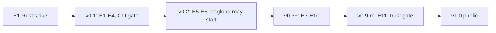

# Agentic Manager — PRD

## Table of Contents

- [Document purpose](#document-purpose): readers, inputs, C/D citation scheme
- [Vision](#vision): org-chart AI company, the traceable-advice bet, differentiation
- [Users and journeys](#users-and-journeys): owner-operator, adopters, non-users; UJ-1 a cross-department report with lineage, UJ-2 first run, UJ-3 steering hats
- [Glossary](#glossary): seat, hat, team, workflow, run, table, grant, Account, budget, estimate, meter, proposal
- [Features and requirements](#features-and-requirements): E1–E11, FR-1–FR-66 (FR-56–FR-60 cross-department work; FR-61–FR-64 built-in, open-by-default capabilities, 2026-11-18; FR-65–FR-66 folder access and many models on one folder, 2026-11-19)
- [Rules](#rules): narrow scope, no department vocabulary, propose-then-approve, local-first, open by default; RULE-1–RULE-7, RULE-20
- [Non-goals](#non-goals): multi-user, SaaS, marketplace, send tools
- [MVP scope](#mvp-scope): v1.0 contents, acceptance test, v1.x deferrals
- [Success metrics](#success-metrics): advice actions, gate acceptance, run success, maintenance, cost; SM-1–SM-8
- [Quality and constraints](#quality-and-constraints): untrusted content, egress, spend caps, secrets, MCP, local server, performance, accessibility; RULE-8–RULE-19
- [AI behavior and evaluation](#ai-behavior-and-evaluation): never-do list, failure modes, ship and rollback thresholds, fallback
- [Experience and platform](#experience-and-platform): Apple-like calm, navigation, platforms, browser first
- [Stakeholders, risks and rollout](#stakeholders-risks-and-rollout): v0.1–v1.0 release train, trust gate, risks
- [Data and compliance](#data-and-compliance): personal data in tables, local storage, deletion
- [Developer experience](#developer-experience): config schema, validate, fake provider, docs
- [Decisions](#decisions): MIT, Rust spike, owner-only, propose-then-approve, grants
- [Open questions](#open-questions): name, baselines, manual advice test (dropped 2026-11-19), search default, leanness; OQ-1–OQ-8
- [Assumptions](#assumptions): inferences awaiting the owner
- [Change log](#change-log): dated replans

## Document purpose

Initiative requirements for Agentic Manager (working name, OQ-1), for Sofia to lift into the initiative and epics, and for UX and architecture. Inputs: the binding party record, `party-decisions/decisions.md` beside this folder, cited as C1–C6 and D1–D13; and the owner's reference-company direction of 2026-11-18, `reference-company-spec-2026-11-18.md`, which wins where they conflict. The owner's original brief is superseded and no longer an input (Change log). Behaviour detail, screens, architecture and edge cases belong to the epics.

## Vision

Agentic Manager is an open-source (MIT), local-first app for running an AI company from an org chart. You build a department of AI seats, sit in it yourself as CEO, Vision Creator, Reviewer or Developer, give every seat its own model and budget, and let it run on a schedule. Results land in built-in tables and documents. It sets up like CrewAI Studio, runs like Paperclip and feels as calm as an Apple app.

Its first user, the owner, a small-company owner-operator, spent time keeping those tools alive or guessing at model costs. The owner wants a simple, Paperclip-style app with everything built in that the owner can self-host, with the right tools for central API Accounts for local and frontier models, an aesthetic, Apple-like look and no distractions. The owner wants to add a key once and hand models to seats, local as easily as cloud, see cost ticking beside the org, and know a task's cost before it runs. The bet v1 must prove: advice that reaches the owner after several departments worked on it is strong and traceable — the owner sees who contributed what, from which inputs, with which model and at what cost — and the owner acts on it in under ten minutes of the owner's week.

Agent org charts are no longer unique; the claim is the combination: humans as seats, departments that hand work to each other and review each other, parallel fan-out and consolidation, advice lineage, per-seat models, budgets and estimates, outcomes inside the app, one signed install with no Docker or cloud account, and safety a stranger can verify.

## Users and journeys

**Primary: the owner-operator.** A time-poor expert running a small technical B2B business on a Mac with local models and cloud keys. Jobs: get actions, not data volume; trust that nothing spends or sends behind the owner's back; steer without maintaining the tool. Departments are open-ended and the owner's to define (for example D1 and D2 in the sample company), and they work together: one department's output becomes another's input, and one department reviews another's work. The engine holds no department knowledge; what each seat does is its instructions, skills and tools.

**Secondary:** small-business owners wanting an AI back office without lock-in; researchers wanting private pipelines on local models; developers extending tools, providers and templates. **Not served in v1:** teams needing logins, enterprises needing SSO, SaaS customers.

Seat names are the abstract reference company, Company A (`reference-workload.md`): an Owner and two departments, D1 and D2.

**UJ-1. The owner gets Report R1 with its lineage.** 08:45. Overnight, D2-Head produced Document A from D2-E1 to D2-E4's rows in Table T1, and it went across to Department 1, where D1-E2 (local model), D1-E1 and D1-E3 (frontier models) worked on it in parallel; D1-Head consolidated the three outputs once all three arrived and handed the result back to D2; D2-Head wrote Report R1, and D1-Head, as a review gate from the other department, approved it. The meter reads ₹96 of ₹600 this week; the Inbox opens with "While you were away: Report R1 awaits your review." The owner opens it, taps Lineage and sees the chain — Owner ← D2-Head ← review gate D1-Head ← D1-Head ← D1-E1 / D1-E2 / D1-E3 ← D2-Head ← D2-E1…E4 — with each seat's model, inputs, output and cost; beneath it, estimate ₹80–120, actual ₹96. The owner asks D2-Head a follow-up through Ask a seat, then returns the report with a note ("compare D1-E2's second finding with D1-E3's") and approves the revision. Value lands when the owner acts on its first recommendation. Failure: D1-E3's model times out; the branch falls back, then fails, and because the fan-in is set to ask, an Inbox item offers Continue with 2 of 3 or Retry D1-E3; nothing overspends. FR-8, FR-14, FR-20, FR-28, FR-29, FR-34–FR-36, FR-53, FR-56–FR-60.

**UJ-2. First run with a local model and no keys.** On a clean Mac running LM Studio, the owner installs the signed app. The wizard takes a company name and shows LM Studio connected ("On this Mac", context 32k) and the built-in capabilities ready, web search as "Local search (SearXNG) · free, no key"; nothing needs a key, so the owner could finish here; the owner adds the owner's Anthropic key once, as an optional upgrade. The owner picks the Blank department (or loads the clearly labelled "Sample company: Company A (two departments)" to explore) and sees a populated org chart. On D1-E2, a local seat built from the Reviewer role template, Test this model marks the chips "tested"; under Run: "About ₹70–150 · rough, no history". Value lands when the first run completes within 15 minutes of install. Failure: a model fails the tool-call probe; the picker warns "may struggle with tool calls" and suggests the recommended model, without blocking; with no local model server and no key, the wizard explains the one choice: install a local model server (LM Studio or Ollama) or add a key. FR-6–FR-9, FR-22, FR-26, FR-29, FR-54, RULE-20.

**UJ-3. The owner steers in three hats.** As CEO the owner sets "Deliver Report R1 every week with every finding traceable". As Vision Creator the owner pins "state confidence for every finding" to D1 for 30 days. Later the learning loop of the Coordinator template (held by D2-Head in the sample) proposes a memory-note change for the D1 seats from the reasons on the owner's returned reports, citing them; in the Developer hat the owner applies it, and the next drill-down shows goal, guidance and note in the prompt. FR-25, FR-30, FR-32, FR-50, FR-51.

*Amended 2026-11-18 (reconcile): UJ-1 and UJ-3 name the head seats, Ask a seat and the Coordinator template; D1-E2 is the sample's local seat; UJ-2 shows the first run with zero keys (RULE-20, Open by default). EXPERIENCE.md Key Flows mirror these journeys.*

## Glossary

- **Seat:** an org-chart position with role, instructions, tools, budget and one occupant, an AI model or the owner. A **hat** is a human seat's role: CEO, Vision Creator, Reviewer, Developer or custom.
- **Team:** seats under a head seat; the company is the root. A **department** is a team with its own workflows and tables.
- **Workflow:** ordered steps owned by a team; each names a seat, inputs, output and a hand-off: next, **loop-back** (bounded return with reasons), **gate** (wait for a human or a reviewing seat), **fan-out** (the same input to several seats in parallel) and **fan-in** (a consolidating step that waits for all branches or a quorum). A **cross-department hand-off** passes an output to a step or workflow of another department.
- **Trigger:** schedule, manual start, or an event (a document updated, a step or workflow completed) that starts another workflow. **Run:** one execution of a workflow. **Lineage:** the contribution chain behind an output: seats, steps, models, inputs and costs.
- **Table:** config-defined data owned by one team; a **grant** lets another team read it.
- **Assistant:** chat over tables, runs, documents and config; it answers and makes **proposals**, diffs the owner applies.
- **Account:** a provider connection with its keychain credential and models; a **model profile** adds parameters and price.
- **Budget:** a spend cap. **Estimate:** a pre-run cost range. **Meter:** spend against budget.
- **Inbox item:** an approval, question, draft, breach or failure. **Document:** a versioned run output such as an advice note.
- **Drop folder:** a watched input folder. **Guidance note:** expiring Vision Creator direction. **Memory note:** learned seat guidance.
- **Tool:** a built-in or MCP capability: read, local-write or external-effect. **Untrusted content:** web, document, MCP or free-text in table rows.
- **Doctor:** the health screen.

## Features and requirements

Ordered by dependency; each feature is the party record's epic of the same number. The bracketed C/D ids cite the party record; the earlier brief ids were retired on 2026-11-18 (Change log).

### E1 Foundations and portable configuration

- **FR-1:** All configuration is plain, git-friendly files in one project folder, free of secrets and runtime state; the flagship folder passes `agentic validate`.
- **FR-2:** UI edits write the files; an outside edit reloads only after a visible prompt. (C6)
- **FR-3:** Every config edit has history with a diff and one-step undo. (D13)
- **FR-4:** A department exports and imports as a folder or zip; an import shows as a diff and never auto-runs. (D7)
- **FR-5:** A newer version opens an older project's data without loss. (C5)

### E2 Accounts and model routing

- **FR-6:** The owner adds an Account (Anthropic, OpenAI or OpenAI-compatible) once; its key goes to the OS keychain. (D3)
- **FR-7:** LM Studio and Ollama on their loopback ports appear as connected Accounts badged "On this Mac", same card and menu as cloud; no LAN scan. (D3)
- **FR-8:** Each seat picks Account › Model and a fallback from one menu that warns, never blocks, on a missing capability and shows each role's Recommended model; errors and timeouts switch to the fallback, logged. (D3)
- **FR-9:** Capability chips are marked known or tested; Test this model probes one tool call and one schema output.
- **FR-10:** A local model's loaded context window is read and set; overflow is handled visibly, never silently truncated.
- **FR-11:** Every call's cost rolls up by step, run, seat, team and week in the company currency and USD from an editable, dated price file; local calls show tokens and time. (D2)

### E3 Workflow engine and CLI

- **FR-12:** Workflows run step by step, each step a bounded agent loop, with next, bounded loop-back and gate hand-offs.
- **FR-13:** Declared output schemas are validated, repaired once, then fail with a clear error.
- **FR-14:** After kill -9 or restart a run resumes, losing at most the in-flight call.
- **FR-15:** Transient errors retry with backoff; steps time out; per-provider rate limits hold across queued workflows.
- **FR-16:** The CLI validates, runs, reports, serves and stops, and offers the Reviewer gate as an approve/return prompt from the first runnable release. (C4)

*Amendment 2026-11-18 (owner direction, reference-company spec: "Cross-department hand-offs and cross-department review come into v1").* Five generic engine primitives join v1, appended without renumbering. They name no department; grants, budgets, reader/actor separation, approvals and egress rules all still apply across departments.

- **FR-56 Cross-department hand-off:** a step's output (a document or table rows) becomes the input of a step or workflow owned by another department, only along a hand-off the owner declared and the receiving department accepts; the payload's taint and provenance travel with it.
- **FR-57 Parallel fan-out and fan-in:** one output goes to several seats in parallel; a consolidating step waits for all branches or a configured quorum or timeout, receives every branch's output labelled by seat, and follows its configured behaviour when a branch fails (fail the run, continue at quorum, or ask in the Inbox).
- **FR-58 Cross-department review gate:** a seat in another department, AI or human, can gate a hand-off: approve, return with a note, or reject, recorded with the actor and hat.
- **FR-59 Advice lineage:** every document or answer reaching a human shows its contribution chain (seats, steps, models, inputs, costs) as a readable trace, opened from the Inbox and Documents and exportable.
- **FR-60 Workflow triggers workflow:** an event ("document X updated", "step Y completed", "workflow Z completed") starts a workflow in any department, with loop protection: a maximum chain depth and cycle detection, a stopped chain shown in the Inbox.

### E4 Triggers, inputs, budgets and safety floor

- **FR-17:** Schedules take cron and timezone through a picker that reads back in words ("every Tuesday 08:00"); runs missed in sleep follow a catch-up policy.
- **FR-18:** Any workflow starts manually from UI or CLI.
- **FR-19:** Drop folders parse office, text and PDF inputs once per content hash, then delete (default), archive or keep them.
- **FR-20:** Budgets per seat and workflow, per run, week and month, stop or ask via the Inbox on breach and pause schedules; scheduled runs get lower default caps. (D2)
- **FR-21:** Stop everything, in the toolbar and as `agentic stop`, halts all runs and pauses all schedules. (D11)

### E5 Org and Seats

- **FR-22:** A first-run wizard of at most four screens ends on a populated org chart.
- **FR-23:** The org chart toggles, per team or globally, between teams (seat count, status, weekly cost) and seat cards (occupant, model, status, spend).
- **FR-24:** Seats and teams are added, moved and removed by drag, panel or keyboard and edited in a side sheet; a seat from a role template takes under 60 seconds.
- **FR-25:** Human seats show avatar, You badge and hat; CEO goals reach every seat below.
- **FR-26:** The Blank department template ships with the full generic role-template set, plus an optional, clearly labelled "Sample company: Company A (two departments)" the wizard can load to explore; no domain department templates ship in v1. (D7; restated 2026-11-18)
- **FR-27:** Each seat states what it can touch and what leaves the machine. (D11)
- **FR-28:** A meter beside the company name shows weekly spend against budget, ticks during runs, turns amber at 80% and stops at 100% with an Inbox ask. (D2)
- **FR-29:** Under Run, an estimate range names its basis ("rough · no history", then "your last N runs"); estimate and actual show after each run. (D2)
- **FR-30:** Vision Creator guidance notes, optionally expiring, show on the chart and reach the prompts below.

*Amendment 2026-11-18 (Owner statement B: "The app we are building is an agent manager — for each agent I want: model (local / paid), tools (data connectors, data crawlers, etc.), storage (a folder where I can drop files — Excel, PDF, links etc.), tasks that agent has to perform, skills associated with that agent, their backstory etc. — all the links that make an agent better").* The seat anatomy becomes first-class: every AI seat is one Agent card with Identity (name, role, goal, backstory, avatar), Brain (FR-8, FR-9), Skills (Agent Skills / SKILL.md folders attached per seat, instructions only, imported as a reviewed diff), Tools & connectors (FR-46, FR-47, plus readers over saved links; watching pages is a scheduled step, not a crawler), Knowledge & inbox (FR-19's drop folder also takes link lists; persistent per-seat reference files never deleted; saved links), Tasks (the workflow steps the seat performs), Memory notes (FR-50), Budget (FR-20) and what it can touch (FR-27). The FR list is not renumbered; the capabilities are carried as initiative R58–R63 with the Seat anatomy safety constraint (skills never grant tools or hosts, no skill scripts in v1, links obey egress and RULE-8). SKILL.md import and attach move into v1; exporting a whole seat as a SKILL.md stays v1.1 (MVP scope). History is not rewritten; the initiative Notes record the decisions.

### E6 Runs, Inbox and Documents

- **FR-31:** A workflow is edited as a step list: seat, instruction, inputs, expected output, hand-off.
- **FR-32:** A run shows live status, log, tokens, cost and duration per step; drill-down shows prompt, response, tool calls with untrusted content marked, and retries.
- **FR-33:** The owner can run now, re-run a step or from a step, pause and cancel.
- **FR-34:** A human step pauses the run as an Inbox item; the Reviewer approves, edits, returns with a note to the producing seat, or rejects.
- **FR-35:** The Inbox holds approvals, questions, drafts, breaches and failures, opening with a "While you were away" digest. (D13)
- **FR-36:** Documents such as an advice note render as formatted pages, versioned per run, exportable to Markdown and PDF.

### E7 Tables, grants and saved views

- **FR-37:** Tables open in a grid with sort, filter, search, inline edit, comments and history.
- **FR-38:** Every row change records its run, step and seat, or human actor. (D5)
- **FR-39:** Templates define status fields with a reason per transition.
- **FR-40:** CSV and xlsx import and export let people outside the app round-trip status and reasons. (D5)
- **FR-41:** Saved views store filters and columns; a table may name its default view.
- **FR-42:** A team can grant another read-only access to a table or document, shown as a dotted line on hover; runs read a start-time snapshot. (D1)

### E8 Assistant and dashboards

- **FR-43:** The Assistant (⌘J) reads tables, runs, documents and config read-only, shows its query, cites sources and explains runs. (D6)
- **FR-44:** Its changes and "Run now" arrive as proposal cards; privilege-widening ones state their effect and need a second confirmation. (D6)
- **FR-45:** Charts, tables and KPIs it builds pin to dashboards that store the query and refresh on open.

### E9 Tools, MCP, search and Doctor

- **FR-46:** Built-in tools are granted per seat; web search defaults to the built-in Local search (SearXNG), free and keyless, with keyed providers as optional upgrades. (D8; restated 2026-11-18, RULE-20)
- **FR-47:** An MCP server is added only after its exact command, arguments, environment and network use are shown, and its tools are assigned per seat. (D11)
- **FR-48:** Doctor checks accounts, keys, MCP servers, disk, schedules, search, blocked egress and keys in files, with one-click fixes where possible.
- **FR-49:** The database is backed up daily, keeping a set number of copies.

*Amendment 2026-11-18 (Owner direction: connectors must be generic technical building blocks, not named after the owner's sources — "for you it must be technical: HTTP/web data, crawler (this could be linking to 3rd-party crawlers), a repository that takes local data (Excel, PDF etc.), ingests it and then cleans the repository for a new load in future"; look at how CrewAI groups tools and expand on it).* Tools gain a supporting entity pair under the Tool concept, not a new core concept: a **Connector** is a typed building block and a **Source** is a configured instance of one (Account, scope, schedule, limits, output table or document, incremental state), owned by a seat. v1 connector types: Web Search (Local search (SearXNG) built in, keyed providers optional; restated 2026-11-18), HTTP Reader (URL to clean text, tables, links and attachments), Crawler (site-scoped seeds, include and exclude patterns, depth and page budget, polite rate, robots.txt respected, only new or changed pages; a built-in crawler for static pages plus one third-party crawl service through an Account), API and Feed (REST/JSON with pagination, auth and field mapping without code; RSS, Atom, sitemaps), Local Repository (a watched folder that ingests xlsx, csv, pdf, docx, txt, json and link lists, extracts, normalises, de-duplicates by content and key, loads into a table or documents, then deletes, archives or keeps each file only after a successful load, so the folder is clean for the next load; this generalises FR-19), Knowledge (persistent reference files per seat or team, never deleted, keyword search in v1), Database (built-in tables), MCP (FR-47) and Actions (drafts only). External databases, cloud storage (through MCP), more crawl services and semantic search are v1.x; approve-then-send stays an open owner decision. Every connector shares keychain credentials, the egress allow-list, usage caps whose paid use (crawl credits, keyed search) is spend in the budget ledger, incremental state so nothing is processed twice, health in Doctor, a Test connector button, the audit trail, robots.txt and site-terms respect, and the existing untrusted-content and reader/actor rules. Named department sources appear only as Source files in templates and fixtures (in v1, the Company A sample and test fixtures), never in engine or UI code; cleaning, normalising and enriching data are the configured agents' jobs, not connector features (owner, 2026-11-18). The FR list is not renumbered; the capabilities are carried as initiative R64–R71, with R19, R46, R61 and R62 restated; this supersedes the 2026-11-18 seat-anatomy line "watching pages is a scheduled step, not a crawler". History is not rewritten; the initiative Notes record the decisions.

*Amendment 2026-11-18, later the same day (owner decisions).* (1) **Free, local crawling.** The owner asked for an open-source alternative instead of a paid crawl account. The HTTP Reader and Crawler gain a **Rendered Reader** mode that renders pages built by scripts in a Chrome, Chromium or Edge already installed on the owner's computer (never bundled), with a fresh empty profile (no cookies or logins), the same allow-list, robots.txt, page budget and time caps, its output untrusted, and no stealth or anti-bot evasion; Doctor finds the browser or explains how to add one. The one third-party crawl adapter becomes a **Firecrawl-compatible API endpoint**, by default a service the owner self-hosts; Firecrawl cloud stays possible through the same adapter but is neither the default nor required, and the app only speaks HTTP to the service, so no licence obligation reaches the MIT app. Carried as initiative R72, with R65 restated. (2) **Team release.** On the team workspace (originally called the rep workspace) and approve-then-send the owner said "this comes later": both move to a **v1.1 Team release** (a team workspace: multi-user, access scoped by group, LAN; renamed 2026-11-19, and approve-then-send of drafts through the owner's own mail account), each with its own threat-model update. The Non-goals above hold for v1. (3) **Generic engine.** The owner restated RULE-2: what a department does is fed to its agents; it is not the job of the agent manager engine. Personal-data duties (Data and compliance, OQ-7) apply to any personal data held in tables.

*Amendment 2026-11-18, late (owner principle "Open by default", RULE-20, and owner addition: "What is open today (even free with a key) can become closed or paid tomorrow — not sustainable. In v1, build web search, browsing/reading pages, crawling, and document skills & knowledge as part of the app itself, shipped in the install. When an agent is created, the user can switch each on/off. Outside API keys can be added when the internal ones are not wanted. MIT so the community makes these functions more robust.").* Appended without renumbering; carried as initiative R78–R82.

*Amendment 2026-11-19 (final review 2, owner delegated; history above not rewritten).* (1) **Safety.** Taint travels through text a tainted step writes (AI review notes, Ask a seat questions, local writes, which stay marked untrusted at rest), and a proposal from a tainted step is never approvable (RULE-3, RULE-8). One classifier decides what widens access on every path, including capability switches, provider Accounts, hand-offs, acceptances, cross-department triggers, imported seats and any change that replaces a human review gate with an AI one; an outside edit or startup that widens waits for the two-step confirmation. The parser, OCR and Local search run in the macOS App Sandbox; the rendering browser and stdio MCP servers cannot be sandboxed by the app, which the About page says, and while either is enabled decisions are made only in the app window. Trigger chains have a spend cap; Local search changes only inside app releases. (2) **Experience.** FR-22: the wizard pre-fills currency and timezone from the Mac's locale, draws the zero-key path first (keys optional, test run at zero cost) and, with no model server, offers the official download pages and Detect again, never a terminal. FR-24: a seat is added through a small popover in under 60 seconds; the Agent card is for editing. FR-63: Capabilities is one compact chip row below Brain. (3) **Generic wording.** The v1.1 Team release's workspace is "Team workspace (multi-user, access scoped by group)"; currency and timezone are never hard-coded; Company A's Owner holds the CEO, Vision Creator, Reviewer and Developer hats.

- **FR-61 Local search (SearXNG):** the install ships a pinned SearXNG as the one built-in managed service of v1 and the default Web Search provider, "Local search (SearXNG) · free, no key": the app starts it with its server, checks its health, restarts it, keeps its logs, updates it only with the owner's consent and removes it cleanly; it is reachable only by the app, sees none of the app's or the project's data, and its results are untrusted content; Settings and the About page disclose that it sends each query to the selected public search engines, whose rate limits it respects with a configurable delay; public SearXNG instances are an opt-in fallback; Brave, Tavily, Exa and Serper are optional keyed providers.
- **FR-62 Built-in capabilities:** shipped in the install, with no download, account or key: Web search (FR-61), Browse & read pages (HTTP and rendered readers), Crawl (built-in crawler), Documents & knowledge (parsers, keyword search, local OCR of scanned PDFs and images), Files workspace, Tables, Memory, Hand-off & ask and Calculate & analyse (arithmetic, statistics and read-only SQL over granted tables; no arbitrary code in v1). They are MIT so the community can harden them; the bundled SearXNG keeps its own licence (AGPL-3.0) and runs as a separate process the app only talks to over local HTTP.
- **FR-63 Capability switches:** each AI seat's Agent card has a Capabilities section near the top with one switch per capability; new seats have only Documents & knowledge on; turning one on shows what the seat may then touch and needs the two-step confirmation; an off capability's tools are absent and refused. The switches are the friendly face of the seat's tool permissions, stored in its file.
- **FR-64 Provider swap:** per seat, each built-in capability can use an external provider through an Account instead ("Provider: Built-in (default) | <Account>"), with its spend metered like model spend; services with a no-key allowance or a free key are optional Accounts too, never pre-selected.

*Amendment 2026-11-19 (owner answers; history above not rewritten).* (1) **PowerPoint.** "A folder to read is OK for Excel, PPT, docs, PDF": pptx joins the formats of Documents & knowledge (FR-62) and of drop folders and the Local Repository (FR-19, the Local Repository under the 2026-11-18 amendment above), next to xlsx, docx and PDF. (2) **OCR provider.** "I can link it to an open model like PaddleOCR and then feed it to an agent": under FR-64, Documents & knowledge's OCR provider is Built-in (Tesseract, the default, bundled, no setup) | a Local OCR service the owner runs on this Mac, for example PaddleOCR, reached on a loopback address only | a model Account tested for images; page images go to the service only after the owner confirms, and its text is untrusted like every document. Bundling PaddleOCR itself waits for Add-ons (v1.x). (3) **Spike.** The Rust spike's REPLAN count (Risks: "fails two of nine criteria") now counts criteria 1–7 and 9: the signed, notarised clean-Mac build (criterion 8) waits for the owner's Apple Developer account and gates the v0.9-rc installer instead.

*Amendment 2026-11-19, later (owner folder-access direction; history above not rewritten).* The owner: "What I want is folder reading access — a tool that I can link to the model. 'PowerPoint is a supported format' is not important: as long as I have tool access to a folder I can link it to an LLM, and that LLM can be decided according to the type of files there. I can have one folder and multiple LLMs pointed there to read different files, and then it feeds the data to the data-gatherer agent for further processing." This simplifies the engine: it provides access and routing, and the models interpret. (1) **Folder access** replaces Documents & knowledge as the capability's centre (FR-62, FR-63): a seat links one or more folders, read-only by default, with write as a separate switch that widens access; it lists and filters files by pattern, type, size and date and reads them by attaching each file to the seat's model as a native input when that model reads the type. Which types a model reads (PDF, images, office files, audio) is shown on its capability chips and proven by Test this model (FR-9 extended). A file the model cannot read is refused with a clear sentence and the owner picks another model for that seat; nothing is converted silently. Sending files to a cloud model leaves the machine: the seat's "what this seat can touch" panel says so, and linking a folder to a cloud-model seat needs the two-step confirmation. (2) **Many models on one folder:** a workflow fans out over a folder by file pattern, each pattern routed to a seat whose model reads that type, and a gathering seat consolidates the results, using the existing fan-out and fan-in (FR-57). (3) **Built-in parsers demoted:** the PowerPoint, Word and Excel readers and bundled OCR leave v1 (the "PowerPoint" and "OCR provider" parts of the amendment above are superseded); OCR is simply a vision- or OCR-capable model, local or cloud, assigned to the seat. One small fallback stays, switched on per seat: plain text from text files (txt, md, csv, json) and the text layer of PDFs, so a local text-only model can still read them. Drop folders (FR-19) accept any file: tables load from csv, json and spreadsheets as before, and other files are kept for the seats' models to read. Appended without renumbering:

- **FR-65 Folder access:** a seat links folders read-only by default (write is a separate switch that widens access); it lists, filters and reads their files, each attached to the seat's model natively when the model reads its type, or as plain text when the seat's text fallback is on and the file is text; otherwise the seat gets a clear refusal naming the type and the remedy (choose another model). File contents are untrusted; files sent to a cloud model are shown as leaving the Mac and linking such a seat needs the two-step confirmation; file count and size are capped per run and their cost goes through the budget ledger.
- **FR-66 Many models on one folder:** a workflow step fans out over a linked folder by file pattern (for example *.pdf to a seat with a PDF-reading model, spreadsheets to another, images to a vision model), each route a parallel branch with its own model and caps, files no route matches listed rather than dropped, and the results consolidated by a gathering seat at the fan-in.

### E10 Dry-run, learning loop and design quality

- **FR-50:** On the owner's schedule, a seat built from the Coordinator role template proposes memory-note or instruction changes from outcome reasons (gate returns and rejections, status reasons), showing their sources; memory notes stay owner-editable.
- **FR-51:** The Developer hat approves tool, model and prompt changes in its subtree through proposals. (D13)
- **FR-52:** A dry-run substitutes a cheap or local model in every seat.
- **FR-53:** "Ask a seat" turns a question into an Inbox thread addressed to any seat the owner picks; by default the top Coordinator seat, else the top head seat. *(Renamed 2026-11-18 from "Ask Chief of Staff"; the role-template set is Head, Coordinator, Analyst, Researcher, Reviewer, Writer, Specialist and Human seat.)*

### E11 Desktop, release and trust gate

- **FR-54:** Signed installers, macOS first, then Windows 11 and Linux, reach first run in under 5 minutes with no runtime to install. (D4) *Amended 2026-11-19 (owner: "Priority is the Mac build. If it's OK, the entire Windows and Linux build can wait for later."): in v1 (v0.x through v1.0) this is the signed, notarised, hardened-runtime macOS Apple Silicon installer only; the Windows 11 and Linux installers move to v1.x.*
- **FR-55:** Updates are verified against a pinned key, never downgrade and never install without consent. (D11)

## Rules

- **RULE-1:** Every feature maps to a core concept (seat, team, workflow, trigger, run, table, Assistant) or glossary entity; a new concept needs owner approval. One obvious way to do each thing.
- **RULE-2:** Engine and UI hold no department vocabulary; templates carry the nouns. CI loads the Company A sample through the generic loader and proves a grant and a cross-department hand-off between its departments. (D1, D7; restated 2026-11-18)
- **RULE-3:** Nothing runs, changes config, widens a privilege or sends without an owner action; agents and the Assistant propose. No global auto-approve. (D6)
- **RULE-4:** Files are the source of truth for configuration. (C6)
- **RULE-5:** Data stays on the machine; network only to configured endpoints; no telemetry.
- **RULE-6:** One user, loopback only, in v1; every human action records its actor. (D5)
- **RULE-7:** Spend and status stay visible on the org chart; an estimate never raises a cap. (D2)
- **RULE-20 Open by default** (owner, 2026-11-18: "Agentic Manager must have all the open options; the only limit should be compute"): every capability works out of the box with free, local, key-free components shipped in the install; paid or keyed services are optional upgrades through Accounts, never required and never pre-selected silently; the first-run wizard reaches a working department with zero keys when a local model server exists, and otherwise explains the one choice (install a local model server or add a key). Threshold: a fresh install with only a local model server and no keys completes the golden Company A F1 run, including a web search step. *(Numbered after RULE-19 so no id moves.)*

## Non-goals

Multi-user accounts, logins or LAN access; cloud hosting or SaaS; a marketplace; mobile or voice; custom code nodes; a hand-built BI editor; a CrewAI wrapper or node-graph builder; tools that send email, posts or webhooks (drafts only); domain-specific engine features (data cleaning, normalisation, enrichment, spreadsheet repair: these are agents' jobs); templates shown as ready before they are tested. *(Cross-department hand-offs left the non-goals on 2026-11-18: FR-56–FR-60.)*

## MVP scope

**In v1.0:** FR-1–FR-66 (FR-65 and FR-66 added 2026-11-19), the Blank department and role templates, the optional Company A sample company, and the trust gate. **Acceptance test:** the owner runs the owner's own company's departments (any the owner chooses), with at least one cross-department flow, on schedule for four clean weeks, replacing Paperclip and CrewAI; the golden end-to-end test is Company A's flow F1 on the fake provider, and the owner-run demo is the same flow on a mix of local and frontier models.

**Deferred to v1.x:** CrewAI YAML import once an outside adopter asks, Paperclip import later; health overlay; prompt caching; wider concurrency; file-drop, webhook and email triggers; email drafts via MCP; dashboard export; notifications and digests; semantic (embedding) retrieval over Knowledge (amended 2026-11-18: v1 has keyword-searchable Knowledge per seat or team); exporting a whole seat as a SKILL.md (targeted for v1.1, because it needs the seat file schema to settle after the dogfood weeks; skills themselves are SKILL.md folders imported and attached in v1, amended 2026-11-18); a free chat window with a seat outside the Inbox (Ask a seat covers questions to any seat in v1); LAN mode; domain department templates; dynamic fan-out over a list of rows; mini-map; 100-seat performance; *amended 2026-11-19 (owner, Mac first):* Windows 11 and Linux x64 builds, installers, signing and CI release jobs, with their platform-specific work (keychain stores, login items, Local search on Windows).

**Leanness:** 55 capabilities is a lot for one owner and coding agents. The room weighed deferring dashboards (FR-45), the Developer hat (FR-51), dry-run (FR-52) and Ask a seat (FR-53); all four stay in v1 because the owner asked for them (guide 5), each in its simplified form, and they sit in late epics (E8, E10) so they can slip to v1.x without blocking the dogfood.

## Success metrics

Measured on the owner's install and clean-machine tests; no telemetry.

- **SM-1:** Advice actions the owner takes from documents reaching the owner's Inbox: ≥3 a week. Counter: review stays ≤15 minutes a week. (FR-34, FR-36, FR-59)
- **SM-2:** Outputs approved at gates without a return: ≥50% by dogfood week 4, baseline OQ-2. Counter: lineage complete on 100% of documents reaching the owner. (FR-12, FR-34, FR-58, FR-59)
- **SM-3:** Unattended weekly runs succeeding: ≥95%. Counter: monthly audit of "successful" runs with useless output. (FR-14, FR-17)
- **SM-4:** Owner maintenance: under 10 minutes a week, baseline OQ-2. Counter: prompts unchanged 8 weeks while rejections grow. (FR-48, FR-50)
- **SM-5:** Install to first successful run under 15 minutes; department from template under 10. Counter: first-run spend. (FR-22, FR-24, FR-54) *Amended 2026-11-18: FR-54's "first run under 5 minutes" means installer opened to wizard on screen; the one table of these targets is EXPERIENCE.md Time Targets.*
- **SM-6:** Estimate within ±30% of actual from run 3. Counter: budget stops that cost a scheduled run. (FR-29)
- **SM-7:** Calls attributed to seat and run: 100%; unapproved weekly overspend: 0. (FR-11, FR-20)
- **SM-8:** Cost per acted-on advice item trends down. Counter: SM-2 holds.

## Quality and constraints

Each ships with a failing-first CI test. (D11)

- **RULE-8 Untrusted content** never enters instructions; a step that read it cannot use an external-effect tool without approval and writes only its declared table. Threshold: the injection pack yields zero outbound calls and zero approvable proposals.
- **RULE-9 Egress:** per-seat and per-Account host allow-lists; private, link-local and metadata addresses blocked; redirects and size capped. Threshold: zero calls outside configured endpoints.
- **RULE-10 Actions:** external-effect tools need approval showing the exact payload; v1 ships no send tools.
- **RULE-11 Spend:** caps reserved before each call, settled after; bounded iterations, tool calls, loop-backs and wall-clock; a circuit breaker. Threshold: settled spend never exceeds a cap.
- **RULE-12 Secrets:** keychain only; never in prompts, logs, traces, exports or config. Threshold: leak scans find zero keys.
- **RULE-13 MCP:** stdio servers get a scrubbed environment, the workspace directory and a pinned version; a changed tool description needs re-approval.
- **RULE-14 Files:** workspace-confined, no symlink escapes, parsers capped by size, pages and archive expansion.
- **RULE-15 Local server:** loopback; per-launch token never in URLs or logs; Host and Origin checked, WebSocket included; no CORS wildcard; owner-only file permissions or no start. Threshold: the rebinding, CSRF and WebSocket suite passes.
- **RULE-16 Audit:** an append-only log of calls, redacted tool calls, approvals and provenance, exportable as JSON.
- **RULE-17 Desktop:** minimal shell capabilities, strict content policy, no remote webview content, narrow IPC.
- **RULE-18 Performance:** interactions under 100 ms; 60 fps at 30 seats; idle memory under 300 MB without models; cold start under 3 s.
- **RULE-19 Accessibility:** keyboard-complete, WCAG 2.2 AA contrast, screen-reader labels, reduced motion.

## AI behavior and evaluation

- **Never:** send off the machine; apply its own change; obey untrusted content; render raw HTML, script or remote images; give a single-number estimate; call an untested capability tested.
- **Failure modes** (owner's CrewAI and Paperclip use): local models failing tool calls and schemas; silent context truncation; search blocked or thin on specialised queries; injected text in pages, PDFs and free-text rows, carried across departments by hand-offs. No prototype output exists yet (OQ-3; *amended 2026-11-19: OQ-3 dropped, see Open questions*).
- **Ship:** the Company A golden run passes on the fake provider and one real local model, schema-valid at every step after at most one repair, and the injection pack passes (RULE-8).
- **Roll back** a prompt, model, instruction or memory-note change through history when SM-2 or SM-3 misses target two weeks running.
- **Fallback:** refusal, timeout or tool failure goes to the fallback model, then a failed step with an Inbox item naming the next action; a low-confidence Assistant says so. Every action line of a document cites its source, and every document reaching a human carries its lineage.

## Experience and platform

Apple-like calm: one accent colour, system font, light and dark modes, 150–220 ms motion only to show cause. Defaults first, advanced behind More; empty states give one sentence and one button. The org chart is home; a sidebar, ⌘K palette and ⌘J Assistant reach the rest; every drag has a keyboard equivalent. Mockups are approved before UI epics and checked at every demo. macOS Apple Silicon first, then Windows 11 and Linux x64; browser mode (current Chrome, Safari, Firefox, Edge) ships before the desktop shell. the company currency (default from the system locale) and USD, timezone-aware, strings externalised. Free; no monetisation.

> **Amended 2026-11-19** (owner: "Priority is the Mac build. If it's OK, the entire Windows and Linux build can wait for later."): v1 (v0.x through v1.0) targets **macOS on Apple Silicon only**, the desktop app and browser mode served by it on the Mac. Windows 11 and Linux x64 builds, installers, signing, CI release jobs and platform-specific work move to a later release (v1.x). The code stays portable so they can follow: no macOS-only API in the core, OS-specific code behind ports, and the core built and unit-tested on Linux CI.

## Stakeholders, risks and rollout

the owner owns every gate. No deadline; two-week milestones, each ending in a 10-minute demo.

> **Amended 2026-11-18** (initiative Decision "Clean weeks", owner delegated): the official four-week dogfood clock starts after E9 on a frozen build, not at v0.2; v1.0 also needs at least the final 2 clean weeks on the v0.9-rc build, and moving to v0.9-rc does not reset the clock (only a manual repair does). The diagram's "dogfood may start" label at v0.2 is superseded; from v0.1 the owner shadow-runs the owner's own departments beside Paperclip.

**v1.0 gate:** four consecutive weeks on a frozen build with no manual repair (a repair resets the clock), one-click install, docs, and the trust gate: signed and notarised builds on all platforms (*amended 2026-11-19: the macOS Apple Silicon build only in v1; Windows and Linux signing is v1.x*), a separate rotatable update key, audited locked dependencies, SHA-pinned CI, SBOM and provenance, OpenSSF Scorecard, SECURITY.md, a published threat model, the RULE-8–RULE-15 suites, a community review window, and a plain page on what the app does and does not protect against. (C3, D10, D11)

**Risks:**
- The owner ignores AI advice: test a manual one with its lineage first (OQ-3). *Amended 2026-11-19 (owner): the pre-build test is dropped, because the app is a generic agent manager; what departments produce is the user's choice; the owner's own use of Paperclip and CrewAI already establishes the need; SM-1 measures this risk during the dogfood weeks.*
- Cross-department runs fan out cost and failure: per-branch reservations, quorum and timeout, loop protection.
- The Rust spike fails two of nine criteria: replan around a hybrid. (D4)
- Unreliable local models: chips, probes, schema repair, cloud fallback.
- Thin or rate-limited local search: configurable engines and delay, opt-in public instances, optional keyed providers, provider comparison. (D8; restated 2026-11-18)
- Bundled third-party components (SearXNG, Tesseract) age or break: pinned versions and checksums, supervision and health in Doctor, consent-gated updates, community hardening of the MIT built-ins.
- Injection: stopped by architecture, not prompts.
- Sleep and crashes: durable state, catch-up, kill tests.
- Scope creep and agent drift: RULE-1, locked mockups, tests before code.

## Data and compliance

Tables may hold personal data (names, emails, notes). It stays in the project's local database, owner-readable only; prompts go only to each seat's chosen endpoint, and FR-27 shows what leaves; a cross-department hand-off moves data only inside the project. Drop files are deleted after processing; deleted rows persist in backups until the backup rotation drops them. The owner named no regulation; data-protection duties and backup encryption are OQ-7.

## Developer experience

MIT; a README path to first run; a documented config schema whose `agentic validate` errors give file, line and fix; a deterministic fake provider and ≥80% engine and persistence coverage; structured logs and trace export; every acceptance test, golden end-to-end, fixture and sample is department-neutral and uses the abstract Company A with synthetic content; config versions migrate forward, never silently (C5); a how-to for moving CrewAI and Paperclip setups by hand (D9); contributor docs, examples, SECURITY.md.

## Decisions

- Amendment 2026-11-18 (owner): an Add-ons framework — one-click install and supervision of open-source packages such as self-hosted Firecrawl, MCP servers and SearXNG as managed local services — is wanted but deferred to v1.x, not v1. *Amended 2026-11-18 (owner, Open by default and built-ins): SearXNG ships built in as the one managed service of v1 (FR-61) and local OCR ships inside the app (FR-62); the Add-ons framework itself stays v1.x.*

Rationale lives in the party record. Headline calls: MIT over Apache-2.0 (C1); Rust core over Python, gated by a spike (C2, D4); dogfood from v0.2, v1.0 after four clean weeks (C3, D10; amended 2026-11-18: clock starts after E9, final 2 weeks on v0.9-rc); owner-only over LAN mode (D5); propose-then-approve over direct Assistant edits (D6); grants for read access (D1), with declared cross-department hand-offs added 2026-11-18 (FR-56); enforcement before estimation (D2); import cut (D9).

## Open questions

- **OQ-1:** Public name (shortlist: Staffroom, Seatwork, Deskwork, Orgline, Cadre). Owner, before v0.9-rc; blocks FR-54 packaging.
- **OQ-2:** Baselines for weekly maintenance time and gate approval rate. Owner, before dogfood; blocks SM-2, SM-4.
- **OQ-3 (dropped 2026-11-19, owner):** ~~Will the owner act on one hand-made advice note with its lineage written out? Owner, before E1; tests the core bet.~~ Closed without a test, because the app is a generic agent manager; what departments produce is the user's choice; the owner's own use of Paperclip and CrewAI already establishes the need; E1 no longer waits on it.
- **OQ-4:** Which keyed provider, if any, is recommended as an upgrade after comparing Brave, Tavily, Exa and Serper with Local search (SearXNG), and whether scheduled runs may fall back to an opt-in public SearXNG instance. Owner, before E9; affects FR-46. *(Restated 2026-11-18: Local search is the default whatever the answer, RULE-20.)*
- **OQ-5 (resolved 2026-11-18):** Dashboards (FR-45), Developer hat (FR-51), dry-run (FR-52) and Ask a seat (FR-53) stay in v1, in late epics, per the owner's delegated mandate (guide 5: comprehensive to what was discussed). Revisit only if E8/E10 threaten the v1.0 trust gate.
- **OQ-6:** Minimum local model per role template. Owner with the architect, before E5; affects FR-8.
- **OQ-7:** Data-protection duties for personal data in tables, and backup encryption. Owner, before v0.9-rc; affects the trust gate. *Amended 2026-11-18 (initiative Decision "Backups", owner delegated): backup encryption is decided (encrypted at rest, key in the OS keychain); the data-protection duties stay open.*
- **OQ-8:** Default caps per run and week for new workflows and the sample company, and the scheduled-run cap. Owner, before v0.1; affects FR-20.

## Assumptions

Inferences not yet confirmed by the owner; each stays until the owner accepts it.

- Users and journeys: UJ-1–UJ-3 are composed from the reference-company direction and party record, with illustrative times and amounts, not narrated by the owner.
- AI behavior (ship): golden-run steps may need at most one schema repair.
- AI behavior (roll back): the trigger is SM-2 or SM-3 missing target two weeks running.
- AI behavior (fallback), FR-36: every input a document cites carries a source link, row or document version.
- OQ-8, FR-20: until the owner sets caps, the working placeholders are ₹150 per scheduled run, ₹250 per manual run and ₹600 per week per workflow and for the company (initiative assumption; mocks).

## Change log

- 2026-11-18 (owner REPLAN, reference-company spec, binding): the earlier domain reference department, its template, journeys, metrics and acceptance workload were removed from the plan; the reference company is the abstract Company A (an Owner and departments D1 and D2, owner Amendment 2); FR-56–FR-60 (cross-department hand-off, fan-out and fan-in, cross-department review gate, advice lineage, workflow triggers workflow) were appended; parallel branches and cross-department routing left the deferred and non-goal lists; FR-26, FR-36, FR-39–FR-41, FR-50, RULE-2, SM-1, SM-2, SM-8, OQ-2, OQ-3, OQ-7, OQ-8 and the acceptance test were restated department-neutral. The owner's original brief moved out of the live plan; its requirement ids (bFR-n, bNFR-n), formerly cited beside each FR, were retired here.
- 2026-11-18 (reconcile and owner principle Open by default, with the owner's addition on built-ins): the role-template set is Head, Coordinator, Analyst, Researcher, Reviewer, Writer, Specialist and Human seat; FR-50 and FR-53 restated (the Coordinator template's learning loop; "Ask a seat" to any seat, replacing "Ask Chief of Staff"); "lead seat" reads "head seat"; UJ-1 to UJ-3 amended; RULE-20 Open by default and FR-61–FR-64 appended; FR-46, OQ-4, the risks and the Add-ons decision restated.
- 2026-11-19 (owner, Mac first: "Priority is the Mac build. If it's OK, the entire Windows and Linux build can wait for later."): v1 targets macOS on Apple Silicon only; FR-54, Experience and platform, the v1.0 gate and MVP Deferred carry dated amendment notes; Windows and Linux builds, installers, signing and CI release jobs move to v1.x with the code kept portable. No FR id changes.
- 2026-11-19 (final review 2, owner delegated): dated amendment under E9 (safety, experience and generic wording); no FR id retired; the persona line no longer names a country.
- 2026-11-19 (owner, binding): OQ-3, the pre-build manual advice test, is dropped because the app is a generic agent manager; what departments produce is the user's choice; the owner's own use of Paperclip and CrewAI already establishes the need; OQ-3, the Failure modes line and the matching risk carry dated notes; E1 no longer waits on it.
- 2026-11-19 (owner folder-access direction): dated amendment under E9: Folder access replaces the built-in parsers as the centre of FR-62/FR-63 (models read files natively per their tested file flags, FR-9 extended; refusal, never silent conversion; cloud sends shown and confirmed twice); FR-65 Folder access and FR-66 many models on one folder appended; the pptx and OCR-provider parts of the earlier owner-answers amendment are superseded; a per-seat plain-text fallback for text files and PDF text layers stays. No FR id retired or renumbered.
